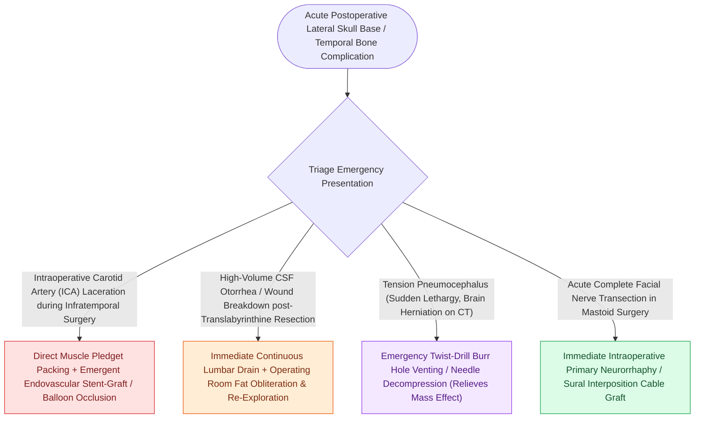

# High-stakes lateral skull base neurotologic complications require rapid multimodal emergency salvage

## Active Recall

> [!question]- What is the immediate patient positioning maneuver when a major tear of the sigmoid sinus occurs during skull base surgery?
> *Answer / Clinical Rationale*: **Trendelenburg position** (tilting head down), which elevates venous pressure above atmospheric to prevent venous air embolism.

> [!question]- What intraoperative capnography finding alerts the anesthesia team to an acute venous air embolism?
> *Answer / Clinical Rationale*: A sudden, precipitous **drop in end-tidal $\text{CO}_2$ ($\text{EtCO}_2$)**.

## Core Clinical & Mechanistic Principles
Lateral skull base and neurotologic surgery involves critical vascular and intracranial structures where intraoperative emergencies [[Cerebrospinal fluid CSF leak and pseudomeningocele require lumbar drainage, fat obliteration, and re-exploration|require]] immediate, calm algorithmic rescue:
- **The Four High-Stakes Lateral Skull Base Crises**:
  1. **Major Venous Sinus Laceration (Sigmoid Sinus / Jugular Bulb)**:
     - *Risk*: Exsanguinating hemorrhage and **venous air embolism**.
     - *Action*: Immediately place the patient in **Trendelenburg position** (elevates venous pressure above atmospheric); flood field with saline; apply **Surgicel / Gelfoam with direct digital cottonoid tamponade**; extraluminally pack sinus with oxidized cellulose.
  2. **Internal Carotid Artery (ICA) Laceration**:
     - *Action*: Direct digital tamponade with muscle patch $\r\r\rightarrow$ Rapid proximal and distal vascular control $\r\r\rightarrow$ Emergent covered stent placement or endovascular balloon occlusion.
  3. **Acute Cerebellar Swelling & Posterior Fossa Hematoma**:
     - *Action*: Hyperventilate ($\text{PaCO}_2 \approx 30\text{–}32\text{ mmHg}$), IV Mannitol ($1.0\text{ g/kg}$) + Dexamethasone, open cisterna magna for CSF release; emergent evacuation of hematoma if neurological decline occurs.
  4. **Postoperative Bacterial Meningitis**:
     - *Action*: Diagnostic lumbar puncture $\r\r\rightarrow$ Immediate high-dose IV Vancomycin + Cefepime + Ampicillin.

### Surgical Technique & Critical Safety Checks
- **Venous Air Embolism Signs**: Sudden drop in end-tidal $\text{CO}_2$ ($\text{EtCO}_2$), acute hypotension, "mill-wheel" heart murmur on precordial Doppler.

## Connected Concepts & Graph Traversal
- **CSF Fistula Decompression**: [[Cerebrospinal fluid CSF leak and pseudomeningocele require lumbar drainage, fat obliteration, and re-exploration|Post-Op CSF Leak Salvage]]
- **Venous Sinus Thrombosis**: [[Lateral sinus thrombophlebitis presents with picket fence fevers and Griesinger sign requiring intravenous antibiotics and mastoidectomy|Sigmoid Sinus Thrombosis]]
- **Intraoperative Monitoring**: [[Intraoperative facial nerve and cochlear nerve monitoring minimize cranial nerve morbidity in skull base surgery|Intraoperative Cranial Monitoring]]
- **Translabyrinthine Salvage**: [[The translabyrinthine approach provides direct exposure of the internal auditory canal with complete hearing sacrifice|Translabyrinthine Decompression]]
- **Facial Nerve Transection Repair**: [[Immediate direct epineurial end-to-end repair is the gold standard for transected facial nerve injury|Immediate Epineurial Repair]]
