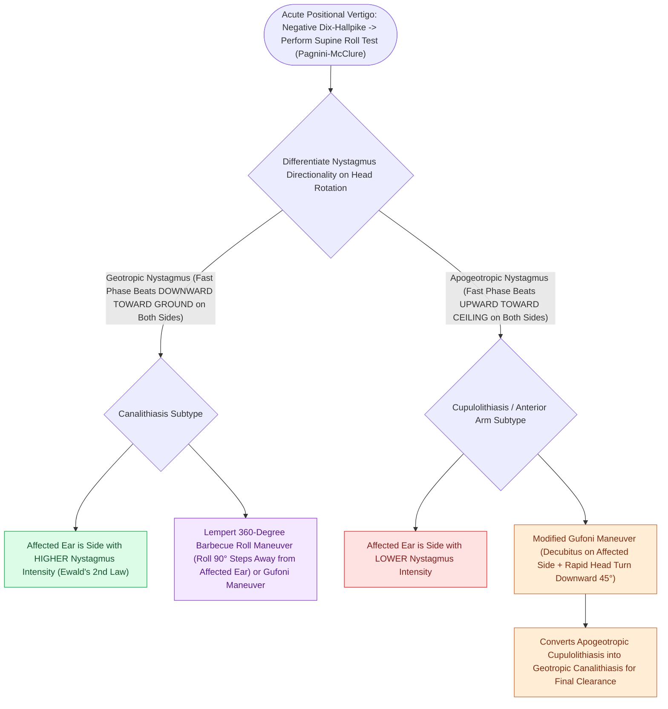

# Horizontal canal BPPV is diagnosed with the supine roll test and treated with the Lempert barbecue maneuver

## Active Recall

> [!question]- In geotropic horizontal canal BPPV, which ear is the affected side according to Ewald's second law?
> *Answer / Clinical Rationale*: The **side with the stronger (more intense) nystagmus** (because ampullopetal endolymph flow creates greater neural excitation).

> [!question]- What therapeutic maneuver involves a sequential 360-degree body roll to clear horizontal canal otoconia?
> *Answer / Clinical Rationale*: The **Lempert barbecue roll maneuver**.

## Core Clinical & Mechanistic Principles
**Horizontal (Lateral) Semicircular Canal BPPV (HC-BPPV)** accounts for $5\text{–}10\%$ of BPPV cases and is diagnosed via the **Supine Roll Test (Pagnini-McClure Test)**:
- **Supine Roll Test Execution**:
  1. Patient lies supine with head elevated $30^\circ$ (aligns horizontal canal vertically).
  2. Rapidly rotate head $90^\circ$ to the right; observe horizontal [[The Dix-Hallpike maneuver produces torsional upbeating nystagmus in posterior canal BPPV|nystagmus]].
  3. Return head to center, then rapidly rotate head $90^\circ$ to the left.
- **Two Nystagmus Variants & Ewald's 2nd Law**:
  1. **Geotropic Nystagmus (Canalithiasis, $>80\%$)**:
     - Nystagmus beats **TOWARD THE GROUND (Geotropic)** on both sides.
     - **Ewald's 2nd Law**: Ampullopetal endolymph flow is excitatory in the horizontal canal; therefore, the **AFFECTED EAR IS THE SIDE WITH STRONGER / MORE INTENSE NYSTAGMUS**.
  2. **Apogeotropic Nystagmus (Cupulolithiasis / Anterior Arm Canalithiasis, $<20\%$)**:
     - Nystagmus beats **AWAY FROM THE GROUND (Apogeotropic / toward ceiling)** on both sides.
     - The **AFFECTED EAR IS THE SIDE WITH WEAKER / LESS INTENSE NYSTAGMUS**.

### Surgical Technique & Critical Safety Checks
- **Treatment Modalities**:
  - **Lempert $360^\circ$ Barbecue Roll**: Sequential $90^\circ$ rolls away from affected ear back to prone and sitting.
  - **Gufoni Maneuver**: Rapid side-lying to healthy side followed by $45^\circ$ downward head rotation.

## Connected Concepts & Graph Traversal
- **Posterior Canal Diagnostic Maneuver**: [[The Dix-Hallpike maneuver produces torsional upbeating nystagmus in posterior canal BPPV|Dix-Hallpike Maneuver]]
- **Repositioning Counterpart**: [[The Epley particle repositioning maneuver clears otoconia from the posterior canal into the utricle|Epley Repositioning]]
- **Nystagmus Biophysical Laws**: [[Ewald's laws and Alexander's law govern the directional dynamics and intensity of vestibular nystagmus|Ewald's 2nd Law in Horizontal BPPV]]
- **Otolith Utricular Origin**: [[oVEMP evaluates the utricle and superior vestibular nerve via crossed inferior oblique excitation|Utricular Otoconia Origin]]
- **Vestibular Neuritis Differential**: [[Vestibular neuritis causes acute spontaneous prolonged vertigo without auditory symptoms|Acute Vestibular Neuritis]]
