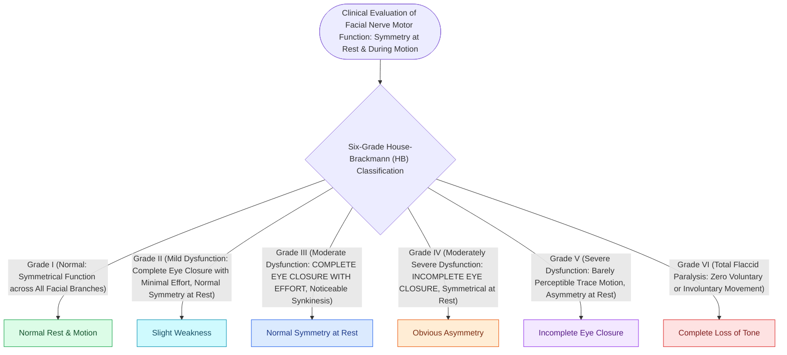

# House-Brackmann grading system stratifies facial nerve function from Grade I normal to Grade VI total paralysis

## Active Recall

> [!question]- What key clinical feature distinguishes House-Brackmann Grade III from Grade IV?
> *Answer / Clinical Rationale*: **Eye closure**: Grade III achieves **complete eye closure with maximal effort**, whereas Grade IV has **incomplete eye closure (lagophthalmos)**.

> [!question]- What House-Brackmann grade is assigned to a patient with asymmetry at rest and barely perceptible mouth twitching?
> *Answer / Clinical Rationale*: **Grade V (Severe Dysfunction)**.

## Core Clinical & Mechanistic Principles
The **House-Brackmann (HB) Facial Nerve Grading System (1985)** is the international standard for evaluating and reporting gross facial motor function and synkinesis:
- **The Six House-Brackmann Grades**:
  - **Grade I (Normal)**: Normal symmetrical facial function in all branches.
  - **Grade II (Mild Dysfunction)**: Slight weakness noticeable on close inspection; normal symmetry and tone at rest; **complete eye closure with minimal effort**; slight synkinesis.
  - **Grade III (Moderate Dysfunction)**: Obvious but not disfiguring asymmetry between sides; normal symmetry and tone at rest; **complete eye closure with maximal effort**; noticeable but not severe synkinesis.
  - **Grade IV (Moderately Severe Dysfunction)**: Obvious and disfiguring weakness; normal symmetry and tone at rest; **INCOMPLETE EYE CLOSURE ([[Upper eyelid gold or platinum weight implantation prevents exposure keratopathy in lagophthalmos|Lagophthalmos]])**; asymmetrical mouth motion with maximal effort.
  - **Grade V (Severe Dysfunction)**: Barely perceptible motion; **asymmetry at rest**; incomplete eye closure; slight movement of corner of mouth.
  - **Grade VI (Total Paralysis)**: Zero movement; complete loss of tone; flaccid asymmetry.

### Surgical Technique & Critical Safety Checks
- **The Grade III vs. IV Watershed**: **Eye closure** is the fundamental clinical boundary: Grade III achieves complete eye closure (low corneal risk); Grade IV exhibits **lagophthalmos** (requires aggressive eye lubrication and gold weight).

## Connected Concepts & Graph Traversal
- **Idiopathic Acute Palsy**: [[Acute Bell's palsy presents with unilateral lower motor neuron facial paralysis treated with early oral steroids|Bell's Palsy Management]]
- **Electrodiagnostic Prognosis**: [[Electroneuronography showing greater than ninety percent degeneration within fourteen days indicates severe facial nerve axonal injury|ENoG Evoked Potentials]]
- **Voluntary Motor Unit Fibrillation**: [[Electromyography EMG detects voluntary motor unit potentials and fibrillations indicating denervation|EMG Motor Potentials]]
- **🔗 Lagophthalmos Eye Protection (FPRS)**: [[Upper eyelid platinum weights and lateral tarsal strips protect the cornea in flaccid facial paralysis|Upper Eyelid Weight Insertion]]
- **Dynamic Reanimation**: [[Masseteric nerve transfer to facial nerve branches restores rapid, powerful dynamic smile reanimation|Masseteric Nerve Transfer]]
