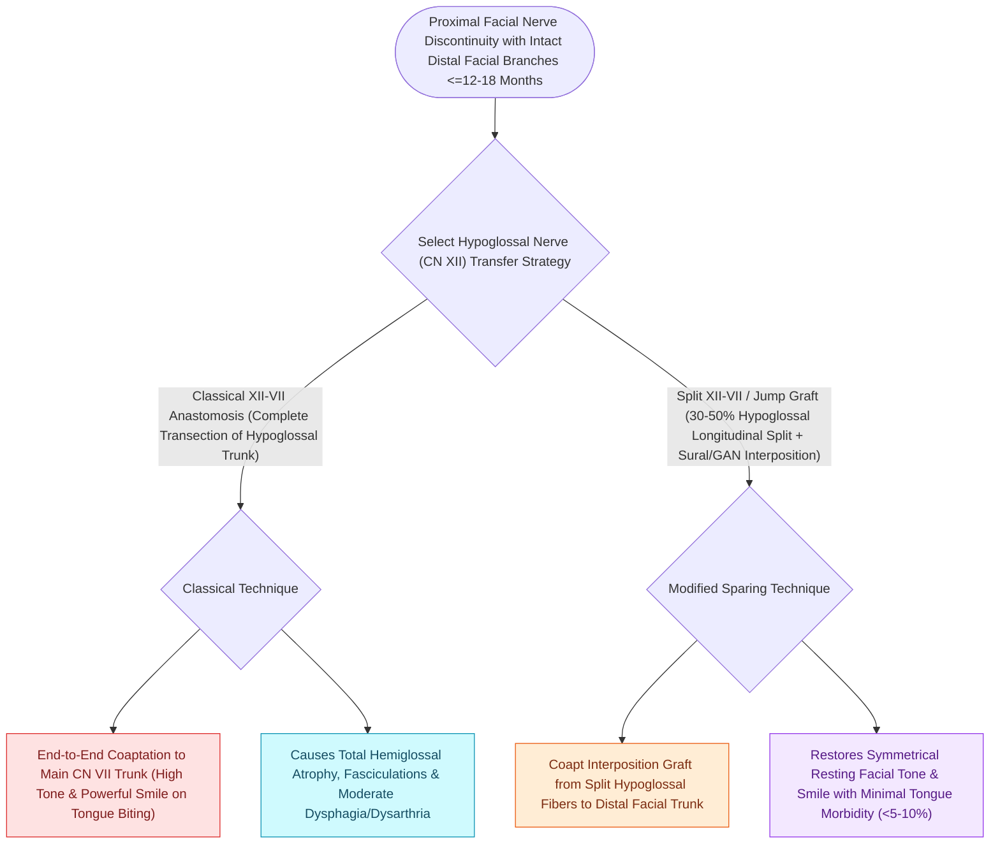

# Hypoglossal-to-facial nerve anastomosis restores resting facial tone and voluntary smile with tongue movement

## Active Recall

> [!question]- What is the major morbidity associated with classic end-to-end hypoglossal-to-facial nerve transfer?
> *Answer / Clinical Rationale*: **Complete ipsilateral hemilingual paralysis and tongue atrophy**, causing severe dysarthria and dysphagia.

> [!question]- How does a side-to-end (jump graft) XII-VII transfer prevent tongue atrophy?
> *Answer / Clinical Rationale*: By taking only a **partial ($30\text{–}50\%$) hemisection of CN XII** via an interposition graft, leaving the majority of hypoglossal axons intact to innervate the tongue.

## Core Clinical & Mechanistic Principles
**Hypoglossal-to-Facial Nerve Transfer (XII-VII anastomosis)** is a classic nerve transfer technique for chronic facial paralysis ($<1\text{–}2\text{ years}$) when the proximal facial nerve trunk is unavailable (e.g., post-[[Vestibular schwannomas arise from the Schwann cell sheath of the inferior or superior vestibular nerve|acoustic neuroma]] resection):
- **Traditional End-to-End XII-VII Transfer**:
  - The hypoglossal nerve (CN XII) is completely transected in the submandibular neck and anastomosed directly to the distal facial nerve trunk.
  - *Disadvantages*: Causes **complete ipsilateral hemilingual paralysis and atrophy**, leading to severe speech articulation and swallowing deficits.
- **Modern Side-to-End (Split-Hypoglossal / Jump Graft) Technique (May & May)**:
  - Incise a longitudinal $30\text{–}50\%$ hemisection of the hypoglossal nerve, or use a **Great Auricular Nerve jump graft** from the side of the intact CN XII to the distal CN VII.
  - **Preserves tongue mobility and prevents hemilingual atrophy** while delivering powerful motor axon input to the face.
- **Functional Outcome**:
  - Restores excellent **static symmetry and resting facial tone**.
  - Dynamic smile requires voluntary tongue movement (pushing tongue against teeth).

### Surgical Technique & Critical Safety Checks
- **Time Window for Transfer**: Must be performed within **$<12\text{–}18\text{ months}$** of injury before facial motor endplates undergo irreversible fibrosis.

## Connected Concepts & Graph Traversal
- **Alternative Dynamic Transfer**: [[Masseteric nerve transfer to facial nerve branches restores rapid, powerful dynamic smile reanimation|Masseteric Nerve Transfer]]
- **Clinical Severity Staging**: [[House-Brackmann grading system stratifies facial nerve function from Grade I normal to Grade VI total paralysis|House-Brackmann Grade VI]]
- **Direct Epineurial Gold Standard**: [[Immediate direct epineurial end-to-end repair is the gold standard for transected facial nerve injury|Immediate Epineurial Repair]]
- **Intratemporal Anatomy**: [[The facial nerve traverses six distinct anatomical segments from the pons to the parotid gland|Extracranial Fallopian Anatomy]]
- **🔗 Corneal Protection Adjunct (FPRS)**: [[Upper eyelid platinum weights and lateral tarsal strips protect the cornea in flaccid facial paralysis|Upper Eyelid Weight Implantation]]
