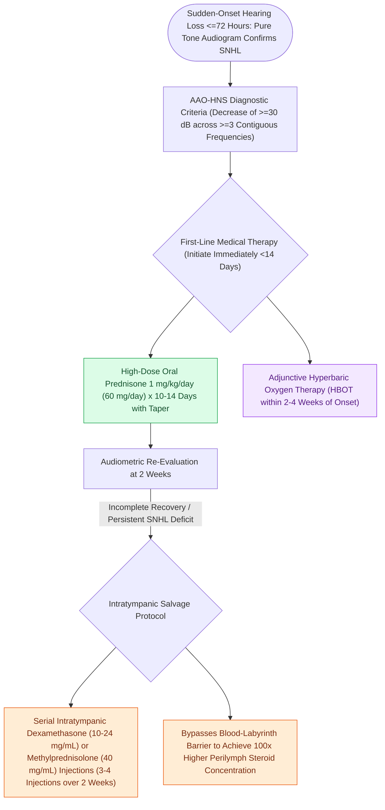

# Idiopathic sudden sensorineural hearing loss requires prompt systemic corticosteroids and intratympanic salvage injection

## Active Recall

> [!question]- What is the formal audiometric definition of sudden sensorineural hearing loss?
> *Answer / Clinical Rationale*: A decrease in sensorineural hearing thresholds of **$\ge$ 30 dB across at least 3 contiguous audiometric test frequencies**, occurring over a timeframe of **$\le$ 72 hours**.

> [!question]- Why is contrast-enhanced MRI of the internal auditory canals mandatory in all patients presenting with idiopathic sudden SNHL?
> *Answer / Clinical Rationale*: Approximately 1% to 3% of patients with sudden SNHL have an underlying **vestibular schwannoma (acoustic neuroma)** or cerebellopontine angle mass compressing the cochlear nerve or internal auditory artery. In addition, MRI identifies multiple sclerosis plaques, stroke, or inner ear hemorrhage.

## Core Clinical & Mechanistic Principles

**Idiopathic sudden sensorineural hearing loss (ISSNHL)** is defined as a sensorineural hearing loss of **$\ge$ 30 dB across at least 3 contiguous audiometric frequencies occurring within a 72-hour window**. It represents an otologic emergency with an estimated incidence of 5–20 per 100,000 persons per year. Although the exact pathophysiology remains idiopathic in >90% of cases, proposed mechanisms include microvascular cochlear ischemia, [[Labyrinthitis presents with acute prolonged vertigo combined with sudden sensorineural hearing loss|viral labyrinthitis]] (e.g., Herpes simplex, CMV), acute autoimmune inner ear inflammation, and intracochlear membrane rupture.

The cornerstone of diagnosis is urgent **pure-tone audiometry with bone conduction** and speech discrimination testing, which distinguishes true sensorineural loss from conductive pathology (e.g., cerumen impaction, otitis media with effusion). Approximately 1–3% of patients presenting with sudden SNHL harbor a retrocochlear lesion; therefore, **contrast-enhanced MRI of the internal auditory canals (IACs) and cerebellopontine angle (CPA)** or diagnostic [[Auditory brainstem response waves I through V identify retrocochlear and brainstem pathology|auditory brainstem response (ABR)]] is mandatory to rule out [[Vestibular schwannomas arise from the Schwann cell sheath of the inferior or superior vestibular nerve|vestibular schwannoma]] or demyelinating disease. In severe presentations, concurrent vestibular symptoms mimic acute labyrinthitis.

### Key Consultation Supplies
- 512 Hz aluminum tuning fork (Weber and Rinne testing)
- Binocular operating microscope with ear speculums (sizes 3, 4, 5 mm)
- Topical anesthetic (88% phenol solution with micro-applicator or 4% buffered lidocaine solution)
- Dexamethasone sodium phosphate (10–24 mg/mL, warmed to body temperature) or methylprednisolone (40 mg/mL)
- 1 mL tuberculin syringe with 27-gauge or 30-gauge spinal / myringotomy needle
- Frazier suction tips (sizes 3 Fr, 5 Fr)
- Urgent pure-tone audiometry order form
- Contrast-enhanced MRI IAC/brain order form

> [!example]- **Operative Note Template: Microscopic intratympanic dexamethasone perfusion**
> **PROCEDURE**: Microscopic [[Intratympanic dexamethasone and gentamicin provide non-ablative and chemical ablative control of Meniere vertigo|intratympanic dexamethasone]] perfusion
> **PRE-PROCEDURAL DIAGNOSIS**: Idiopathic sudden sensorineural hearing loss of the [right/left] ear
> **POST-PROCEDURAL DIAGNOSIS**: Idiopathic sudden sensorineural hearing loss of the [right/left] ear status-post transtympanic steroid injection
> **SURGEON**: [Surgeon Name, MD]
> **ASSISTANT**: [Resident/Fellow Name, MD]
>
> **PROCEDURE IN DETAIL**:
> Informed consent was obtained. The patient was positioned supine with the head rotated 45 degrees toward the contralateral side. Under high-power binocular operating microscopy, an ear speculum was inserted and the tympanic membrane was visualized.
>
> A pinpoint application of 88% phenol solution was applied to the posteroinferior quadrant of the tympanic membrane with immediate local blanching and complete anesthesia. Using a 27-gauge long needle on a 1 mL tuberculin syringe, an anterosuperior vent puncture was placed, followed by slow injection of 0.6 mL of body-temperature dexamethasone (10 mg/mL) into the posteroinferior middle ear space until the [[Round window and extended round window insertions minimize intracochlear acoustic trauma|round window]] niche and middle ear were completely flooded.
>
> The patient was maintained supine with the head turned for 30 minutes with strict instructions to refrain from swallowing or speaking. The patient tolerated the procedure without vertigo, pain, or complications.

## References
1. Chandrasekhar, S.S., Tsai Do, B.S., Schwartz, S.R., et al. (2019). Clinical Practice Guideline: Sudden Hearing Loss (Update). *Otolaryngol Head Neck Surg*, 161(1_suppl):S1-S45.
2. Le Prell, C.G. (2020). Sensorineural Hearing Loss in Adults. In Flint, P.W., et al. (Eds.), *Cummings Otolaryngology Head and Neck Surgery* 7e (pp. 2311-2327). Philadelphia, PA: Elsevier.
3. Oliver, E.R., Hashisaki, G.T. (2013). Sudden Sensory Hearing Loss. In Johnson, J.J., Rosen, C.A. (Eds.), *Bailey’s Head and Neck Surgery-Otolaryngology* 5e (pp. 2589-2596). Baltimore, MD: Lippincott Williams & Wilkins.

## Connected Concepts & Graph Traversal
- **Diagnostic Imaging & Evaluation**: [[Auditory brainstem response waves I through V identify retrocochlear and brainstem pathology|ABR & Retrocochlear Evaluation]]
- **Vestibular & Cochlear Pathology**: [[Labyrinthitis presents with acute prolonged vertigo combined with sudden sensorineural hearing loss|Acute Labyrinthitis]]
- **Auditory Biophysics**: [[The stria vascularis generates the endocochlear potential of positive eighty millivolts|Stria Vascularis & Endolymph]]
- **Cochlear Amplification**: [[Outer hair cell electromotility driven by prestin amplifies cochlear micromechanics|Outer Hair Cell Mechanics]]
- **Advanced Rehabilitation**: [[Cochlear implant candidacy criteria include severe to profound bilateral sensorineural hearing loss|Cochlear Implantation]]
- **Barotraumatic Differential**: [[Inner ear barotrauma and decompression sickness produce acute cochleovestibular dysfunction through pressure-induced membrane rupture or inert gas bubble embolization requiring hyperbaric therapy|Inner Ear Barotrauma & Decompression Sickness]]
