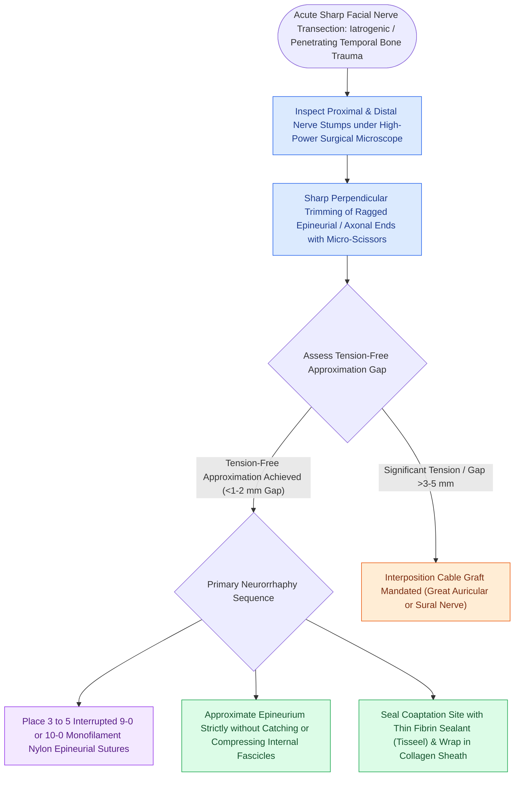

# Immediate direct epineurial end-to-end repair is the gold standard for transected facial nerve injury

## Active Recall

> [!question]- What is the maximum achievable House-Brackmann recovery grade following complete transection and repair of the facial nerve?
> *Answer / Clinical Rationale*: **House-Brackmann Grade III** (due to inevitable synkinesis and mass movement from aberrant axonal regeneration).

> [!question]- Why is tension across a microneurovascular nerve repair catastrophic for regeneration?
> *Answer / Clinical Rationale*: Tension causes **capillary ischemia within the nerve stump**, promoting dense collagenous scarring that blocks axonal growth cones.

## Core Clinical & Mechanistic Principles
When the facial nerve is sharply transected during trauma or oncologic surgery, **immediate tension-free end-to-end epineurial neurorrhaphy** provides the highest rate of functional recovery:
- **The Tension-Free Mandate**:
  - Any tension across a nerve repair causes endoneurial ischemia, fibrous scar proliferation, and axonal sprouting failure.
  - If the nerve ends cannot be approximated without tension, **rerouting** (mobilizing the nerve out of the [[The facial nerve traverses six distinct anatomical segments from the pons to the parotid gland|Fallopian canal]]) or an **interposition cable graft (Great Auricular Nerve)** must be performed.
- **Microsurgical Craft Execution**:
  1. **Trimming**: Refresh proximal and distal nerve stumps with a fresh micro-blade to expose healthy, herniating fascicles.
  2. **Epineurial Suturing**: Place **3 to 5 interrupted 9-0 or 10-0 monofilament nylon sutures** through the outer epineurium only, avoiding penetrating the endoneurial fascicles.
  3. **Fascicular Alignment**: Align longitudinal epineurial blood vessels to ensure correct rotational orientation.
  4. **Fibrin Glue Reinforcement**: Seal the coaptation with a drop of fibrin sealant.

### Surgical Technique & Critical Safety Checks
- **Realistic Recovery Expectations**: Following complete transection and repair, the best possible functional outcome is **House-Brackmann Grade III** (mass movement with synkinesis); Grade I or II recovery is biologically impossible due to non-specific axonal misdirection.

## Connected Concepts & Graph Traversal
- **Dynamic Reanimation Alternative**: [[Masseteric nerve transfer to facial nerve branches restores rapid, powerful dynamic smile reanimation|Masseteric Nerve Transfer]]
- **Hypoglossal Cable Transfer**: [[Hypoglossal-to-facial nerve anastomosis restores resting facial tone and voluntary smile with tongue movement|Hypoglossal-Facial Anastomosis]]
- **Intratemporal Fallopian Course**: [[The facial nerve traverses six distinct anatomical segments from the pons to the parotid gland|Fallopian Canal Landmarks]]
- **Traumatic Temporal Bone Injury**: [[Temporal bone longitudinal and transverse fractures cause delayed or immediate facial paralysis|Temporal Bone Fractures]]
- **🔗 Corneal Lagophthalmos Protection (FPRS)**: [[Upper eyelid platinum weights and lateral tarsal strips protect the cornea in flaccid facial paralysis|Upper Eyelid Weight Implantation]]
