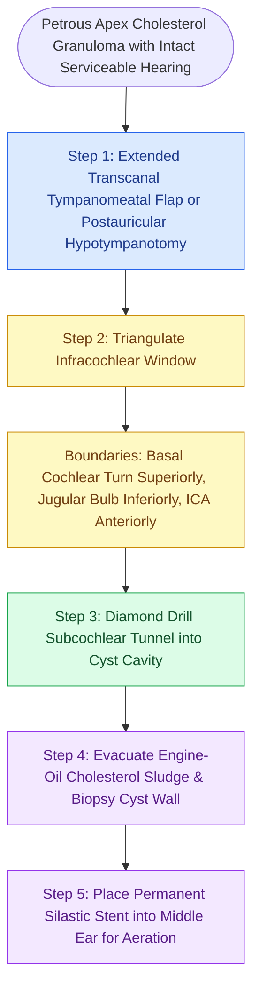

# Infracochlear and infralabyrinthine approaches establish hearing-preserving drainage pathways for petrous apex cholesterol granulomas inferior to the otic capsule

## Active Recall

> [!question]- What anatomic boundaries define the surgical safety window for an infracochlear approach to the petrous apex?
> *Answer / Clinical Rationale*: The infracochlear corridor is bounded **superiorly** by the basal turn of the cochlea (promontory), **inferiorly** by the dome of the jugular bulb, **anteriorly** by the vertical ascending segment of the internal carotid artery, and **posteriorly** by the hypotympanic air cell tract and Fallopian canal. A favorable distance between the cochlea and jugular bulb (typically >= 3 to 4 mm on high-resolution CT) is required to safely drill into the anterior petrous apex without causing sensorineural deafness or vascular hemorrhage.
>
> [!question]- Why is permanent Silastic or soft-tissue stenting required following petrous apex cholesterol granuloma drainage?
> *Answer / Clinical Rationale*: Cholesterol granulomas are expansive cystic lesions driven by anaerobic red blood cell breakdown, foreign-body giant cell reaction, and osmotic fluid transudation within an isolated, unventilated pneumatic cell tract. Because complete surgical extirpation of the deeply adherent fibrous pseudocapsule is hazardous to surrounding neurovascular structures, the primary surgical goal is permanent drainage and re-aeration. Placing a permanent Silastic stent across the drilled bony tunnel into the middle ear cavity prevents osteoneogenesis and mucosal scarring from re-obstructing the drainage port, which would cause cyst re-accumulation.

## Core Clinical & Mechanistic Principles

Lesions of the petrous apex represent a diverse diagnostic spectrum including cholesterol granulomas, cholesteatomas, mucoceles, petrous apicitis, and chordomas. As established by high-resolution multi-parametric MRI, [[Petrous apex lesions are differentiated into cholesterol granuloma, cholesteatoma, and mucocele by T1, T2, and non-EPI diffusion-weighted MRI|differentiation of petrous apex lesions]] relies on signal characteristics: cholesterol granulomas demonstrate pathognomonic hyperintensity on both T1- and T2-weighted sequences with peripheral hemosiderin rims and no diffusion restriction on non-EPI DWI.

When managing symptomatic cholesterol granulomas (presenting with headache, retro-orbital pain, abducens nerve palsy, or secondary Eustachian tube obstruction) in patients with intact, serviceable hearing, radical otic-capsule-sacrificing corridors are contraindicated. Instead, hearing-preserving petrous apicotomies—specifically the **Infracochlear Approach** and the **Infralabyrinthine Approach**—are indicated to achieve permanent cyst decompression. These techniques are distinct from [[Petrous apex cholesteatoma requires infracochlear, translabyrinthine, or middle cranial fossa exteriorization|exteriorization corridors]] intended for epithelial removal.

The **Infracochlear Approach** accesses the anterior petrous apex via the hypotympanum inferior to the cochlear capsule. It can be performed through an extended transcanal tympanotomy or combined with a postauricular cortical mastoidectomy. By dissecting within the triangle formed by the promontory, carotid artery, and jugular bulb, the surgeon follows the infracochlear air cell tract directly into the expansile cystic cavity. Conversely, the **Infralabyrinthine Approach** utilizes a transmastoid corridor inferior to the posterior semicircular canal and ampulla, traversing between the vertical segment of cranial nerve VII and the jugular bulb into the inferior petrous apex.

### Anatomic Boundaries & Surgical Craft

1. **Preoperative High-Resolution Temporal Bone CT**: The surgeon must measure the distance between the inferior margin of the round window niche/cochlea and the apex of the jugular bulb. A high-riding, dehiscent jugular bulb or an aberrant internal carotid artery represents a strict relative contraindication to the infracochlear route, mandating a subtemporal middle cranial fossa or endoscopic transsphenoidal approach instead.
2. **Exposure of Hypotympanum**: A postauricular incision or large tympanomeatal flap is elevated. The fibrous annulus is displaced, and the hypotympanic cells are unroofed. Continuous facial nerve monitoring is active throughout.
3. **Skeletonization of Internal Carotid Artery**: The anterior hypotympanic bone is thinned until the bony carotid plate is identified. The vertical internal carotid artery is skeletonized with diamond burrs, establishing the anterior boundary of the surgical channel.
4. **Jugular Bulb Depressurization**: The bone over the jugular bulb dome is skeletonized inferiorly. If the bulb impinges on the corridor, gentle compression with bone wax or oxidized cellulose (Surgicel) widens the working aperture.
5. **Penetration into Cholesterol Granuloma**: Using a 1.5 to 2.0 mm diamond burr angled medially, anteriorly, and slightly superiorly beneath the promontory, the thinned petrous cortex is unroofed. Puncture yields characteristic dark brown, viscous "crankcase engine oil" fluid laden with iridescent cholesterol crystals.
6. **Evacuation & Permanent Stenting**: The cavity is copiously irrigated with warm saline. A rolled Silastic (Teflon or silicone) drainage tube is seated with its medial tip within the petrous apex and its lateral flange anchored into the middle ear or mastoid antrum, establishing lifelong pneumatic communication.

## Connected Concepts & Graph Traversal
- **Differential Diagnosis**: [[Gradenigo triad of otorrhea, retroorbital pain, and abducens nerve palsy indicates suppurative petrous apicitis]]
- **Infratemporal Corridor**: [[Fisch infratemporal fossa approach Type B and Type C expose the petrous apex, clivus, and infratemporal fossa by mobilizing the zygomatic arch and temporalis muscle]]
- **Retrotympanic Anatomy**: [[The retrotympanum is partitioned into sinus tympani, facial sinus, and subtympanic sinus by the ponticulus and subiculum]]
- **Inferior Boundary**: [[Jugular paragangliomas arise from the glomus body in the adventitia of the jugular bulb]]
- **Otic Capsule Anatomy**: [[The otic capsule is an immutable endochondral bone that provides fixed surgical reference landmarks]]
