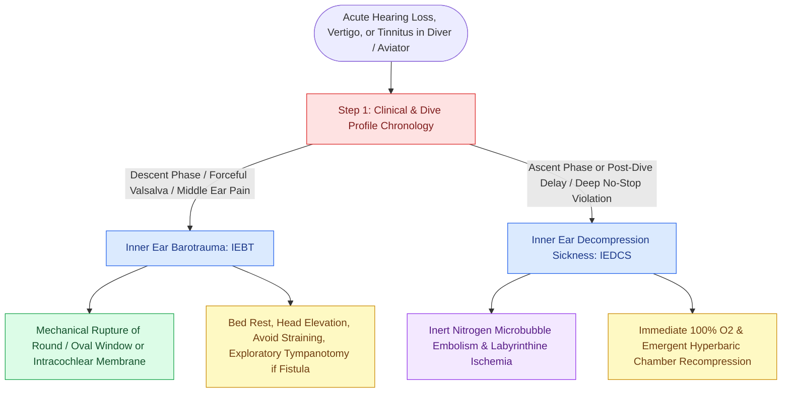

# Inner ear barotrauma and decompression sickness produce acute cochleovestibular dysfunction through pressure-induced membrane rupture or inert gas bubble embolization requiring hyperbaric therapy

## Active Recall

> [!question]- How do the clinical timing and pathophysiology differ between inner ear barotrauma (IEBT) and inner ear decompression sickness (IEDCS)?
> *Answer / Clinical Rationale*: IEBT occurs almost exclusively during the descent phase of diving or upon landing in aviation due to failed middle ear equalization; forceful Valsalva maneuvers create implosive or explosive mechanical pressure differentials across the middle-to-inner ear interface, rupturing the round or oval window membrane (perilymph fistula). In contrast, IEDCS occurs during ascent or within hours post-dive due to Henry's and Boyle's laws; dissolved inert nitrogen gas forms intravascular microbubbles and extravascular emboli within the terminal labyrinthine microvasculature, causing acute cochleovestibular ischemia.
>
> [!question]- Why is immediate hyperbaric oxygen recompression mandatory for inner ear decompression sickness but potentially hazardous in uncorrected inner ear barotrauma?
> *Answer / Clinical Rationale*: IEDCS is an ischemic emergency requiring immediate recompression in a hyperbaric chamber to shrink intravascular nitrogen bubbles and restore labyrinthine perfusion. Conversely, in acute IEBT with a fresh round window perilymph fistula, rapid ambient pressure changes in a hyperbaric chamber can exacerbate membrane herniation and drive middle ear air into the inner ear (pneumolabyrinth); IEBT requires strict bed rest, head elevation, and surgical exploratory tympanotomy if vertigo and hearing loss progress.

## Core Clinical & Mechanistic Principles

Scuba diving, hyperbaric exposure, and rapid aviation descents expose the otologic apparatus to extreme barometric differentials governed by Boyle's Law ($P_1 V_1 = P_2 V_2$). When pressure equilibration across the middle ear fails, acute cochleovestibular emergencies develop. Distinguishing between Inner Ear Barotrauma (IEBT) and Inner Ear Decompression Sickness (IEDCS / "the staggers") is one of the highest-stakes diagnostic challenges in neurotology, as their medical and surgical management pathways are strictly divergent.

Inner Ear Barotrauma occurs when negative middle ear pressure develops during descent. If the diver performs a forceful Valsalva maneuver against an obstructed [[Eustachian tube dysfunction divides into dilatory and patulous forms with opposite treatment goals|Eustachian tube]], cerebrospinal fluid pressure rises sharply and transmits through an abnormally patent cochlear aqueduct into the scala tympani, causing an **explosive** rupture of the round window membrane. Alternatively, severe middle ear atelectasis forcefully displaces the tympanic membrane and stapes footplate inward, driving an **implosive** perilymph wave that tears the round window outwardly. Patients experience immediate acoustic "pop", sensorineural or mixed hearing loss, roaring tinnitus, and violent positional vertigo accompanied by [[Perilymphatic fistula causes fluctuating hearing loss and pressure-induced vertigo after barotrauma or stapes surgery|perilymphatic fistula]].

Inner Ear Decompression Sickness (IEDCS) represents a manifestation of Type II DCS. As a diver remains at depth, ambient nitrogen dissolves into lipid-rich vestibular and auditory neural tissues. If ascent is overly rapid or decompression profiles are violated, nitrogen supersaturates and transitions out of solution, forming microbubbles. Because the labyrinthine artery is an end-artery lacking collateral circulation, intravascular bubble coalescences, platelet activation, and venous sinus stasis rapidly induce labyrinthine infarction and irreversible sensorineural hearing loss.

### Diagnostic Workup and Protocol Differentiation

1. **History & Profile Audit**:
   - IEBT: Onset during descent; associated with difficulty clearing ears, severe otalgia, or aggressive Valsalva; shallow dives (< 10 meters) are common.
   - IEDCS: Onset during ascent or delayed 10 minutes to 6 hours post-surfacing; deep dives (> 20–30 meters) with missed decompression stops or repetitive multi-day profiles; may be accompanied by cutaneous marbling, spinal cord paresthesias, or joint bends.
2. **High-Resolution CT of the Temporal Bone**: Mandatory to detect middle ear hemotympanum, stapes subluxation, and pneumolabyrinth (air bubbles inside the cochlea or vestibule confirming inner ear membrane violation).
3. **Emergency Management Pathway**:
   - If IEDCS is confirmed or suspected: Administer 100% normobaric oxygen immediately, initiate aggressive isotonic intravenous hydration, and arrange immediate emergent transfer to a recompression hyperbaric oxygen facility (US Navy Treatment Table 6).
   - If IEBT with perilymph fistula is identified: Strict bed rest with head elevated 30 to 45 degrees, stool softeners, avoidance of nose-blowing and straining. If vestibular symptoms remain refractory or profound sensorineural hearing loss progresses beyond 48 to 72 hours, emergent exploratory tympanotomy with soft tissue patching of the round and oval window niches is indicated.

## Connected Concepts & Graph Traversal
- **Pathophysiological Mechanism**: [[Traumatic perilymphatic fistula and stapes subluxation present with pneumolabyrinth, vertigo, and mixed hearing loss]]
- **Clinical Presentation**: [[Perilymphatic fistula causes fluctuating hearing loss and pressure-induced vertigo after barotrauma or stapes surgery]]
- **Physiological Basis**: [[Eustachian tube dysfunction divides into dilatory and patulous forms with opposite treatment goals]]
- **Differential Diagnosis**: [[Labyrinthitis presents with acute prolonged vertigo combined with sudden sensorineural hearing loss]]
- **Medical Salvage**: [[Idiopathic sudden sensorineural hearing loss requires prompt systemic corticosteroids and intratympanic salvage injection]]
