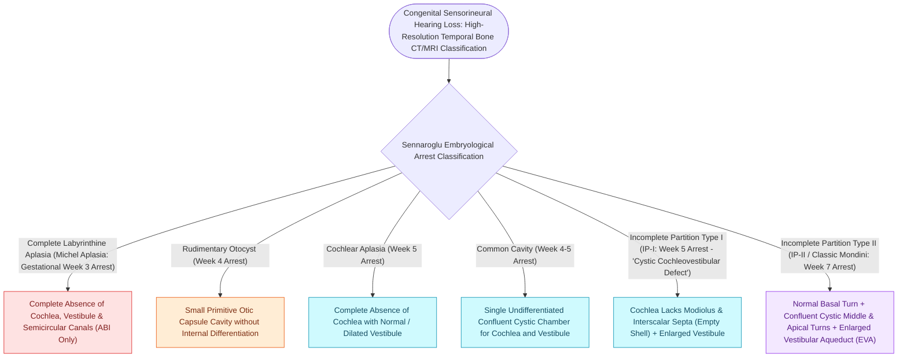

# Inner ear malformations are classified by Jackler and Sennaroglu based on embryonic arrest timing and cochleovestibular architecture

## Active Recall

> [!question]- What is the classic diagnostic triad of Mondini dysplasia (Incomplete Partition Type II), and at what gestational week does embryonic arrest occur?
> *Answer / Clinical Rationale*: **Mondini Dysplasia (Incomplete Partition Type II)** results from embryonic arrest during the **7th week of gestation**. The classic triad consists of: (1) **1.5 cochlear turns** (a normal basal turn with cystic confluence/fusion of the middle and apical turns into a single apex cavity), (2) **Enlarged Vestibular Aqueduct (EVA $>1.5\text{ mm}$ at midpoint)**, and (3) **Dilated vestibule** with normal or enlarged semicircular canals.

> [!question]- How do Incomplete Partition Type I, Type II, and Type III differ anatomically and in terms of genetic etiology and cochlear gusher risk?
> *Answer / Clinical Rationale*: - **Type I (Cochleovestibular Dysplasia, 5th week arrest)**: Cochlea is a completely featureless, empty cystic cavity lacking both modiolus and interscalar septa; vestibule is dilated. High perilymph gusher risk due to defective cribriform plate. - **Type II (Mondini Malformation, 7th week arrest)**: Basal turn preserved, middle/apical turns confluent, modiolus present only in basal turn, enlarged vestibular aqueduct (associated with *SLC26A4* / Pendred syndrome). Low gusher risk. - **Type III (X-linked Deafness / *DFNX2* mutation in *POU3F4*)**: Modiolus is completely absent, but interscalar septa are present; wide bulbous internal auditory canal (IAC) fundus with direct bony defect at the modiolus base. Has the **highest risk of severe, profuse stapes/cochleostomy gusher** in otology.

> [!question]- What is the distinction between Michel deformity, Common Cavity, and Cochlear Aplasia?
> *Answer / Clinical Rationale*: - **Michel Agenesis (3rd week arrest)**: Complete absence of all inner ear structures (no cochlea, vestibule, or canals; promontory is flat, otic capsule absent). Absolute contraindication to cochlear implant; requires Auditory Brainstem Implant (ABI). - **Common Cavity (4th week arrest)**: Confluent, single cystic cavity without any internal differentiation into cochlea or vestibule. Cochlear implant electrode can be placed along the outer perimeter wall. - **Cochlear Aplasia (5th week arrest)**: Complete absence of the cochlea, but a normal or malformed vestibule and semicircular canals are present.

## Core Clinical & Mechanistic Principles

Inner ear organogenesis progresses from the **otic placode** (3rd gestational week) through otocyst invagination, differential outpocketing, and full $2.5-2.75$ cochlear turn coiled maturation (8th to 10th week):

### Classification of Pure Membranous Dysplasias (Normal Bony Labyrinth on CT)
While the Jackler and Sennaroglu schemas classify radiographically visible **osseous labyrinth malformations**, pure membranous malformations display a completely normal bony otic capsule on high-resolution temporal bone CT:
- **Scheibe Dysplasia (Cochleosaccular Dysplasia)**:
  - The **most common congenital inner ear malformation overall** ($approx 70\%$ of hereditary congenital deafness).
  - *Embryology & Histopathology*: Arrest during the late embryonic phase (after the bony otic capsule has formed normally). Affects the **pars inferior (cochlea and saccule)** with partial or total atrophy of the organ of Corti, collapse of the scala media (Reissner membrane adherent to stria vascularis), and degeneration of the saccular macula. The **pars superior (utricle and semicircular canals) is completely spared and functionally normal**.
  - *Clinical Picture*: Presents with profound bilateral congenital sensorineural hearing loss with preserved vestibular/canal function and entirely normal temporal bone CT. Classically seen in sporadic mutations, CMV, rubella, and syndromic disorders (Waardenburg, Usher, Jervell and Lange-Nielsen).
- **Alexander Dysplasia (Basal Turn Dysplasia)**:
  - Membranous dysplasia confined to the **basal turn of the cochlear duct**, sparing the middle/apical turns and vestibular apparatus; manifests as congenital high-frequency progressive SNHL.
- **Bing-Siebenmann Dysplasia (Complete Membranous Aplasia)**:
  - Complete membranous aplasia affecting both pars inferior and pars superior within a well-formed bony otic capsule.

### Surgical Technique & Cochlear Gusher Management
- **Cochlear Gusher Pathophysiology**:
  - Direct communication between the subarachnoid space and the perilymphatic space via an abnormally patent internal auditory canal fundus / deficient lamina cribrosa.
- **High-Risk Profiles**: Incomplete Partition Type I and Type III (*POU3F4*).
- **Intraoperative Rescue Protocol**:
  1. **Head-up Position**: Reverse Trendelenburg ($30^\circ$) to reduce intracranial CSF pressure.
  2. **Anesthetic Control**: Hyperventilation, IV mannitol / furosemide.
  3. **Immediate Electrode Insertion**: Place [[Cochlear implant candidacy criteria include severe to profound bilateral sensorineural hearing loss|cochlear implant]] electrode array through cochleostomy or round window.
  4. **Tight Fascial Sealing**: Pack peri-cochleostomy site tightly with temporalis muscle, fascia, and fibrin glue.
  5. **Postoperative Lumbar Drain**: Placed for $48-72\text{ hours}$ if CSF pulsation persists through the middle ear.

## Connected Concepts & Graph Traversal
- **Pendred Syndrome & EVA**: [[Pendred syndrome causes sensorineural hearing loss and euthyroid goiter due to SLC26A4 mutations with enlarged vestibular aqueducts|Pendred Syndrome & EVA Triad]]
- **Cochlear Implant Insertion**: [[Round window and extended round window insertions minimize intracochlear acoustic trauma|Round Window CI Surgery]]
- **Auditory Brainstem Implants**: [[Auditory Brainstem Implantation ABI bypasses the cochlea and cochlear nerve to stimulate the cochlear nucleus in NF2|ABI for Cochlear Agenesis]]
- **Gushing Footplate Complication**: [[Gushing footplate indicates a congenital perilymph fistula from an abnormally patent cochlear aqueduct|Stapes Surgery Gusher Rescue]]
- **🔗 Pediatric SNHL Genetics (Pediatrics)**: [[Syndromic pediatric sensorineural hearing loss encompasses Pendred, Usher, Waardenburg, and Jervell and Lange-Nielsen syndromes|Pediatric SNHL Genetic Syndromes]]
- **🔗 Connexin 26 Mutations (Pediatrics)**: [[Connexin 26 mutations in GJB2 and congenital CMV infection are leading causes of non-syndromic pediatric sensorineural hearing loss|GJB2 & Non-Syndromic SNHL]]
