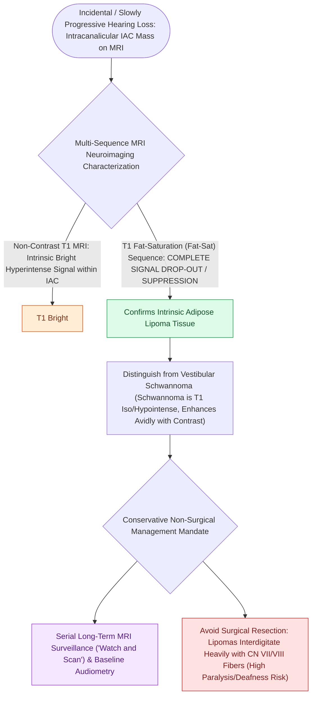

# Internal auditory canal lipomas demonstrate T1 hyperintensity with fat saturation signal loss and mandate conservative observation

## Active Recall

> [!question]- What is the definitive MRI sequence used to distinguish an IAC lipoma from a vestibular schwannoma?
> *Answer / Clinical Rationale*: **T1-weighted imaging with fat saturation (Fat-Sat)**; lipomas demonstrate pathognomonic **complete signal drop-out (darkening)**, whereas vestibular schwannomas remain enhancing and do not suppress.

> [!question]- Why is surgical resection contraindicated for the vast majority of symptomatic IAC lipomas?
> *Answer / Clinical Rationale*: Lipomas **infiltrate and intertwine directly with the axons and perineurium of CN VII and CN VIII** without a capsule or cleavage plane; surgical excision results in near-certain permanent facial nerve paralysis and complete hearing destruction.

## Core Clinical & Mechanistic Principles
**Internal Auditory Canal (IAC) and Cerebellopontine Angle (CPA) lipomas** are exceedingly rare, benign congenital lesions resulting from abnormal persistence and maldifferentiation of the embryonic meninx primitiva (accounting for $<0.15\%$ of all CPA tumors):

- **MRI Signal Signature & Differential Diagnosis**:
  - **T1-Weighted Sequences**: Markedly **hyperintense (bright)** on non-contrast T1-weighted MRI, closely mimicking hemorrhage, proteinaceous fluid, or melanin.
  - **T2-Weighted Sequences**: Variable to hyperintense, typically less bright than adjacent cerebrospinal fluid (CSF).
  - **Fat Suppression (Fat-Sat) MRI Sequences — The Definitive Diagnostic Standard**:
    - Application of frequency-selective fat saturation demonstrates **complete signal drop-out (loss of T1 brightness / darkening)** of the lesion.
    - *Pathognomonic Distinction*: Differentiates IAC lipoma from **[[Vestibular schwannomas arise from the Schwann cell sheath of the inferior or superior vestibular nerve|vestibular schwannoma]]** (T1 iso/hypointense, vivid post-contrast enhancement) and **meningioma** (broad dural base, dural tail, no fat-sat drop-out).
  - **Contrast Enhancement**: Lipomas show **no true intrinsic enhancement** on post-gadolinium sequences (apparent enhancement is often persistent high T1 fat signal if fat-saturation is not applied).

- **Biological Architecture & Cranial Nerve Entanglement**:
  - Unlike encapsulated vestibular schwannomas that displace adjacent neural structures, **lipomas lack a true surgical capsule** and exhibit intimate **intermingling of mature adipocytes with the axons of the facial nerve (CN VII) and cochleovestibular nerve (CN VIII)**.
  - Adipose tissue infiltrates the perineurium and endoneurium, rendering microdissection and surgical cleavage planes non-existent.

- **The Management Axiom — Strict Conservative Observation**:
  - *Surgical Hazard*: Attempted total surgical resection carries an unacceptably high rate of **permanent facial paralysis (House-Brackmann Grade VI)**, total profound sensorineural hearing loss, and intractable vestibular deficit.
  - *Standard of Care*: **Non-operative surveillance with serial high-resolution MRI** and annual audiometric monitoring.
  - *Surgical Indications*: Reserved exclusively for massive lesions causing severe, life-threatening fourth ventricular obstruction, progressive obstructive hydrocephalus, or profound, refractory brainstem compression.

### Surgical Technique & Critical Safety Checks
- **Subtotal Decompression if Mandatory**: If intractable intracranial hypertension or brainstem compression necessitates intervention via a **retrosigmoid or translabyrinthine craniotomy**, the surgeon must perform **conservative central debulking only**. Adipose tissue adherent to or infiltrating the cranial nerve root entry zones must be left untouched.

## Connected Concepts & Graph Traversal
- **Vestibular Schwannoma MRI**: [[Auditory brainstem response waves I through V identify retrocochlear and brainstem pathology|ABR & Retrocochlear Pathology]]
- **Translabyrinthine Corridors**: [[The translabyrinthine approach provides direct exposure of the internal auditory canal with complete hearing sacrifice|Translabyrinthine CPA Approach]]
- **Facial Nerve Monitoring**: [[Intraoperative facial nerve and cochlear nerve monitoring minimize cranial nerve morbidity in skull base surgery|Intraoperative Cranial Nerve Monitoring]]
- **Facial Nerve Grading**: [[House-Brackmann grading system stratifies facial nerve function from Grade I normal to Grade VI total paralysis|House-Brackmann Facial Nerve System]]
- **Cerebellopontine Angle Approaches**: [[Auditory Brainstem Implantation ABI bypasses the cochlea and cochlear nerve to stimulate the cochlear nucleus in NF2|ABI & Lateral Skull Base Corridors]]
