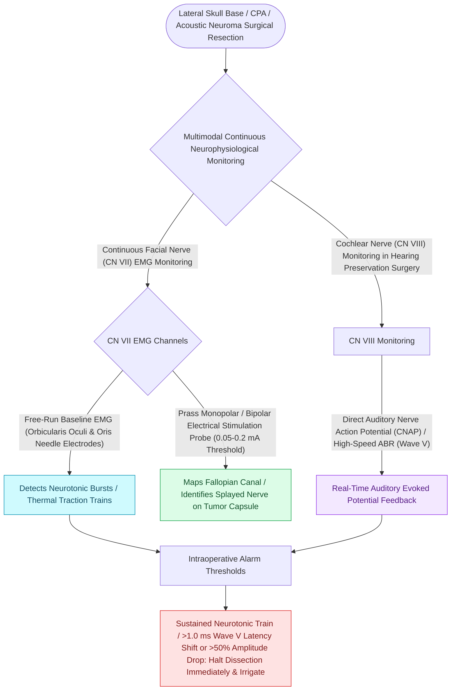

# Intraoperative facial nerve and cochlear nerve monitoring minimize cranial nerve morbidity in skull base surgery

## Active Recall

> [!question]- What post-resection facial nerve stimulation threshold and amplitude predict excellent ([[House-Brackmann grading system stratifies facial nerve function from Grade I normal to Grade VI total paralysis|HB Grade]] I–II) long-term recovery?
> *Answer / Clinical Rationale*: A stimulation threshold of **$\le 0.05\text{–}0.1\text{ mA}$** with a CMAP amplitude **$>500\ \mu\text{V}$** at the brainstem root entry zone.

> [!question]- What topical vasodilator is applied to the internal auditory artery when BAEP Wave V deteriorates intraoperatively?
> *Answer / Clinical Rationale*: **Papaverine** (or nimodipine).

## Core Clinical & Mechanistic Principles
Continuous multimodality intraoperative neurophysiological monitoring during lateral skull base surgery is mandatory to preserve facial function and hearing:
- **Facial Nerve (CN VII) Monitoring Modalities**:
  1. **Free-Running (Spontaneous) Electromyography (EMG)**:
     - Subdermal needle electrodes placed in the orbicularis oculi and orbicularis oris.
     - *Neurotonic Discharges*: "Train" activity and sustained burst firing alert the surgeon to mechanical traction, thermal energy, or ischemia.
  2. **Triggered (Stimulated) EMG**:
     - Handheld monopolar probe ($0.05\text{–}0.2\text{ mA}$) maps the course of the nerve on the tumor capsule.
     - **Post-Resection Prognostic Metric**: A proximal stimulation threshold of **$\le 0.05\text{–}0.1\text{ mA}$** with a CMAP amplitude **$>500\ \mu\text{V}$** at the brainstem root entry zone predicts **$>90\text{–}95\%$ long-term House-Brackmann Grade I or II recovery**.
- **Cochlear Nerve (CN VIII) Monitoring**:
  - **Brainstem Auditory Evoked Potentials (BAEP / ABR)**: Continuous Wave V tracking ([[Wave I of the ABR arises from the distal auditory nerve while wave V originates at the lateral lemniscus and inferior colliculus|auditory brainstem response origins]]); alert at $>1.0\text{ ms}$ latency shift or $>50\%$ amplitude drop.
  - **Direct Cochlear Nerve Action Potential (CNAP)**: Near-field recording electrode placed on the proximal nerve stump; gives instantaneous real-time feedback with zero averaging delay.

### Surgical Technique & Critical Safety Checks
- **Chemical Vasospasm Rescue**: If BAEP Wave V deteriorates during dissection, pause surgery and apply **warm saline and topical Papaverine** to relieve vasospasm of the labyrinthine artery.

## Connected Concepts & Graph Traversal
- **ABR Monitoring Baselines**: [[Auditory brainstem response waves I through V identify retrocochlear and brainstem pathology|ABR Wave Peak Latencies]]
- **Translabyrinthine Surgery**: [[The translabyrinthine approach provides direct exposure of the internal auditory canal with complete hearing sacrifice|Translabyrinthine Monitoring]]
- **Retrosigmoid Hearing Preservation**: [[The retrosigmoid suboccipital approach allows hearing preservation for small to medium vestibular schwannomas|Retrosigmoid Cranial Nerve Monitoring]]
- **Facial Schwannoma Surgery**: [[Facial nerve schwannomas present with slow progressive paralysis or facial twitching along the Fallopian canal|Facial Schwannoma Resection]]
- **Electrodiagnostic ENoG Testing**: [[Electroneuronography showing greater than ninety percent degeneration within fourteen days indicates severe facial nerve axonal injury|ENoG Potentials]]
