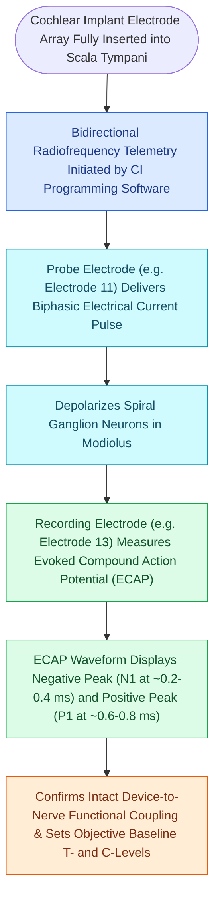

# Intraoperative neural response telemetry NRT confirms auditory nerve fiber stimulation

## Active Recall

> [!question]- What anatomical structure generates the Electrically Evoked Compound Action Potential (ECAP) measured by NRT?
> *Answer / Clinical Rationale*: The **spiral ganglion cells and distal axons of the auditory nerve (CN VIII)**.

> [!question]- What are the two primary peaks of an ECAP waveform and their latencies?
> *Answer / Clinical Rationale*: A negative peak **N1 at $0.2\text{–}0.4\text{ ms}$** and a positive peak **P2 at $0.6\text{–}0.8\text{ ms}$**.

## Core Clinical & Mechanistic Principles
**Neural Response Telemetry (NRT)** / **Electrically Evoked Compound Action Potential (ECAP)** testing provides objective, intraoperative verification of auditory nerve activation:
- **Biophysical Mechanism**:
  - The [[Cochlear implant candidacy criteria include severe to profound bilateral sensorineural hearing loss|cochlear implant]] delivers a brief electrical pulse through a stimulating electrode in the array.
  - A neighboring recording electrode on the same array measures the synchronous electrical action potential generated by the firing **spiral ganglion cells / auditory nerve fibers**.
  - The telemetry data is transmitted wirelessly across the skin back to the programming system.
- **The ECAP Waveform**:
  - Characterized by a negative peak (**N1**) occurring at **$\approx 0.2\text{–}0.4\text{ ms}$**, followed by a positive peak (**P2**) at **$\approx 0.6\text{–}0.8\text{ ms}$**.
- **Clinical Utility in the Operating Room**:
  1. **Confirms Device Function**: Verifies that the internal receiver-stimulator and all individual electrode contacts are functional.
  2. **Confirms Neural Responsiveness**: Verifies physiological activation of the auditory nerve in infants and uncooperative patients under general anesthesia.
  3. **Guides Initial Fitting**: ECAP thresholds correlate with behavioral Comfort (C-levels) and Threshold (T-levels) for postoperative map creation.

### Surgical Technique & Critical Safety Checks
- **Electrode Impedance Telemetry**: Measures resistance ($0.5\text{–}20\text{ k}\Omega$); identifies open circuits (broken wire / high impedance) or short circuits (touching contacts / low impedance).

## Connected Concepts & Graph Traversal
- **Cochlear Implant Candidacy**: [[Cochlear implant candidacy criteria include severe to profound bilateral sensorineural hearing loss|CI Candidacy]]
- **Scala Tympani Insertion**: [[Scala tympani electrode array placement preserves residual hearing and avoids basilar membrane translocation|Scala Tympani Array]]
- **Round Window Insertion Craft**: [[Round window and extended round window insertions minimize intracochlear acoustic trauma|Round Window Insertion]]
- **ABR Electrophysiological Wave V**: [[Wave I of the ABR arises from the distal auditory nerve while wave V originates at the lateral lemniscus and inferior colliculus|ABR Evoked Potentials]]
- **Bimodal Stimulation Combinations**: [[Bimodal stimulation combines a contralateral hearing aid with an ipsilateral cochlear implant|Bimodal Stimulation]]
