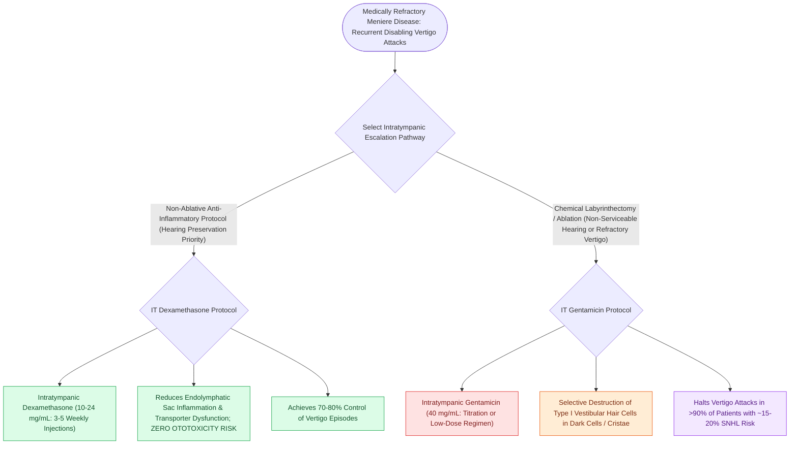

# Intratympanic dexamethasone and gentamicin provide non-ablative and chemical ablative control of Meniere vertigo

## Active Recall

> [!question]- What specific inner ear cells are selectively damaged by intratympanic gentamicin?
> *Answer / Clinical Rationale*: **Type I vestibular sensory hair cells** in the ampullae of the semicircular canals.

> [!question]- What is the risk of sensorineural hearing loss associated with titrated low-dose intratympanic gentamicin?
> *Answer / Clinical Rationale*: Approximately **$10\text{ to }20\%$**.

## Core Clinical & Mechanistic Principles
When [[Meniere disease is characterized by episodic vertigo, fluctuating low-frequency SNHL, tinnitus, and aural fullness|Meniere]]'s disease fails first-line medical therapy, **intratympanic (IT) injections** deliver high drug concentrations across the round window membrane directly into the inner ear:
- **Intratympanic Dexamethasone (Non-Ablative Therapy)**:
  - *Indication*: First-line interventional therapy; preferred when hearing preservation is paramount.
  - *Mechanism*: Upregulates $\text{Na}^+/\text{K}^+$-ATPase in the [[The stria vascularis generates the endocochlear potential of positive eighty millivolts|stria vascularis]], reduces local inner ear inflammation and immune-mediated hydrops.
  - *Protocol*: Dexamethasone ($10\text{–}24\text{ mg/mL}$); $0.4\text{–}0.8\text{ mL}$ injected into middle ear; patient maintains head turned $45^\circ$ for 30 minutes without swallowing.
  - *Efficacy*: Controls vertigo in $60\text{–}70\%$ of patients with **zero risk of [[Platinum and aminoglycoside ototoxicity mandates baseline and serial high-frequency audiometric monitoring|ototoxicity]]**.
- **Intratympanic Gentamicin (Chemical Vestibular Ablation)**:
  - *Indication*: Severe, refractory vertigo in patients with unserviceable hearing or failing steroid therapy.
  - *Mechanism*: Aminoglycoside with selective **vestibulotoxicity for Type I vestibular hair cells** in the cristae ampullares.
  - *Protocol (Low-Dose Titration)*: IT Gentamicin ($40\text{ mg/mL}$); single injection; observe 4 weeks; repeat only if vertigo recurs.
  - *Efficacy*: Vertigo control in **$>85\text{–}90\%$**; **risk of sensorineural hearing loss is $10\text{–}20\%$**.

### Surgical Technique & Critical Safety Checks
- **Candidacy Warning**: IT Gentamicin is contraindicated in an only hearing ear or bilateral Meniere disease (causes [[Rotary chair testing assesses low-frequency bilateral vestibular hypofunction and central compensation|bilateral vestibular loss]] / [[Bilateral vestibulopathy causes oscillopsia and dark-dependent imbalance from bilateral hair cell loss|oscillopsia]]).

## Connected Concepts & Graph Traversal
- **Hydrops Pathophysiology**: [[Endolymphatic hydrops results from impaired resorption of endolymph within the endolymphatic sac|Endolymphatic Hydrops]]
- **Clinical Diagnostic Criteria**: [[Meniere disease is characterized by episodic vertigo, fluctuating low-frequency SNHL, tinnitus, and aural fullness|Meniere Disease]]
- **First-Line Medical Therapy**: [[Low-sodium diet, hydrochlorothiazide, and betahistine form the first-line medical therapy for Meniere disease|Medical Osmotic Therapy]]
- **Endolymphatic Sac Shunt Surgery**: [[Endolymphatic sac decompression and shunt surgery alleviate hydrops while preserving auditory function|Endolymphatic Sac Shunting]]
- **Bilateral Vestibulopathy Risk**: [[Bilateral vestibulopathy causes oscillopsia and dark-dependent imbalance from bilateral hair cell loss|Gentamicin Ototoxicity Warning]]
