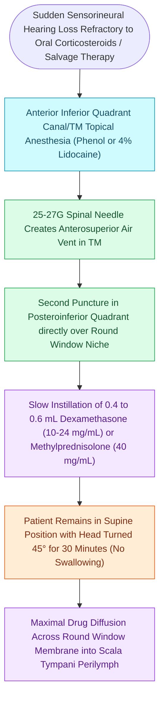

# Intratympanic dexamethasone injection delivers high local cochlear drug concentrations for sudden sensorineural hearing loss salvage

## Active Recall

> [!question]- Why must intratympanic steroid solutions be warmed to body temperature ($37^\circ\text{C}$) prior to middle ear instillation?
> *Answer / Clinical Rationale*: Instilling cold or room-temperature fluid into the middle ear stimulates caloric endolymph convection currents within the lateral semicircular canal, inducing acute, violent caloric vertigo, rotatory nystagmus, nausea, and severe patient distress.

> [!question]- What anatomical barrier in the round window niche can impede steroid diffusion during intratympanic injection?
> *Answer / Clinical Rationale*: A **false round window membrane (pseudomembrane)** or thick mucosal web across the round window niche can obstruct the injected drug solution, preventing direct contact with the true round window membrane and severely attenuating perilymph drug diffusion.

## Core Clinical & Mechanistic Principles
In [[Idiopathic sudden sensorineural hearing loss requires prompt systemic corticosteroids and intratympanic salvage injection|idiopathic sudden sensorineural hearing loss (SSNHL)]], systemic high-dose oral corticosteroids (e.g., prednisone 60 mg/day for 10–14 days) are often limited by systemic adverse effects (hyperglycemia in diabetics, psychiatric disturbances, peptic ulceration, and avascular necrosis of the hip) and the restrictive blood-labyrinth barrier. Intratympanic (IT) steroid perfusion bypasses the systemic circulation, instilling concentrated corticosteroid solution (dexamethasone 10–24 mg/mL or methylprednisolone 40 mg/mL) directly into the middle ear. The medication diffuses across the semipermeable **round window membrane (RWM)** into the scala tympani of the cochlea, generating perilymph drug concentrations up to 100- to 1000-fold higher than those achievable with systemic delivery while maintaining near-zero systemic serum levels.

### Procedural Technique & Execution Nuances
1. **Patient Positioning & Topical Anesthesia**:
   - Position the patient supine with the head rotated $45^\circ$ toward the contralateral ear.
   - Under binocular microscopy, apply a pinpoint drop of 88% phenol solution or topical 4% lidocaine to the posteroinferior quadrant of the tympanic membrane to achieve instantaneous local anesthesia and blanching.
2. **Double-Puncture Micro-Injection**:
   - Using a 27-gauge or 30-gauge long spinal needle attached to a 1 mL tuberculin syringe filled with warmed ($37^\circ\text{C}$) dexamethasone solution:
   - *Anterolateral Vent Hole (Optional)*: Make a small puncture in the anterosuperior quadrant to allow air egress and prevent middle ear barotrauma.
   - *Active Injection Site*: Pierce the anesthetized posteroinferior quadrant and slowly inject 0.4 to 0.8 mL of dexamethasone until the middle ear fills completely and a clear fluid meniscus is visible behind the tympanic membrane.
## References
1. Chandrasekhar, S.S., Tsai Do, B.S., Schwartz, S.R., et al. (2019). Clinical Practice Guideline: Sudden Hearing Loss (Update). *Otolaryngol Head Neck Surg*, 161(1_suppl):S1-S45.
2. Bird, P.A., et al. (2011). Intratympanic versus intravenous delivery of methylprednisolone to perilymph. *Otol Neurotol*, 32(6):933-936.
3. Rauch, S.D., et al. (2011). Oral vs intratympanic corticosteroid therapy for idiopathic sudden sensorineural hearing loss: A randomized trial. *JAMA*, 305(20):2071-2079.

## Connected Concepts & Graph Traversal
- **Physiological Basis**: [[Idiopathic sudden sensorineural hearing loss requires prompt systemic corticosteroids and intratympanic salvage injection|Idiopathic SSNHL Guidelines]]
- **Auditory Rehabilitation**: [[Cochlear implant candidacy criteria include severe to profound bilateral sensorineural hearing loss|Cochlear Implantation Candidacy]]
- **Differential Pathology**: [[Koos grading system classifies vestibular schwannomas from Stage I intracanalicular to Stage IV brainstem compression|Vestibular Schwannoma]]
- **Vestibular Acute Loss**: [[Labyrinthitis presents with acute prolonged vertigo combined with sudden sensorineural hearing loss|Acute Labyrinthitis]]
- **Tympanic Membrane Safety**: [[Traumatic tympanic membrane perforations heal spontaneously in the majority of cases without early surgery|Traumatic TM Perforation]]
