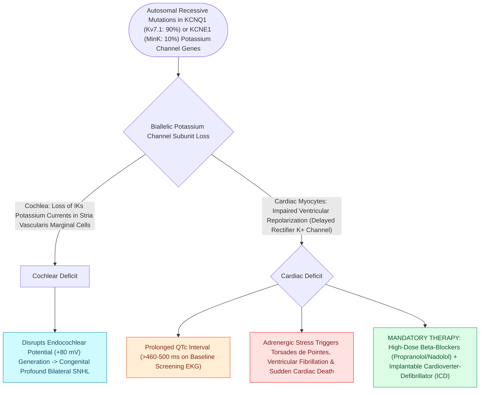

# Jervell and Lange-Nielsen syndrome combines congenital profound sensorineural hearing loss with a prolonged QT interval

## Active Recall

> [!question]- What is the genetic inheritance and molecular ion channel defect in Jervell and Lange-Nielsen syndrome (JLNS)?
> *Answer / Clinical Rationale*: JLNS is an autosomal recessive cardioauditory channelopathy caused by homozygous or compound heterozygous mutations in **KCNQ1** ($90\%$, chromosome 11p15.5) or **KCNE1** ($10\%$, chromosome 21q22.1). These genes encode the alpha and beta subunits of the **slowly activating delayed rectifier potassium channel ($I_{Ks}$)**, essential for endolymph $K^+$ secretion in the inner ear stria vascularis and phase 3 repolarization of myocardial ventricular myocytes.

> [!question]- What is the fatal cardiac manifestation of JLNS, and what ECG metric defines the diagnosis?
> *Answer / Clinical Rationale*: Defective cardiac repolarization produces severe **prolongation of the corrected QT interval (QTc $>500\text{ ms}$, often $>550\text{ ms}$)**. This predisposes to life-threatening syncopal attacks triggered by emotional stress, auditory fright, or exercise, culminating in **polymorphic ventricular tachycardia (Torsades de Pointes), ventricular fibrillation, and sudden cardiac death** in $>50\%$ of untreated children before age 15.

> [!question]- Why is a screening electrocardiogram (ECG) a mandatory clinical standard in all infants with bilateral congenital sensorineural hearing loss?
> *Answer / Clinical Rationale*: Because syncopal episodes may be misdiagnosed as simple seizures or temper tantrums, a **screening 12-lead ECG is mandatory** for any infant presenting with unexplained severe-to-profound bilateral SNHL. Immediate identification allows prophylactic administration of **high-dose beta-blockers (propranolol/nadolol)**, avoidance of QT-prolonging drugs, and implantation of an **implantable cardioverter-defibrillator (ICD)** before a fatal arrhythmia occurs.

## Core Clinical & Mechanistic Principles
[[Syndromic pediatric sensorineural hearing loss encompasses Pendred, Usher, Waardenburg, and Jervell and Lange-Nielsen syndromes|Jervell and Lange-Nielsen]] syndrome is an ultra-high-risk cardioauditory syndrome affecting $1\text{ in }200,000\text{ to }400,000$ live births:

### Cardiology Co-Management & Anesthetic Safeguards
1. **Cardiac Pharmacotherapy**:
   - First-line therapy: High-dose non-selective beta-blockers (Nadolol $1\text{–}2\text{ mg/kg/day}$ or Propranolol).
   - High-risk patients (QTc $>550\text{ ms}$, prior syncope, or cardiac arrest): Mandatory **Implantable Cardioverter-Defibrillator (ICD)** placement and left cardiac sympathetic denervation (LCSD).
2. **Cochlear Implantation Precautions**:
   - Cochlear implantation is highly effective for auditory restoration but carries extreme intraoperative anesthetic risks.
   - Requires continuous 12-lead cardiac telemetry, absolute avoidance of QT-prolonging anesthetics and antiemetics (e.g., ondansetron, droperidol, volatile agents with high arrhythmogenic potential), maintaining normal serum potassium and magnesium, and having external defibrillator pads placed prior to induction.

## Connected Concepts & Graph Traversal
- **Endocochlear Potential Generation**: [[The stria vascularis generates the endocochlear potential of positive eighty millivolts|Stria Vascularis Potassium Transport]]
- **🔗 Syndromic SNHL Overview (Pediatrics)**: [[Syndromic pediatric sensorineural hearing loss encompasses Pendred, Usher, Waardenburg, and Jervell and Lange-Nielsen syndromes|Syndromic SNHL Overview]]
- **Cochlear Implantation**: [[Cochlear implant candidacy criteria include severe to profound bilateral sensorineural hearing loss|Cochlear Implantation in JLNS]]
- **Syndromic Differential**: [[Usher syndrome combines congenital sensorineural hearing loss with progressive retinitis pigmentosa and vestibular dysfunction|Usher vs JLNS Distinction]]
- **Anatomical Foundation**: [[Alport syndrome manifests with progressive sensorineural hearing loss, anterior lenticonus, and progressive glomerulonephritis|Alport Syndrome]]
