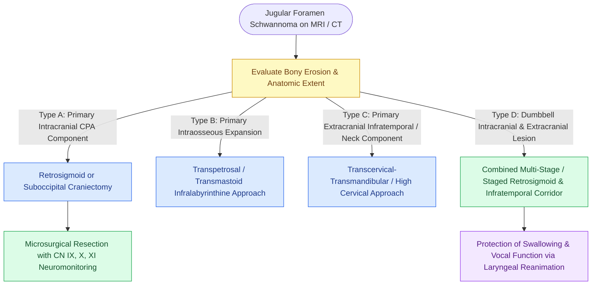

# Jugular foramen schwannomas are classified by the Kaye-Pellet system into intracranial, intraforaminal, and extracranial dumbbell lesions managed with tailored skull base approaches

## Active Recall

> [!question]- How does the Kaye-Pellet classification stratify jugular foramen schwannomas, and how does each subtype guide surgical approach selection?
> *Answer / Clinical Rationale*: The Kaye-Pellet (Pellet-Gormley) classification divides jugular foramen schwannomas into four types: **Type A** tumors are primarily intracranial/cisternal with minimal foramen extension, approached via a retrosigmoid/suboccipital craniectomy; **Type B** tumors are primarily intraosseous within the jugular foramen, approached via a transmastoid/transjugular or infralabyrinthine route; **Type C** tumors are primarily extracranial in the infratemporal fossa or upper neck, approached via a transcervical approach; and **Type D** tumors are multi-compartmental "dumbbell" lesions extending both intracranially and extracranially, requiring a combined staged or simultaneous retrosigmoid-transcervical/transpetrosal skull base resection.
>
> [!question]- What radiographic features on CT and MRI reliably differentiate a jugular foramen schwannoma from a glomus jugulare paraganglioma?
> *Answer / Clinical Rationale*: On high-resolution temporal bone CT, a schwannoma produces smooth, well-corticated scalloping and enlargement of the jugular foramen margin without bone destruction; in contrast, a glomus jugulare causes permeative, moth-eaten osteolytic destruction of the carotico-jugular spine and petrous bone. On MRI, schwannomas are sharply circumscribed, hypointense on T1, hyperintense on T2, and enhance uniformly (or with cystic degeneration) without flow voids; glomus jugulare tumors exhibit a pathognomonic "salt-and-pepper" appearance with abundant serpiginous flow voids on both T1 and T2 sequences.

## Core Clinical & Mechanistic Principles

Jugular foramen schwannomas are rare, slow-growing benign nerve sheath tumors arising from Schwann cells of the glossopharyngeal (CN IX), vagus (CN X), or spinal accessory (CN XI) nerves. Accounting for approximately 3% to 4% of all intracranial schwannomas, they represent the second most common non-vascular neoplasm of the jugular foramen. Because clinical presentation is often insidious, patients frequently present with large tumors that have already compromised the lower cranial nerves, manifesting with hoarseness, dysphagia, aspiration, loss of the gag reflex, trapezius weakness, or pulsatile tinnitus.

Distinguishing jugular foramen schwannomas from hypervascular [[Jugular paragangliomas arise from the glomus body in the adventitia of the jugular bulb|jugular paragangliomas]] is essential to avoid catastrophic intraoperative hemorrhage and inappropriate preoperative embolization. Schwannomas lack the hypervascular glomus architecture, demonstrate no arteriovenous shunting on catheter angiography, and do not invade the intraluminal internal jugular vein endothelium. Preoperative functional evaluation must document baseline [[Cranial nerve polyneuropathies of the skull base are localized by specific anatomical foramen involvement|lower cranial nerve polyneuropathies]] using flexible fiberoptic laryngoscopy, videofluoroscopic swallow studies, and vocal fold position assessment.

The classic **Kaye-Pellet Classification** (refined by Pellet and Gormley) dictates surgical management:
- **Type A**: Primary cisternal/CPA tumor with minimal enlargement of the jugular foramen.
- **Type B**: Primary intraosseous tumor centered within the jugular foramen with bony expansion.
- **Type C**: Primary extracranial tumor extending beneath the skull base into the parapharyngeal space.
- **Type D**: Dumbbell lesion with substantial intracranial CPA and extracranial cervical components separated by a constricted intraforaminal waist.

### Surgical Strategy & Lower Cranial Nerve Preservation

1. **Intraoperative Neurophysiological Monitoring**: Continuous EMG monitoring of the soft palate (CN IX), vocalis muscle via an endotracheal tube with integrated surface electrodes (CN X), and the trapezius muscle (CN XI) is mandatory, along with facial nerve (CN VII) monitoring.
2. **Surgical Corridors**:
   - For Type A: A standard retrosigmoid suboccipital craniectomy exposes the cisternal tumor component.
   - For Type B and D: A transjugular / transmastoid-infralabyrinthine approach is combined with high cervical neck dissection. The internal jugular vein is ligated in the upper neck, and the sigmoid sinus is extraluminally packed or ligated distal to the Labbé junction.
   - For Type C: A transcervical-transmandibular or preauricular subtemporal approach avoids mastoidectomy entirely.
3. **Dissection Plane**: Because schwannomas expand eccentrically within the nerve perineurium, meticulous microsurgical internal debulking with an ultrasonic aspirator is performed before peeling the tumor capsule away from functioning adjacent fascicles.
4. **Postoperative Airway & Swallowing Protection**: In patients with new-onset postoperative vagal paralysis, immediate bedside laryngoscopy is conducted. Vocal fold injection medialization (hyaluronic acid or carboxymethylcellulose) and temporary nasogastric tube feeding prevent fatal aspiration pneumonia.

## Connected Concepts & Graph Traversal
- **Classification System**: [[Fisch classification categorizes temporal bone and skull base paragangliomas from Class A to Class D]]
- **Histopathological Basis**: [[Vestibular schwannomas arise from the Schwann cell sheath of the inferior or superior vestibular nerve]]
- **Surgical Approach**: [[Fisch infratemporal fossa approach Type A mobilizes the facial nerve and exposes the jugular foramen]]
- **Anatomical Differential**: [[Jugular paragangliomas arise from the glomus body in the adventitia of the jugular bulb]]
- **Cranial Nerve Differential**: [[Facial nerve schwannomas present with slow progressive paralysis or facial twitching along the Fallopian canal]]
- **🔗 Diagnostic Imaging (Head & Neck) (Head and Neck)**: [[Jugular foramen masses differentiate into paraganglioma, schwannoma, and meningioma based on bone erosion patterns and MRI signal characteristics|Jugular Foramen Mass Differential]]
