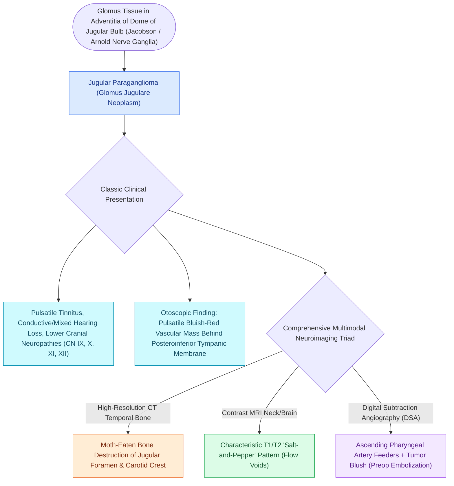

# Jugular paragangliomas arise from the glomus body in the adventitia of the jugular bulb

## Active Recall

> [!question]- What is the anatomical site of origin for a glomus jugulare tumor?
> *Answer / Clinical Rationale*: The **glomus bodies within the adventitia / dome of the jugular bulb** (associated with Arnold's and Jacobson's nerves).

> [!question]- What genetic mutation family is strongly associated with familial, bilateral, and multifocal paragangliomas?
> *Answer / Clinical Rationale*: Mutations in the **Succinate Dehydrogenase (SDH) complex genes** (*SDHD, SDHB, SDHC*).

## Core Clinical & Mechanistic Principles
**Temporal bone paragangliomas (Glomus tumors)** are highly vascular neuroendocrine neoplasms arising from paraganglia (glomus bodies / neural crest cells) associated with the autonomic nervous system:
- **Two Primary Temporal Bone Types**:
  1. **Glomus Tympanicum (Tympanic Paraganglioma)**: Arises from glomus bodies along **Jacobson's nerve (tympanic branch of CN IX)** on the promontory. Confined to middle ear.
  2. **Glomus Jugulare (Jugular Paraganglioma)**: Arises from glomus bodies in the **dome / adventitia of the jugular bulb** along **Arnold's nerve (auricular branch of CN X)** or Jacobson's nerve.
- **Clinical Presentation**:
  - **Pulsatile Tinnitus ($>80\%$)**: Synchronous with the arterial pulse; abolished by gentle pressure over the ipsilateral common carotid artery.
  - Conductive or mixed hearing loss.
  - **Phelps / Brown Sign**: Reddish-blue, hypervascular, pulsating mass visible behind the intact lower tympanic membrane; blushes under positive pneumatic otoscopy.
  - **Lower Cranial Nerve Palsies (Vernier Syndrome)**: Dysphagia, hoarseness, shoulder weakness, and tongue deviation from CN IX, X, XI, and XII involvement in the jugular foramen.

### Surgical Technique & Critical Safety Checks
- **Genetic Screening**: All patients must undergo screening for **Succinate Dehydrogenase (*SDHD, SDHB, SDHC*) mutations** (linked to familial, multifocal, and malignant [[Fisch classification categorizes temporal bone and skull base paragangliomas from Class A to Class D|paragangliomas]]).
- **Urinary Metanephrines**: Screen 24-hr urine/plasma free metanephrines to rule out functional catecholamine secretion ($1\text{–}3\%$).

## Connected Concepts & Graph Traversal
- **Fisch Staging Classification**: [[Fisch classification categorizes temporal bone and skull base paragangliomas from Class A to Class D|Fisch Classification]]
- **Infratemporal Fossa Type A**: [[Fisch infratemporal fossa approach Type A mobilizes the facial nerve and exposes the jugular foramen|Infratemporal Fossa Type A]]
- **Preoperative Embolization**: [[Preoperative embolization reduces intraoperative blood loss in hypervascular glomus jugulare tumors|Angiographic Embolization]]
- **Pulsatile Tinnitus Evaluation**: [[Pulsatile tinnitus is differentiated into arterial and venous etiologies by auscultation, jugular compression, and targeted vascular imaging|Pulsatile Tinnitus Workup]]
- **Lower Cranial Polyneuropathies**: [[Cranial nerve polyneuropathies of the skull base are localized by specific anatomical foramen involvement|Jugular Foramen Syndromes]]
- **Schwannoma Differential Diagnosis**: [[Jugular foramen schwannomas are classified by the Kaye-Pellet system into intracranial, intraforaminal, and extracranial dumbbell lesions managed with tailored skull base approaches|Kaye-Pellet Jugular Foramen Schwannomas]]
