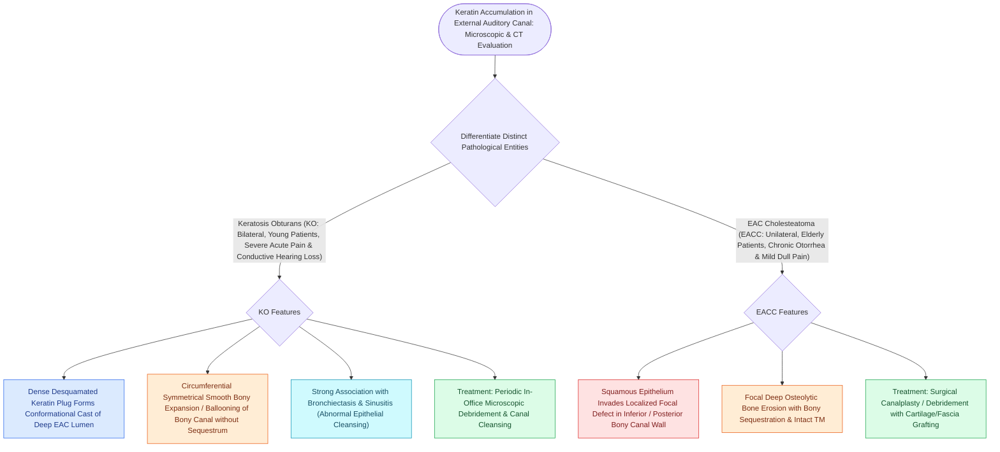

# Keratosis obturans and external auditory canal cholesteatoma differ in clinical presentation, bone erosion patterns, and systemic associations

## Active Recall

> [!question]- What are the key differentiating clinical features (age, laterality, symptoms, and pulmonary association) between Keratosis Obturans (KO) and External Auditory Canal Cholesteatoma (EACC)?
> *Answer / Clinical Rationale*: - **Keratosis Obturans (KO)**: Affects **younger patients ($<40\text{ years}$)**, is typically **bilateral ($>50\%$)**, presents with **severe acute otalgia and significant conductive hearing loss**, and is strongly associated with **bronchiectasis and chronic rhinosinusitis**. - **EAC Cholesteatoma (EACC)**: Affects **older patients ($>60\text{ years}$)**, is almost exclusively **unilateral**, presents with **chronic painless/mild otorrhea and normal hearing**, and has **no pulmonary or sinus associations**.

> [!question]- How do the patterns of bony external auditory canal remodeling and histopathology differ between KO and EACC?
> *Answer / Clinical Rationale*: - **KO**: Exhibits **generalized, smooth circumferential bony widening (ballooning) of the entire deep osseous canal** due to circumferential compression by concentric laminated keratin plugs, with an **intact subepithelial connective tissue layer and no osteitis or bone necrosis**. - **EACC**: Exhibits **localized, focal ulceration and invasion of squamous epithelium into a focal bony defect (usually the canal floor or posterior-inferior wall)**, with **active osteitis, focal bone necrosis, and sequestrum formation (dead bone)** covered by localized keratin debris.

> [!question]- What is the definitive management approach for Keratosis Obturans versus EAC Cholesteatoma?
> *Answer / Clinical Rationale*: - **KO**: Managed non-surgically with **meticulous microscopic aural debridement under anesthesia / in clinic**, keratolytic/steroid drops, and regular periodic cleaning every 3–6 months (recurrence is common without surgery). - **EACC**: Mild localized disease may be cleared in office; however, progressive or deep bony invasion mandates **surgical canaloplasty, debridement of osteitic bone down to healthy bleeding bone, and fascia/cartilage grafting or mastoidectomy** to prevent facial nerve or jugular bulb erosion.

## Core Clinical & Mechanistic Principles

The [[The University of Pittsburgh staging system classifies external auditory canal carcinoma from T1 canal limited to T4 medial wall and facial paralysis|external]] auditory canal maintains an active self-cleaning mechanism driven by lateral **radial migration of stratum corneum** from the umbo of the tympanic membrane to the cartilaginous meatus. Disruptions of this epithelial conveyor belt produce two distinct clinical entities:

### Pathophysiological Mechanisms
- **Keratosis Obturans**: Results from abnormal hyperactive epithelial desquamation and failure of the lateral migration conveyor mechanism, leading to concentric layers of non-inflamed keratin ("onion-skin" cast) that physically expand the bony canal walls through bone remodeling.
- **EAC Cholesteatoma**: Results from localized periosteal trauma, chronic inflammation, or previous radiation where migrating squamous epithelium directly invades the subepithelial space and periosteum, activating osteoclasts that bore into the tympanic bone.

## Connected Concepts & Graph Traversal
- **Primary Acquired Cholesteatoma**: [[Primary acquired cholesteatoma arises from retraction pocket invagination of the pars flaccida into Prussak space|Middle Ear Cholesteatoma Comparison]]
- **Tympanometry & Ear Canal Volume**: [[Tympanometry classifies middle ear compliance and pressure into Jerger Types A, As, Ad, B, and C|ECV Measurement in Canal Occlusion]]
- **EAC Carcinoma Staging**: [[The University of Pittsburgh staging system classifies external auditory canal carcinoma from T1 canal limited to T4 medial wall and facial paralysis|EAC Carcinoma Differential]]
- **Acute Otitis Externa**: [[Acute otitis externa is managed with topical antimicrobial-steroid drops and aural debridement|Acute Otitis Externa]]
- **Ear Foreign Bodies**: [[External auditory canal foreign bodies require atraumatic extraction under microscopic guidance to protect the tympanic membrane|EAC Debridement Technique]]
- **Malignant Otitis Externa**: [[Malignant necrotizing otitis externa is an invasive pseudomonal skull base osteomyelitis in elderly diabetic patients|Malignant Otitis Externa]]
