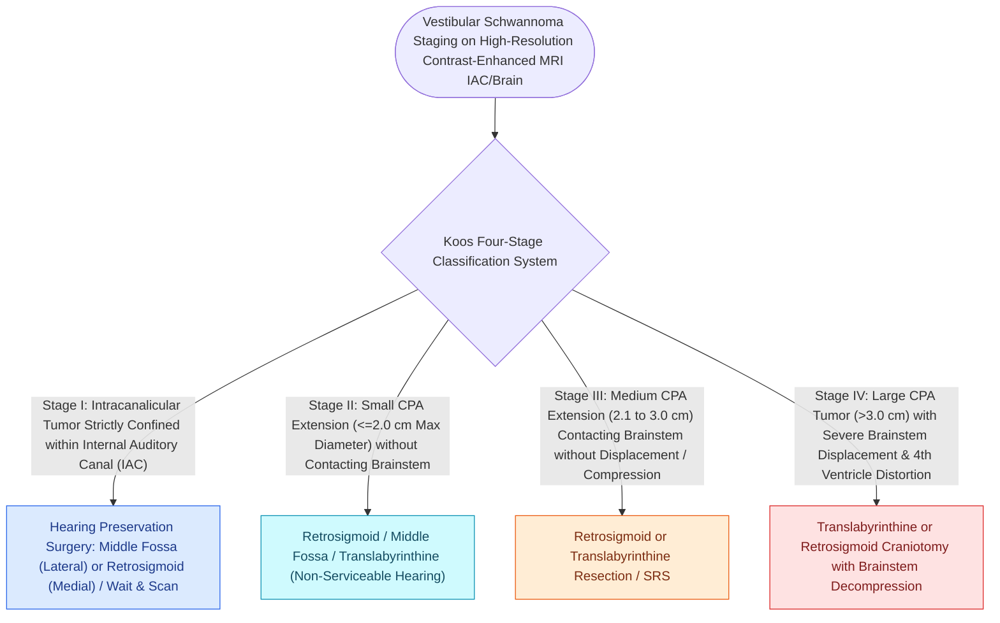

# Koos grading system classifies vestibular schwannomas from Stage I intracanalicular to Stage IV brainstem compression

## Active Recall

> [!question]- What defines a Koos Stage III vs. Koos Stage IV vestibular schwannoma?
> *Answer / Clinical Rationale*: **Koos III touches the brainstem without compression**; **Koos IV causes significant displacement and compression of the brainstem and fourth ventricle**.

> [!question]- What is the maximal size threshold for a Koos Stage II vestibular schwannoma?
> *Answer / Clinical Rationale*: A maximal cisternal diameter of **$\le 2.0\text{ cm}$** (with no brainstem contact).

## Core Clinical & Mechanistic Principles
The **Koos Classification System** stratifies [[Vestibular schwannomas arise from the Schwann cell sheath of the inferior or superior vestibular nerve|vestibular schwannomas]] into four progressive anatomical stages based on size and relationship to the cerebellopontine angle (CPA) and brainstem:
- **The Four Koos Stages**:
  - **Koos Stage I (Intracanalicular)**: Tumor is confined entirely within the **internal auditory canal (IAC)**; no cisternal CPA extension ($<1.0\text{ cm}$).
  - **Koos Stage II (Small CPA Tumor)**: Tumor extends out of the porus acusticus into the cerebellopontine angle cistern, measuring **$\le 2.0\text{ cm}$ in maximal diameter**; **NO contact with the brainstem**.
  - **Koos Stage III (Medium CPA Tumor)**: Tumor measures **$\le 3.0\text{ cm}$ in maximal diameter**; **touches the brainstem WITHOUT displacing or compressing it**.
  - **Koos Stage IV (Large / Giant CPA Tumor)**: Tumor measures **$>3.0\text{ cm}$**; causes **marked displacement, compression, and indentation of the brainstem and fourth ventricle**, with potential obstructive hydrocephalus.

### Surgical Technique & Critical Safety Checks
- **Treatment Strategy by Koos Stage**:
  - *Koos I/II*: Options include active MRI surveillance ("wait-and-scan"), stereotactic radiosurgery (Gamma Knife / CyberKnife, $12\text{–}13\text{ Gy}$), or hearing preservation microsurgery (Retrosigmoid / MCF).
  - *Koos III/IV*: Primary surgical resection ([[The translabyrinthine approach provides direct exposure of the internal auditory canal with complete hearing sacrifice|Translabyrinthine]] or Retrosigmoid) to relieve brainstem compression and prevent hydrocephalus.

## Connected Concepts & Graph Traversal
- **Schwannoma Cell Origin**: [[Vestibular schwannomas arise from the Schwann cell sheath of the inferior or superior vestibular nerve|Vestibular Schwannoma Pathophysiology]]
- **Translabyrinthine Skull Base Approach**: [[The translabyrinthine approach provides direct exposure of the internal auditory canal with complete hearing sacrifice|Translabyrinthine Approach]]
- **Retrosigmoid Hearing Preservation Approach**: [[The retrosigmoid suboccipital approach allows hearing preservation for small to medium vestibular schwannomas|Retrosigmoid Approach]]
- **Middle Fossa Intracanalicular Approach**: [[The middle cranial fossa approach provides hearing preservation for intracanalicular schwannomas with lateral fundus extension|Middle Cranial Fossa Approach]]
- **Diagnostic ABR Latencies**: [[Auditory brainstem response waves I through V identify retrocochlear and brainstem pathology|ABR Wave I-V Interpeak Latency]]
