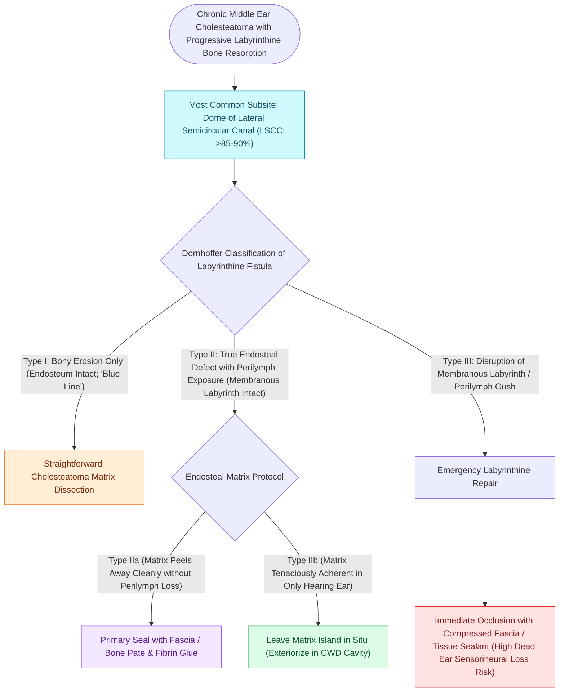

# Labyrinthine fistula from cholesteatoma erosions most frequently involves the lateral semicircular canal

## Active Recall

> [!question]- Which semicircular canal is most frequently eroded by cholesteatoma to cause a labyrinthine fistula?
> *Answer / Clinical Rationale*: The **lateral (horizontal) semicircular canal (LSCC)** (in $>80\text{–}90\%$ of cases).

> [!question]- What is a positive fistula sign (Hennebert sign) on pneumatic otoscopy?
> *Answer / Clinical Rationale*: Induction of **vertigo and nystagmus** upon applying positive or negative pneumatic pressure to the external auditory canal.

## Core Clinical & Mechanistic Principles
A **labyrinthine fistula** occurs in $5\text{–}10\%$ of chronic [[Primary acquired cholesteatoma arises from retraction pocket invagination of the pars flaccida into Prussak space|cholesteatoma]] cases when expanding disease erodes the endochondral bone of the otic capsule:
- **Anatomical Distribution of Fistulas**:
  - **Lateral (Horizontal) Semicircular Canal (LSCC)**: Involved in **$>80\text{–}90\%$** of cases due to its prominent anatomical projection into the floor of the mastoid antrum.
  - **Superior Semicircular Canal**: $5\text{–}10\%$.
  - **Posterior Semicircular Canal**: $3\text{–}5\%$.
  - **Cochlear Promontory / Oval Window**: Rare, carries the highest risk of total deafness.
- **Clinical Presentation & Fistula Sign (Hennebert Sign)**:
  - Applying positive pneumatic pressure to the external auditory canal with a Siegle pneumatic speculum displaces perilymph, causing transient **vertigo and nystagmus (positive fistula test)**.
- **Classification of Labyrinthine Fistulas (Dornhoffer & Milewski)**:
  - **Type I (Erosion of Bony Capsule Only)**: Endosteum intact; no perilymph leak.
  - **Type II (True Fistula / Endosteum Exposed)**: Endosteum eroded; perilymph space open.
  - **Type III (Membranous Labyrinth Disrupted)**: Complete disruption of membranous duct; high risk of dead ear.

### Surgical Technique & Critical Safety Checks
- **High-Resolution CT**: Demonstrates erosion of the dense bony capsule of the LSCC dome with soft tissue attenuation directly abutting the lumen.

## Connected Concepts & Graph Traversal
- **Matrix Preservation Craft**: [[Management of a labyrinthine fistula requires preservation of the matrix until complete bony exposure|Labyrinthine Fistula Management]]
- **Prussak Space Retraction**: [[Primary acquired cholesteatoma arises from retraction pocket invagination of the pars flaccida into Prussak space|Primary Cholesteatoma]]
- **Canal Wall Down Mastoidectomy**: [[Canal wall down mastoidectomy lowers the facial ridge and exteriorizes the mastoid into the ear canal|CWD Mastoidectomy]]
- **Third-Window Tullio Phenomenon**: [[Superior semicircular canal dehiscence SCDS presents with Tullio phenomenon and sound-induced vertigo|Third-Window Biomechanics]]
- **Suppurative Labyrinthitis Risk**: [[Labyrinthitis presents with acute prolonged vertigo combined with sudden sensorineural hearing loss|Suppurative Labyrinthitis]]
