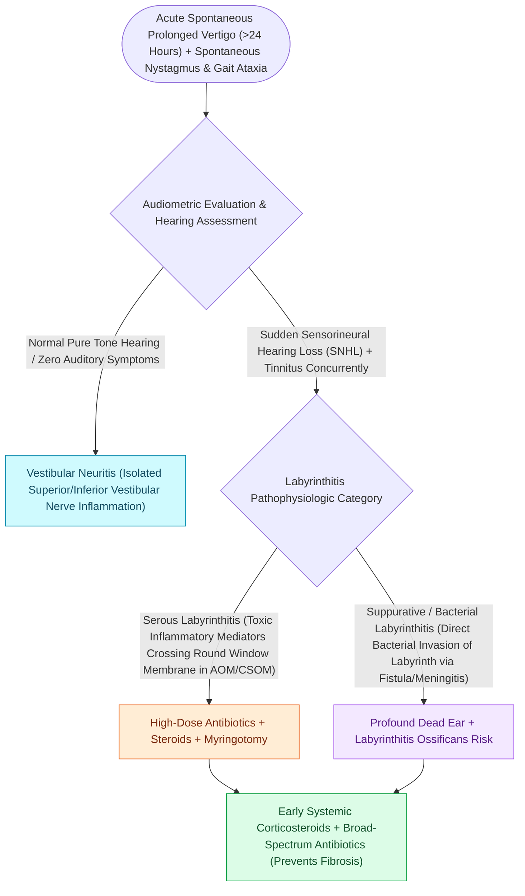

# Labyrinthitis presents with acute prolonged vertigo combined with sudden sensorineural hearing loss

## Active Recall

> [!question]- What is the clinical hallmark distinguishing labyrinthitis from vestibular neuritis?
> *Answer / Clinical Rationale*: Labyrinthitis involves **both vertigo and [[Idiopathic sudden sensorineural hearing loss requires prompt systemic corticosteroids and intratympanic salvage injection|sudden sensorineural hearing loss]]**, whereas vestibular neuritis involves vertigo alone with normal hearing.

> [!question]- Why is urgent cochlear implantation required following bacterial meningitis or suppurative labyrinthitis?
> *Answer / Clinical Rationale*: To place the electrode array before **labyrinthitis ossificans** completely obliterates the cochlear fluid lumen with new bone.

## Core Clinical & Mechanistic Principles
**Labyrinthitis** is an inflammatory or infectious disorder involving both the vestibular and cochlear end-organs of the inner ear:
- **The Critical Distinction from Vestibular Neuritis**:
  - *Vestibular Neuritis*: Causes severe vertigo **WITHOUT hearing loss**.
  - *Labyrinthitis*: Causes severe vertigo **COMBINED WITH acute, unilateral sensorineural hearing loss and tinnitus**.
- **Three Clinical Categories**:
  1. **Viral (Endolymphatic) Labyrinthitis**: Most common; viral hematogenous spread (CMV, mumps, measles, influenza) or reactivation causing sudden SNHL, vertigo, and spontaneous nystagmus.
  2. **Serous (Toxic) Labyrinthitis**: Non-purulent inflammation caused by bacterial toxins and cytokines diffusing across the round or oval window membrane during [[Uncomplicated acute otitis media in pediatric and adult patients is treated with first-line high-dose amoxicillin|acute otitis media]] or cholesteatoma. Reversible if treated early.
  3. **Suppurative (Purulent) Labyrinthitis**: Direct bacterial invasion of the inner ear fluid spaces (complication of otitis media, meningitis, or [[Labyrinthine fistula from cholesteatoma erosions most frequently involves the lateral semicircular canal|labyrinthine fistula]]). Bacteria destroy neuroepithelium, leading to **permanent "dead ear"** and rapid **labyrinthitis ossificans**.

### Surgical Technique & Critical Safety Checks
- **Labyrinthitis Ossificans**: Following suppurative labyrinthitis or meningitis, fibroblastic proliferation and osteogenesis obliterate the scala tympani within weeks; **urgent cochlear implantation** is required before the cochlear lumen occludes.

## Connected Concepts & Graph Traversal
- **Vestibular Neuritis Sparing**: [[Vestibular neuritis causes acute spontaneous prolonged vertigo without auditory symptoms|Vestibular Neuritis vs Labyrinthitis]]
- **Fistula Precursor**: [[Labyrinthine fistula from cholesteatoma erosions most frequently involves the lateral semicircular canal|Labyrinthine Fistula Erosion]]
- **Intracranial Spread**: [[Otogenic intracranial complications escalate from meningitis to sigmoid sinus thrombosis and brain abscess|Otogenic Meningitis]]
- **Idiopathic Sudden Loss**: [[Idiopathic sudden sensorineural hearing loss requires prompt systemic corticosteroids and intratympanic salvage injection|Sudden SNHL Salvage]]
- **HINTS Bedside Examination**: [[The HINTS examination separates vestibular neuritis from posterior circulation stroke in acute vestibular syndrome|HINTS Stroke Protocol]]
