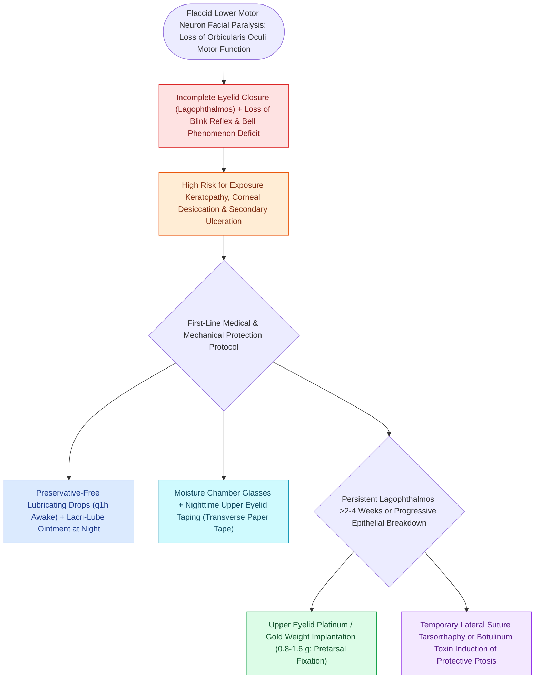

# Lagophthalmos in facial nerve paralysis requires aggressive corneal lubrication, moisture chambers, and eyelid taping

## Active Recall

> [!question]- Why does an absent Bell's phenomenon dramatically increase the risk of blinding corneal ulceration in facial palsy?
> *Answer / Clinical Rationale*: Bell's phenomenon is a physiological protective reflex wherein the globe automatically rotates superiorly and laterally during attempted eyelid closure, burying the delicate central cornea beneath the upper lid. When Bell's phenomenon is absent or impaired, attempted closure leaves the central cornea directly exposed to desiccation and nocturnal trauma.

> [!question]- Why must eyelid taping at night be performed horizontally rather than vertically?
> *Answer / Clinical Rationale*: Horizontal taping follows the natural curve of the orbicularis fibers and safely anchors the upper lid closed. Vertical taping risks catching the lid margin improperly, allowing the eyelid to partially open underneath the tape while sleeping, causing the adhesive surface to abrade the cornea directly and inducing acute corneal ulceration.

## Core Clinical & Mechanistic Principles
In acute or chronic [[The House-Brackmann facial nerve grading system standardizes facial paralysis severity|facial nerve paralysis]], denervation of the zygomatic and buccal branches deprives the **orbicularis oculi muscle** of motor innervation. This paralytic loss of voluntary and involuntary blink reflex, combined with loss of the parasympathetic lacrimal pump mechanism and ectropion of the lower eyelid, results in **[[Upper eyelid gold or platinum weight implantation prevents exposure keratopathy in lagophthalmos|lagophthalmos]]** (incomplete mechanical eye closure). Unopposed levator palpebrae superioris tone ($CN\text{ III}$) leaves the inferior cornea persistently exposed to ambient air drying, desiccation, and epithelial breakdown. Without aggressive preventive measures, rapid progression to exposure keratitis, corneal ulceration, stromal melt, and permanent blindness will ensue.

### Multimodal Corneal Preservation Protocol
1. **Daytime Medical Lubrication**:
   - Prescribe **preservative-free artificial tear drops** instilled every 1 to 2 hours while awake. Preservative-free formulations are mandatory to prevent benzalkonium chloride toxicity from frequent dosing.
   - Employ clear, moisture-chamber glasses or wrap-around eyewear with foam side shields to reduce evaporation.
2. **Nighttime Desiccation Defense**:
   - Prior to sleep, apply a generous ribbon of **petrolatum-based ophthalmic lubricant ointment** (e.g., Refresh Lacri-Lube or Refresh P.M.) into the inferior conjunctival cul-de-sac.
   - **Horizontal Eyelid Taping**: Instruct the patient or caregiver to pull the upper lid gently downward and apply paper or silicone tape *horizontally* across the lid margin to the cheek. *Never apply tape vertically over an open eye, which risks corneal abrasion from tape adhesive*.
   - Apply a transparent polyethylene moisture barrier over the orbital rim (creating a micro-humidification chamber).
## References
1. Baugh, R.F., Basura, G.J., Ishii, L.E., et al. (2013). Clinical Practice Guideline: Bell’s Palsy. *Otolaryngol Head Neck Surg*, 149(3_suppl):S1-S27.
2. Vrabec, J.T., Lin, J.W. (2013). [[Acute Bell's palsy presents with unilateral lower motor neuron facial paralysis treated with early oral steroids|Acute Facial Nerve Paralysis]]. In Johnson, J.J., Rosen, C.A. (Eds.), *Bailey’s Head and Neck Surgery-Otolaryngology* 5e (pp. 2503-2518). Baltimore, MD: Lippincott Williams & Wilkins.
3. Mattox, D.E., Vivas, E.X. (2020). Clinical Disorders of the Facial Nerve. In Flint, P.W., et al. (Eds.), *Cummings Otolaryngology Head and Neck Surgery* 7e (pp. 2587-2597). Philadelphia, PA: Elsevier.

## Connected Concepts & Graph Traversal
- **🔗 Physiological Basis (FPRS)**: [[The House-Brackmann facial nerve grading system standardizes facial paralysis severity|House-Brackmann Facial Paralysis]]
- **Etiological Precursor**: [[Acute Bell's palsy presents with unilateral lower motor neuron facial paralysis treated with early oral steroids|Bell's Palsy Presentation & Steroids]]
- **Electrophysiological Testing**: [[Electroneuronography showing greater than ninety percent degeneration within fourteen days indicates severe facial nerve axonal injury|ENoG Prognostication]]
- **Temporal Trauma**: [[Temporal bone longitudinal and transverse fractures cause delayed or immediate facial paralysis|Temporal Bone Fractures]]
- **🔗 Upper Lid Blepharoplasty (FPRS)**: [[Upper blepharoplasty requires precise skin crease marking to avoid lagophthalmos|Blepharoplasty Lagophthalmos Avoidance]]
