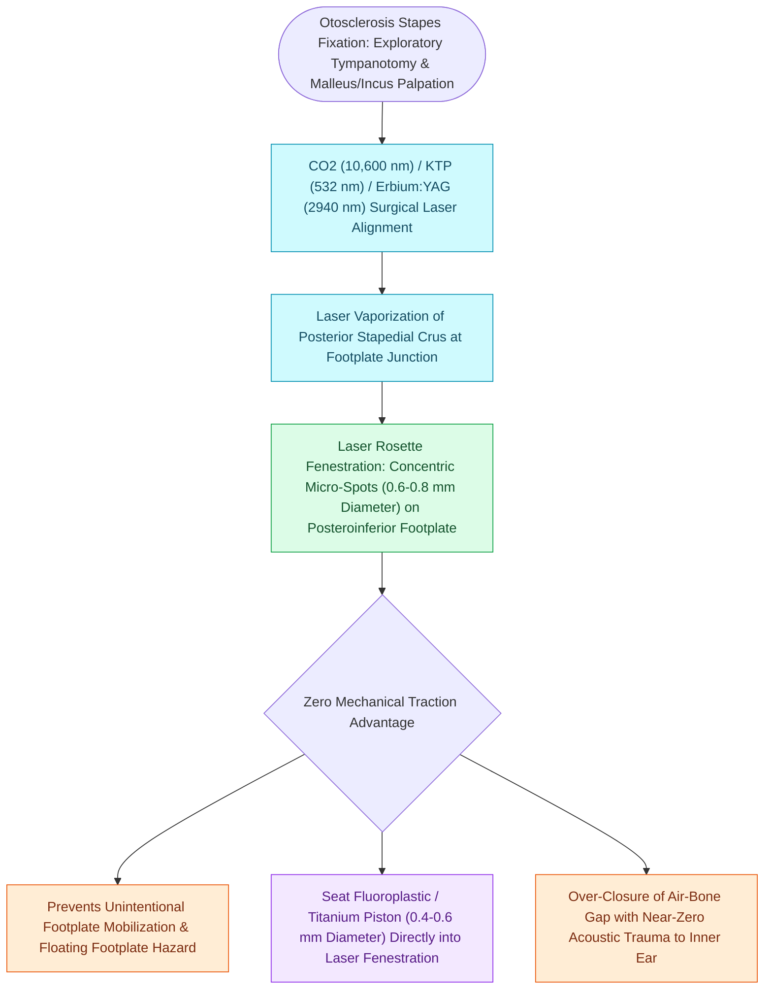

# Laser stapedotomy reduces mechanical trauma and footplate mobilization compared to manual perforators

## Active Recall

> [!question]- Why does the CO2 laser have a superior safety profile in the vestibule compared to visible green (KTP) lasers?
> *Answer / Clinical Rationale*: Because CO2 laser light is **completely absorbed by water and perilymph in the first $10\ \mu\text{m}$**, preventing penetration and thermal injury to the deep vestibular maculae.

> [!question]- What major intraoperative complication is virtually eliminated by using a non-contact laser for stapedotomy fenestration?
> *Answer / Clinical Rationale*: A **floating or depressed footplate** (which occurs from mechanical drill/pick pressure).

## Core Clinical & Mechanistic Principles
The introduction of surgical lasers (CO2, KTP, Argon, Erbium:YAG) in [[Stapedotomy utilizes a micro-drill or laser fenestration of the posterior footplate|stapedotomy]] provides precise, non-contact footplate fenestration:
- **Biomechanical Advantages over Micro-Drills and Manual Picks**:
  1. **Zero Mechanical Force on Footplate**: Eliminates the risk of depressing or dislodging a thin or mobile footplate into the vestibule (**[[Floating footplate complication during stapedectomy is managed with small inferior fenestration or vein graft|floating footplate]]**).
  2. **Vaporization of Tendon and Crura**: Allows bloodless, precise transection of the stapedius tendon and posterior stapes crus.
  3. **Precise Rosette Fenestration**: Delivers controlled pulses (e.g., CO2 laser at $1.5\text{–}2.5\text{ W}$, pulse duration $50\text{ ms}$) in a circular rosette pattern to create a pristine $0.6\text{–}0.8\text{ mm}$ fenestra.
- **Laser Wavelength Safety Profile**:
  - **CO2 Laser ($10.6\ \mu\text{m}$)**: Strongly absorbed by water and perilymph; laser energy is absorbed within the superficial $10\ \mu\text{m}$ of perilymph fluid, preventing thermal penetration into underlying vestibular neuroepithelium.
  - **Visible Lasers (KTP 532 nm, Argon 488/514 nm)**: Transmitted through clear perilymph; absorbed by pigmented tissue (melanocytes in saccular/utricular maculae), carrying higher theoretical thermal hazard.

### Surgical Technique & Critical Safety Checks
- **Precautions**: Always verify perilymph fill in the vestibule to prevent laser firing onto dry, exposed saccular macula.

## Connected Concepts & Graph Traversal
- **Stapes Fixation Pathology**: [[Otosclerosis is characterized by abnormal bone remodeling of the otic capsule causing stapes fixation|Otosclerosis Stapes Fixation]]
- **Surgical Fenestration Craft**: [[Stapedotomy utilizes a micro-drill or laser fenestration of the posterior footplate|Stapedotomy Technique]]
- **Floating Footplate Complication**: [[Floating footplate complication during stapedectomy is managed with small inferior fenestration or vein graft|Floating Footplate Complication]]
- **Gushing Footplate Crisis**: [[Gushing footplate indicates a congenital perilymph fistula from an abnormally patent cochlear aqueduct|Gushing Footplate Complication]]
- **Incus-to-Footplate Distance**: [[The distance from the incus long process to the stapes footplate averages four to four point five millimeters|Piston Length Sizing]]
