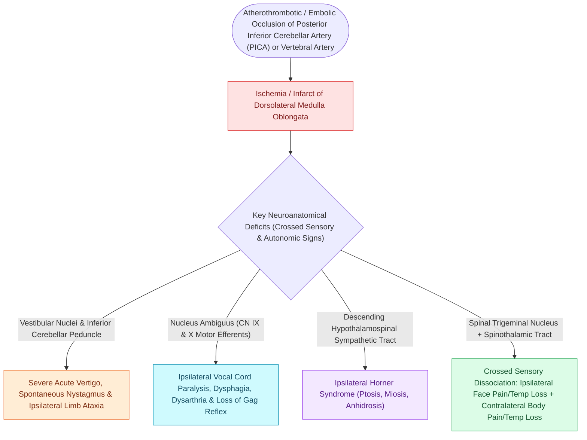

# Lateral medullary syndrome Wallenberg syndrome results from PICA occlusion causing distinct cranial neuropathies and sensory dissociation

## Active Recall

> [!question]- What vascular territory occlusion causes lateral medullary (Wallenberg) syndrome, and what specific brainstem nuclei and tracts are infarcted?
> *Answer / Clinical Rationale*: Occlusion of the **Posterior Inferior Cerebellar Artery (PICA)** or the **vertebral artery** causes infarction of the dorsolateral medulla, damaging: 1. **Nucleus Ambiguus (CN IX, X motor)** $\rightarrow$ Dysphagia, dysarthria, hoarseness, and ipsilateral palatal droop. 2. **Spinal Trigeminal Nucleus & Tract ($V$)** $\rightarrow$ Ipsilateral loss of pain and temperature sensation on the face. 3. **Spinothalamic Tract** $\rightarrow$ Contralateral loss of pain and temperature sensation on the body/limbs (crossed hemisensory dissociation). 4. **Inferior Cerebellar Peduncle (Restiform Body)** $\rightarrow$ Ipsilateral limb ataxia, dysmetria, and falling toward the lesion side. 5. **Vestibular Nuclei** $\rightarrow$ Acute vertigo, nystagmus (rotary/horizontal), nausea, and vomiting. 6. **Descending Oculosympathetic Tract** $\rightarrow$ Ipsilateral Horner syndrome (ptosis, miosis, anhidrosis).

> [!question]- Why does Wallenberg syndrome spare tongue motor function, and what syndrome affects it instead?
> *Answer / Clinical Rationale*: The **Hypoglossal nucleus (CN XII)** lies in the *paramedian medulla* supplied by the **Anterior Spinal Artery (ASA)** and paramedian vertebral branches. CN XII is affected in **Medial Medullary Syndrome (Dejerine syndrome)** (causing ipsilateral tongue paralysis and contralateral hemiplegia) rather than lateral medullary syndrome.

> [!question]- What is the hallmark neurological presentation of sensory dissociation in lateral medullary syndrome?
> *Answer / Clinical Rationale*: **Crossed sensory loss**: loss of pain and temperature on the **ipsilateral face** (due to uncrossed primary afferents descending in the spinal trigeminal tract) combined with loss of pain and temperature on the **contralateral trunk and extremities** (due to crossed second-order ascending fibers in the lateral spinothalamic tract).

## Core Clinical & Mechanistic Principles
**Lateral Medullary Syndrome (Wallenberg Syndrome)** is the classic neurovascular stroke syndrome encountered in neurotology, resulting from thromboembolic or dissection-related occlusion of the **PICA or vertebral artery**:

### Urgent Neurotologic Differentiation
- Differentiating Wallenberg syndrome from acute **[[Vestibular neuritis causes acute spontaneous prolonged vertigo without auditory symptoms|vestibular neuritis]]** or **[[Labyrinthitis presents with acute prolonged vertigo combined with sudden sensorineural hearing loss|labyrinthitis]]** is critical: HINTS examination in Wallenberg demonstrates **skew deviation, normal horizontal head impulse test (HIT), and direction-changing nystagmus (central pattern)**, mandating urgent emergency brain MRI with diffusion-weighted imaging (DWI).

## Connected Concepts & Graph Traversal
- **Cranial Nerve Exits**: [[The twelve cranial nerves are evaluated by functional components, skull base exits, and clinical reflexes|12 Cranial Nerves Functional Anatomy]]
- **Skull Base Neuropathies**: [[Cranial nerve polyneuropathies of the skull base are localized by specific anatomical foramen involvement|Skull Base Polyneuropathies]]
- **🔗 Vocal Fold Paralysis (Laryngology)**: [[Unilateral vocal fold paralysis causes glottic insufficiency, breathiness, and aspiration|Vocal Fold Paralysis in Stroke]]
- **Vestibular Differentiation**: [[Vestibular neuritis causes acute spontaneous prolonged vertigo without auditory symptoms|Central vs Peripheral Vertigo]]
- **ABR Latency Pathways**: [[Auditory brainstem response waves I through V identify retrocochlear and brainstem pathology|Auditory Brainstem Evoked Potentials]]
