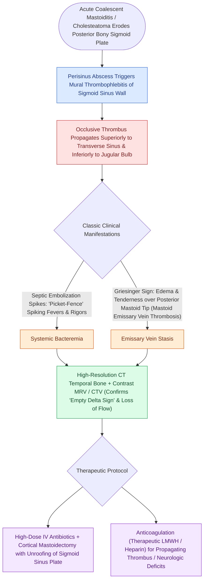

# Lateral sinus thrombophlebitis presents with picket fence fevers and Griesinger sign requiring intravenous antibiotics and mastoidectomy

## Active Recall

> [!question]- What pathophysiological vascular events produce the picket-fence fever curve and Griesinger's sign in lateral (sigmoid) sinus thrombosis?
> *Answer / Clinical Rationale*: **Picket-fence (spiking) fevers** with rigors result from periodic showering of **septic emboli** from the infected intraluminal mural thrombus into the systemic circulation. **Griesinger's sign** represents localized postauricular pitting edema and point tenderness resulting from retrograde thrombophlebitic occlusion of the **mastoid emissary vein**, which connects the sigmoid sinus directly to the posterior auricular venous plexus through the mastoid foramen.

> [!question]- What radiological sign on contrast-enhanced cranial CT/MRV confirms sigmoid sinus thrombosis, and what is otitic hydrocephalus?
> *Answer / Clinical Rationale*: The **empty delta sign**, characterized by a non-enhancing central intraluminal filling defect (the clot) rimmed by a brightly enhancing, hyperemic dural sinus wall (with absence of venous flow on MRV). **Otitic hydrocephalus** is elevated intracranial pressure (papilledema, headache, CN VI palsy) **with normal ventricular size** caused by occlusion of a dominant transverse/sigmoid venous system impairing venous outflow and arachnoid villi CSF resorption.

## Core Clinical & Mechanistic Principles
Lateral (sigmoid) sinus thrombophlebitis is a severe intracranial complication of [[Acute coalescent mastoiditis causes trabecular osteoclasis and subperiosteal abscess formation|coalescent mastoiditis]] or chronic [[Primary acquired cholesteatoma arises from retraction pocket invagination of the pars flaccida into Prussak space|cholesteatoma]]. Osteoperiostitis and bony erosion of the sigmoid sinus plate expose the sinus adventitia to perisinus abscess and localized bacterial inflammation. This provokes endophlebitis, endothelial disruption, and intraluminal mural thrombus formation. As the infected thrombus propagates, intermittent showering of septic emboli produces classic **"picket fence" (spiking) fevers** and rigors. Occlusion of the mastoid emissary vein leads to edema and tenderness over the posterior mastoid process, termed **Griesinger's sign**.

### Diagnostic Imaging & Physical Signs
- **Key Physical Findings**:
  - *Griesinger sign*: Erythema, edema, and point tenderness over the mastoid emissary vein puncture site posterior to the mastoid tip.
  - *Internal Jugular Vein "Cord" Sign*: Palpable, tender cord-like induration along the anterior border of the sternocleidomastoid muscle if thrombosis propagates inferiorly into the cervical IJV (similar to [[Lemierre syndrome involves Fusobacterium necrophorum internal jugular thrombophlebitis and septic emboli|Lemierre's syndrome]]).
  - *Increased Intracranial Pressure (Otitic Hydrocephalus)*: Papilledema, headache, nausea, and abducens nerve paresis due to impaired venous outflow through the dominant (typically right) transverse/sigmoid sinus.
- **Radiological Workup**:
  - **Contrast-Enhanced CT**: Demonstrates the classic **"empty delta sign"** on axial cuts (central unenhanced intraluminal thrombus surrounded by a brightly enhancing, inflamed triangular dural sinus wall).
  - **MRV (Magnetic Resonance Venography)**: Gold standard showing complete loss of venous flow signal and thrombus extension into the transverse sinus, superior sagittal sinus, or jugular bulb.

### Surgical & Medical Protocol
1. **Intravenous Antimicrobial Therapy**: Immediate high-dose broad-spectrum antibiotics covering *Streptococcus pneumoniae*, *Staphylococcus aureus*, *Pseudomonas aeruginosa*, and anaerobes (e.g., vancomycin plus ceftriaxone/cefepime and metronidazole).
2. **Complete Cortical Mastoidectomy**:
   - Complete exenteration of mastoid air cells, skeletonizing the sigmoid sinus plate.
   - Decompress the perisinus space and unroof the bony plate over the diseased sinus wall until healthy, blue, non-inflamed dura is circumferentially exposed proximal and distal to the clot.
   - If a fluctuant perisinus abscess is drained, needle aspiration of the sinus lumen can confirm patency versus thrombosis; routine open sinusotomy/thrombectomy or IJV ligation is no longer required unless septic emboli persist despite therapy.
3. **Anticoagulation Considerations**:
   - Systemic anticoagulation (LMWH / unfractionated heparin) is individualized and strongly considered for **clot propagation** into the transverse/cavernous sinus or internal jugular vein, persistent septic emboli, neurologic deficits, or hypercoagulable states.
## References
1. Arts, H.A., Adams, M.E. (2013). Intratemporal and Intracranial [[Otogenic intracranial complications escalate from meningitis to sigmoid sinus thrombosis and brain abscess|Complications of Otitis Media]]. In Johnson, J.J., Rosen, C.A. (Eds.), *Bailey’s Head and Neck Surgery-Otolaryngology* 5e (pp. 2399-2409). Baltimore, MD: Lippincott Williams & Wilkins.
2. Schilder, A.G., Rosenfeld, R.M., Venekamp, R.P. (2020). Acute Otitis Media and Otitis Media with Effusion. In Flint, P.W., et al. (Eds.), *Cummings Otolaryngology Head and Neck Surgery* 7e (pp. 2956-2969). Philadelphia, PA: Elsevier.
3. Viswanatha, K.O., Naseeruddin, K. (2014). Lateral sinus thrombosis in otology: a review. *Mediterr J Hematol Infect Dis*, 6(1):e2014065.

## Connected Concepts & Graph Traversal
- **Physiological Basis**: [[Acute coalescent mastoiditis causes trabecular osteoclasis and subperiosteal abscess formation|Acute Coalescent Mastoiditis]]
- **Intracranial Complication Continuum**: [[Otogenic intracranial complications escalate from meningitis to sigmoid sinus thrombosis and brain abscess|Otogenic Intracranial Complications]]
- **Surgical Drainage Craft**: [[Complete cortical mastoidectomy unroofs the mastoid antrum and establishes dependent middle ear drainage|Cortical Mastoidectomy & Sigmoid Skeletonization]]
- **🔗 Cervical Venous Differential (Head & Neck) (Head and Neck)**: [[Lemierre syndrome involves Fusobacterium necrophorum internal jugular thrombophlebitis and septic emboli|Lemierre Syndrome IJV Thrombophlebitis]]
- **Intracranial Spread**: [[Gradenigo triad of otorrhea, retroorbital pain, and abducens nerve palsy indicates suppurative petrous apicitis|Petrous Apicitis & Dural Sinuses]]
- **Primary Precursor**: [[Uncomplicated acute otitis media in pediatric and adult patients is treated with first-line high-dose amoxicillin|Acute Otitis Media]]
