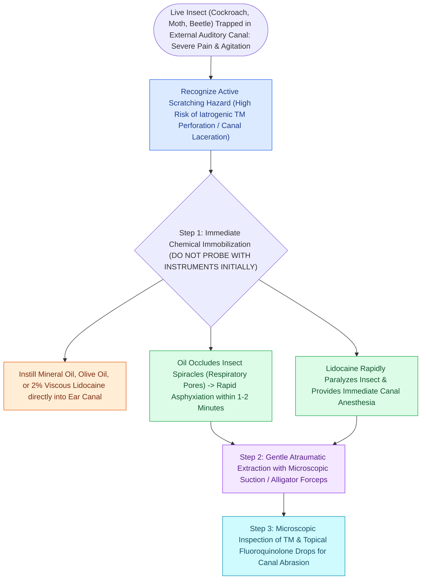

# Live insect foreign bodies in the ear canal require mineral oil immobilization prior to microscopic extraction

## Active Recall

> [!question]- Why is water irrigation strictly contraindicated for button batteries and organic swelling foreign bodies, and why is mineral oil preferred over water for live insects?
> *Answer / Clinical Rationale*: Water irrigation of button batteries accelerates electrochemical hydrolysis and hydroxide generation causing transmural liquefactive necrosis, while organic vegetable matter (e.g., beans) swells dramatically when exposed to water, wedging tightly in the bony canal. For insects, mineral oil has high viscosity and surface tension, rapidly occluding respiratory spiracles to cause rapid asphyxiation and providing canal lubrication, whereas water may agitate the insect without extinguishing movement.

> [!question]- What critical middle ear structure must be inspected following complete insect extraction?
> *Answer / Clinical Rationale*: The entire pars tensa, pars flaccida, and malleus handle must be inspected under microscopy to verify tympanic membrane integrity and rule out traumatic perforation, hemotympanum, or ossicular chain disruption caused by insect bites, burrowing, or previous unguided instrumentation attempts.

## Core Clinical & Mechanistic Principles
Live insects within the external auditory canal (EAC) cause excruciating pain, loud mechanical fluttering against the [[Traumatic tympanic membrane perforations heal spontaneously in the majority of cases without early surgery|tympanic membrane]], extreme patient agitation, and secondary canal lacerations or TM perforation from frenetic clawing and burrowing. Direct mechanical instrumentation of an active, moving insect with forceps or microhooks invariably provokes violent defensive flailing, pushing the insect deeper into the anterior tympanic sulcus, shearing canal skin, and risking traumatic ossicular injury. Filling the EAC completely with viscous mineral oil, 2% lidocaine solution, or baby oil rapidly suffocates the insect through spiracle asphyxiation and halts all motor activity within 60 to 120 seconds, transforming an unpredictable moving hazard into an immobile object suitable for controlled [[External auditory canal foreign bodies require atraumatic extraction under microscopic guidance to protect the tympanic membrane|microscopic extraction]].

### Surgical Technique & Craft Nuances
1. **Chemical Suffocation & Anesthesia**:
   - Place the patient in the lateral decubitus position with the affected ear facing upward.
   - Instill 3–5 mL of mineral oil or 2% unbuffered lidocaine into the canal until the meniscus reaches the conchal bowl. 
   - Maintain positioning for 2 to 3 minutes until all buzzing, fluttering, and scratching sensations cease entirely.
2. **Microscopic Extraction**:
   - Under high-power binocular operating microscopy, insert a size 4 or 5 metal ear speculum to dilate the cartilaginous meatus.
   - Advance a Hartmann micro-alligator forceps or Takahashi cupped forceps to firmly grasp the thorax or abdomen of the insect.
   - For soft, friable insects or larvae, apply a 5 French or 7 French Frazier suction tip directly to the body to deliver steady vacuum extraction.
   - For smooth hard beetles wedged in the bony canal, slip a 1.0 mm $90^\circ$ blunt microhook past the insect to roll it laterally.
## References
1. Friedman, E.M. (2016). Videos in Clinical Medicine. Removal of Foreign Bodies from the Ear and Nose. *N Engl J Med*, 374(7):e7.
2. Lotterman, S., Sohal, M. (2020). Ear Foreign Body Removal. In: *StatPearls*. Treasure Island (FL): StatPearls Publishing.
3. Olson, M.D., Saw, J., Visscher, S., Balakrishnan, K. (2018). Cost comparison and safety of emergency department conscious sedation for the removal of ear foreign bodies. *Int J Pediatr Otorhinolaryngol*, 110:140-143.

## Connected Concepts & Graph Traversal
- **Physiological Basis**: [[External auditory canal foreign bodies require atraumatic extraction under microscopic guidance to protect the tympanic membrane|EAC Foreign Body Extraction]]
- **Tympanic Membrane Safety**: [[Traumatic tympanic membrane perforations heal spontaneously in the majority of cases without early surgery|Traumatic TM Perforations]]
- **Infectious Complication**: [[Acute otitis externa is managed with topical antimicrobial-steroid drops and aural debridement|Acute Otitis Externa]]
- **Severe Canal Obstruction**: [[Ear wick placement bridges severe canal edema to deliver topical antimicrobial drops to the medial external auditory canal|Ear Wick Canal Stenting]]
- **Anatomical Foundation**: [[Keratosis obturans and external auditory canal cholesteatoma differ in clinical presentation, bone erosion patterns, and systemic associations|Keratosis Obturans vs EAC Cholesteatoma]]
