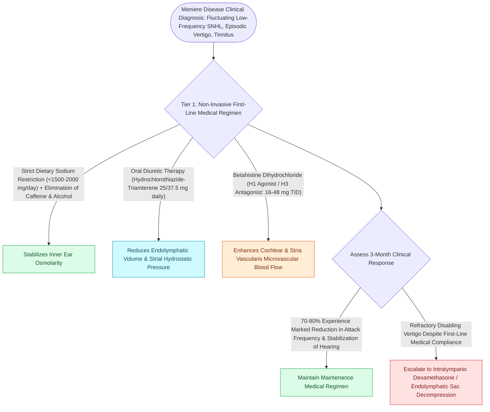

# Low-sodium diet, hydrochlorothiazide, and betahistine form the first-line medical therapy for Meniere disease

## Active Recall

> [!question]- What is the daily sodium intake limit recommended for patients with Meniere's disease?
> *Answer / Clinical Rationale*: **$1,500\text{ to }2,000\text{ mg per day}$** of sodium.

> [!question]- What is the pharmacological mechanism of betahistine in Meniere's disease?
> *Answer / Clinical Rationale*: It is a **histamine H3 receptor antagonist and H1 agonist**, increasing microvascular blood flow to the stria vascularis and inner ear.

## Core Clinical & Mechanistic Principles
First-line medical therapy successfully controls vertigo attacks in **$>75\text{–}80\%$ of patients** with [[Meniere disease is characterized by episodic vertigo, fluctuating low-frequency SNHL, tinnitus, and aural fullness|Meniere's disease]]:
- **The Core Lifestyle & Dietary Foundation**:
  - **Strict Low-Sodium Diet ($1,500\text{–}2,000\text{ mg/day}$ / $<2\text{ g/day}$)**: Even sodium distribution throughout the day prevents osmotic shifts in inner ear endolymph volume.
  - **Elimination of Triggers**: Restrict caffeine, nicotine, and alcohol (prevent microvascular vasoconstriction and metabolic fluctuation).
- **First-Line Pharmacotherapy**:
  1. **Diuretics (Hydrochlorothiazide-Triamterene / Acetazolamide)**:
     - *Dose*: HCTZ $25\text{ mg}$ / Triamterene $37.5\text{ mg}$ daily.
     - *Mechanism*: Promotes renal sodium and water excretion, reducing systemic and inner ear [[Endolymphatic hydrops results from impaired resorption of endolymph within the endolymphatic sac|endolymphatic hydrops]] pressure. Monitor serum potassium.
  2. **Betahistine (Serc)**:
     - *Mechanism*: Strong **histamine H3 receptor antagonist** and weak **H1 agonist**; vasodilates [[The stria vascularis generates the endocochlear potential of positive eighty millivolts|stria vascularis]] microvasculature, increasing inner ear blood flow and accelerating endolymph resorption.
     - *Dose*: $16\text{–}48\text{ mg}$ TID.
- **Acute Attack Rescue**: Oral/sublingual **benzodiazepines (Diazepam 2–5 mg)** or antiemetics (Promethazine/Meclizine) for vestibular suppression during acute vertigo episodes.

### Surgical Technique & Critical Safety Checks
- **Refractory Disease**: Patients who fail 3–6 months of conservative medical therapy escalate to intratympanic therapies or surgical options.

## Connected Concepts & Graph Traversal
- **Underlying Endolymph Expansion**: [[Endolymphatic hydrops results from impaired resorption of endolymph within the endolymphatic sac|Endolymphatic Hydrops]]
- **Diagnostic Clinical Criteria**: [[Meniere disease is characterized by episodic vertigo, fluctuating low-frequency SNHL, tinnitus, and aural fullness|Meniere Disease]]
- **Intratympanic Perfusion Escalation**: [[Intratympanic dexamethasone and gentamicin provide non-ablative and chemical ablative control of Meniere vertigo|Intratympanic Perfusion]]
- **Surgical Shunting Option**: [[Endolymphatic sac decompression and shunt surgery alleviate hydrops while preserving auditory function|Endolymphatic Sac Shunting]]
- **Electrodiagnostic Monitoring**: [[Electrocochleography SP to AP ratio exceeding zero point four indicates endolymphatic hydrops|ECoG Diagnostics]]
