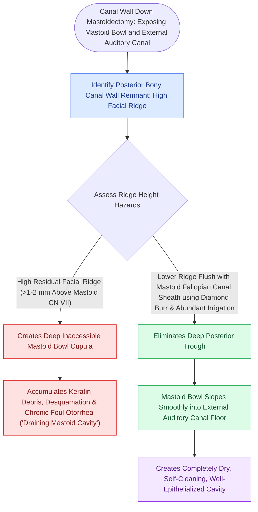

# Lowering the facial ridge flush with the facial nerve is essential to prevent dependent cavity pooling

## Active Recall

> [!question]- What chronic postoperative complication results from leaving a high facial ridge during CWD mastoidectomy?
> *Answer / Clinical Rationale*: **Chronic, refractory otorrhea and granulation tissue** caused by dependent pooling of secretions and keratin in the mastoid bowl.

> [!question]- To what anatomical landmark must the facial ridge be lowered during CWD mastoidectomy?
> *Answer / Clinical Rationale*: Flush with the **sheath of the vertical (mastoid) segment of the facial nerve** and the floor of the external auditory canal.

## Core Clinical & Mechanistic Principles
During a [[Canal wall down mastoidectomy lowers the facial ridge and exteriorizes the mastoid into the ear canal|Canal Wall Down]] (CWD) mastoidectomy, the **facial ridge** (the bony bridge overlying the vertical mastoid segment of the facial nerve) must be lowered flush with the floor of the external auditory canal:
- **The "High Facial Ridge" Pitfall**:
  - If the surgeon leaves a high bony ridge over the facial nerve, the mastoid bowl becomes a **deep, dependent well** separated from the ear canal.
  - Secretions, desquamated keratin, and cerumen pool in the dependent mastoid tip, producing **chronic, foul-smelling otorrhea** and recurrent granulation tissue (the classic "wet cavity").
- **Surgical Execution**:
  1. Identify the lateral semicircular canal (LSCC) and short process of the incus (or fossa incudis).
  2. Trace the facial nerve from the second genu vertically down to the stylomastoid foramen using a large diamond burr with continuous irrigation.
  3. Drill bone parallel to the course of the nerve until the pink sheath is visible through a thin eggshell of bone.
  4. Amputate the **mastoid tip** completely (or obliterate it) to bring the cavity floor level with the inferior canal wall.

### Surgical Technique & Critical Safety Checks
- **Facial Nerve Protection**: Always drill parallel to the nerve, never perpendicular; use diamond burrs; never drill without suction irrigation.

## Connected Concepts & Graph Traversal
- **Canal Wall Down Mastoidectomy**: [[Canal wall down mastoidectomy lowers the facial ridge and exteriorizes the mastoid into the ear canal|CWD Mastoidectomy]]
- **Wide Meatal Aeration**: [[Wide meatoplasty provides adequate aeration and easy cleaning of a canal wall down mastoid cavity|Wide Meatoplasty]]
- **Mastoid Cavity Obliteration**: [[Mastoid obliteration with local muscle flaps or bioactive glass reduces cavity volume and discharge|Mastoid Obliteration]]
- **Fallopian Canal Anatomy**: [[The facial nerve traverses six distinct anatomical segments from the pons to the parotid gland|Mastoid CN VII Segment]]
- **Spontaneous Exteriorization**: [[Auto-mastoidectomy occurs when chronic expansive cholesteatoma exteriorizes spontaneously into the canal|Auto-Mastoidectomy]]
