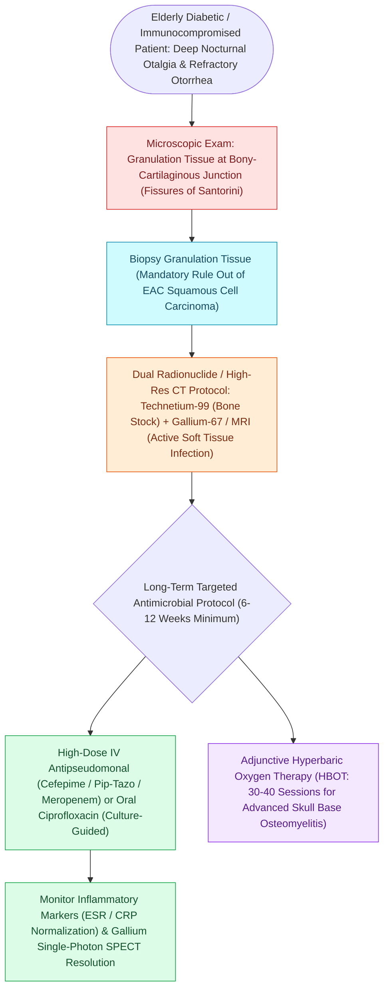

# Malignant necrotizing otitis externa is an invasive pseudomonal skull base osteomyelitis in elderly diabetic patients

## Active Recall

> [!question]- Which nuclear imaging modality is utilized to monitor treatment response and confirm resolution of infection in malignant otitis externa?
> *Answer / Clinical Rationale*: A **Gallium-67 citrate scan** (or Indium-111 labeled leukocyte scan), which normalizes as active inflammation clears.

> [!question]- Through what anatomical structures in the external auditory canal does Pseudomonas spread to the skull base in MOE?
> *Answer / Clinical Rationale*: Through the **fissures of Santorini** (cartilaginous EAC) and the **tympanomastoid suture line**.

## Core Clinical & Mechanistic Principles
**Malignant (Necrotizing) Otitis Externa (MOE)** is a life-threatening, aggressive pseudomonal osteomyelitis of the temporal bone and lateral skull base, occurring predominantly in **elderly patients with diabetes mellitus ($>90\%$)** or severe immunocompromise:
- **Microbiology & Pathogenesis**:
  - **Bacterial Predominance**: *Pseudomonas aeruginosa* accounts for $>90	ext{–}95\%$ of all cases, elaborating exotoxin A, elastase, and collagenase that cause microvascular endarteritis and extensive tissue necrosis.
  - **Fungal Pathogens (Atypical / Refractory MOE)**: While *Pseudomonas* is overwhelmingly the most common pathogen overall, **Aspergillus species** (*Aspergillus fumigatus*, *Aspergillus flavus*) represent the **most common fungal etiology of necrotizing external otitis**. Fungal MOE typically presents in severely immunocompromised individuals (HIV, hematologic malignancy, post-chemotherapy) or in diabetic patients failing standard anti-pseudomonal fluoroquinolone therapy, requiring urgent voriconazole/amphotericin B and surgical debridement.
  - **Corridors of Spread**: Infection invades from the cartilaginous [[Acute otitis externa is managed with topical antimicrobial-steroid drops and aural debridement|external]] auditory canal (EAC) via the **fissures of Santorini** and the tympanomastoid suture line into the stylomastoid foramen, infratemporal fossa, petrous apex, and jugular foramen.
- **Clinical Hallmarks**:
  - **Severe, unrelenting, deep nocturnal otalgia** completely out of proportion to exam findings.
  - Granulation tissue at the **osseocartilaginous junction** of the external auditory canal floor.
  - Progressive cranial neuropathies (CN VII most common, followed by CN IX, X, XI at the jugular foramen and CN XII at the hypoglossal canal).
- **Diagnostic Imaging & Nuclear Medicine**:
  - **CT Temporal Bone**: Demonstrates cortical bone erosion, demineralization, and skull base destruction.
  - **MRI Skull Base**: Superior for evaluating soft tissue phlegmon, dural enhancement, and medullary bone marrow replacement.
  - **Technetium-99m Bone Scan**: Highly sensitive for osteoblastic activity (initial diagnosis, but remains positive for months/years).
  - **Gallium-67 / Indium-111 WBC Scan**: Reflects active acute inflammation; used as the **gold standard to confirm resolution of infection and determine when to stop antibiotic therapy**.

### Key Consultation Supplies
- Coaxial surgical headlight, loupes, or binocular operating microscope
- Metallic ear speculums (sizes 3, 4, 5 mm)
- Frazier suction tips (sizes 3 Fr, 5 Fr) with thumb-control port
- Micro-cup forceps / Hartman alligator forceps (for granulation tissue biopsy and debridement)
- Sterile bacterial (aerobic/anaerobic) and fungal culture swabs
- Compressed polyvinyl alcohol ear wicks (Pope Oto-Wick)
- Ototopical antipseudomonal drops (ciprofloxacin-dexamethasone or ofloxacin 0.3%)
- Laboratory orders: ESR, CRP, HbA1c, CBC, CMP, and blood cultures
- Imaging orders: HRCT temporal bone without contrast, MRI IAC/skull base with contrast, and nuclear medicine scans ($^{99\text{m}}\text{Tc}$ and $^{67}\text{Ga}$)

## References
1. Linstrom, C.J., Lucente, F.E. (2013). Diseases of the External Ear. In Johnson, J.J., Rosen, C.A. (Eds.), *Bailey’s Head and Neck Surgery-Otolaryngology* 5e (pp. 2333-2357). Baltimore, MD: Lippincott Williams & Wilkins.
2. Naples, J.G., Brant, J.A., Ruckenstein, M.J. (2020). Infections of the External Ear. In Flint, P.W., et al. (Eds.), *Cummings Otolaryngology Head and Neck Surgery* 7e (pp. 2093-2100). Philadelphia, PA: Elsevier.
3. Carfrae, M.J., Kesser, B.W. (2008). Malignant otitis externa. *Otolaryngol Clin North Am*, 41(3):537-549.

## Connected Concepts & Graph Traversal
- **Acute Precursor Infection**: [[Acute otitis externa is managed with topical antimicrobial-steroid drops and aural debridement|Acute Otitis Externa]]
- **Auricular Cartilage Extension**: [[Acute perichondritis of the auricle requires antipseudomonal therapy to prevent cartilage necrosis|Auricular Perichondritis]]
- **Skull Base Foramen Neuropathies**: [[Cranial nerve polyneuropathies of the skull base are localized by specific anatomical foramen involvement|Jugular Foramen Cranial Neuropathies]]
- **Facial Nerve Infiltration**: [[The facial nerve traverses six distinct anatomical segments from the pons to the parotid gland|Stylomastoid Foramen CN VII Infiltration]]
- **Anatomical Route of Spread**: [[The external auditory canal cartilaginous third harbors Fissures of Santorini and Foramen of Huschke as routes of disease spread|EAC Fissures of Santorini & Foramen of Huschke]]
