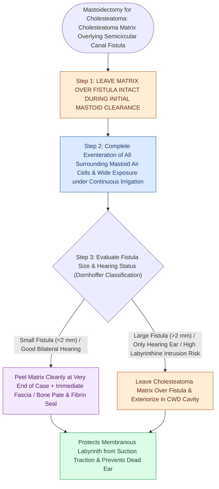

# Management of a labyrinthine fistula requires preservation of the matrix until complete bony exposure

## Active Recall

> [!question]- Why is direct suction strictly forbidden over an open labyrinthine fistula?
> *Answer / Clinical Rationale*: Because suction **aspirates perilymph and tears the delicate membranous labyrinth**, causing immediate permanent total sensorineural hearing loss ('dead ear').

> [!question]- Under what clinical circumstance should the cholesteatoma matrix be left in place over a labyrinthine fistula?
> *Answer / Clinical Rationale*: In a **large fistula ($>2\text{ mm}$)**, when the **membranous labyrinth is breached**, or in an **only hearing ear**, managed by exteriorization in a CWD cavity.

## Core Clinical & Mechanistic Principles
Surgical management of a [[Labyrinthine fistula from cholesteatoma erosions most frequently involves the lateral semicircular canal|labyrinthine fistula]] requires strict operative discipline to eradicate disease while preventing profound sensorineural hearing loss (**"dead ear"**):
- **The Cardinal Surgical Rules**:
  1. **Leave Matrix Over Fistula Until the Very End**: Clear all other mastoid, middle ear, and attic cholesteatoma first; skeletonize surrounding bone with diamond burrs.
  2. **NEVER Suction Directly on the Fistula**: Direct suction on exposed perilymph or membranous labyrinth aspirates inner ear fluid and avulses the neuroepithelium, causing immediate permanent deafness.
  3. **Prepare Repair Materials in Advance**: Have harvested temporalis fascia, perichondrium, bone pâté, and fibrin glue ready on the back table *before* touching the matrix.
- **Matrix Management Strategy by Fistula Type**:
  - **Small / Medium Fistula ($<2\text{ mm}$, Type I/II)**: Gently peel matrix off the fistula under continuous irrigation using a slow rolling motion with a Rosen needle or Gelfoam; **immediately seal with fascia and bone pâté**.
  - **Large Fistula ($>2\text{ mm}$, Type III) or Only Hearing Ear**: Perform a **Canal Wall Down (CWD) mastoidectomy and leave the cholesteatoma matrix undisturbed over the fistula**, exteriorizing it into the cavity to preserve inner ear integrity.

### Surgical Technique & Critical Safety Checks
- **Postoperative Care**: High-dose IV dexamethasone to reduce [[Labyrinthitis presents with acute prolonged vertigo combined with sudden sensorineural hearing loss|labyrinthitis]] and strict bed rest for 48 hours.

## Connected Concepts & Graph Traversal
- **Fistula Site Predilection**: [[Labyrinthine fistula from cholesteatoma erosions most frequently involves the lateral semicircular canal|Lateral Semicircular Canal Fistula]]
- **Primary Cholesteatoma Origin**: [[Primary acquired cholesteatoma arises from retraction pocket invagination of the pars flaccida into Prussak space|Prussak Space Cholesteatoma]]
- **Canal Wall Down Exteriorization**: [[Canal wall down mastoidectomy lowers the facial ridge and exteriorizes the mastoid into the ear canal|CWD Mastoidectomy]]
- **Suppurative Labyrinthitis Risk**: [[Labyrinthitis presents with acute prolonged vertigo combined with sudden sensorineural hearing loss|Suppurative Labyrinthitis]]
- **Otic Capsule Anatomy**: [[The otic capsule is an immutable endochondral bone that provides fixed surgical reference landmarks|Otic Capsule Invariant]]
