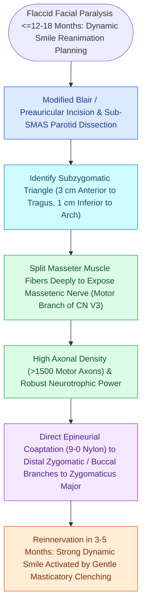

# Masseteric nerve transfer to facial nerve branches restores rapid, powerful dynamic smile reanimation

## Active Recall

> [!question]- What cranial nerve provides the motor fibers in a masseteric nerve transfer?
> *Answer / Clinical Rationale*: The **mandibular division of the trigeminal nerve (CN V3)**.

> [!question]- What are the major advantages of the masseteric nerve transfer over hypoglossal transfer?
> *Answer / Clinical Rationale*: **Zero tongue morbidity**, **higher motor axon density**, **faster recovery (3–6 months)**, and **powerful dynamic smile excursion**.

## Core Clinical & Mechanistic Principles
The **masseteric nerve transfer (nerve to masseter $\r\r\rightarrow$ CN VII)** has become the preferred motor nerve transfer for dynamic midface reanimation:
- **Anatomical Advantages of the Nerve to Masseter (V3)**:
  1. **Dense Motor Axon Count**: Contains $\approx 1,500\text{–}2,000$ pure myelinated motor axons (nearly double that of the [[Hypoglossal-to-facial nerve anastomosis restores resting facial tone and voluntary smile with tongue movement|hypoglossal]] nerve).
  2. **Proximity to Target**: Located in the cheek $1.0\text{–}1.5\text{ cm}$ deep to the masseteric fascia, allowing direct, tension-free coaptation to the zygomatic and buccal branches without an interposition graft.
  3. **Zero Donor Morbidity**: Mastication is fully preserved by the temporalis and medial pterygoid muscles.
  4. **Rapid Reinnervation**: Clinical recovery occurs within **$3\text{ to }6\text{ months}$** (due to short distance to motor endplates).
- **Surgical Execution**:
  1. Preauricular incision; elevate sub-SMAS flap.
  2. Identify masseteric nerve $1.0\text{ cm}$ inferior to zygomatic arch and $3.0\text{ cm}$ anterior to tragus within the submasseteric space.
  3. Coapt nerve to masseter directly to the **zygomatic/buccal branches** of CN VII with 9-0 nylon.

### Surgical Technique & Critical Safety Checks
- **Cortical Plasticity**: Initially, patients smile by clenching teeth; with biofeedback rehabilitation, the brain undergoes cortical reorganization, achieving **spontaneous, emotional smiling**.

## Connected Concepts & Graph Traversal
- **Hypoglossal Reanimation Counterpart**: [[Hypoglossal-to-facial nerve anastomosis restores resting facial tone and voluntary smile with tongue movement|Hypoglossal-Facial Anastomosis]]
- **Direct Epineurial Repair**: [[Immediate direct epineurial end-to-end repair is the gold standard for transected facial nerve injury|Immediate Epineurial Repair]]
- **Clinical Paralysis Staging**: [[House-Brackmann grading system stratifies facial nerve function from Grade I normal to Grade VI total paralysis|House-Brackmann Scale]]
- **Motor Unit EMG Evaluation**: [[Electromyography EMG detects voluntary motor unit potentials and fibrillations indicating denervation|EMG Reinnervation Potentials]]
- **🔗 Lagophthalmos Corneal Care (FPRS)**: [[Upper eyelid platinum weights and lateral tarsal strips protect the cornea in flaccid facial paralysis|Upper Eyelid Weight Implantation]]
