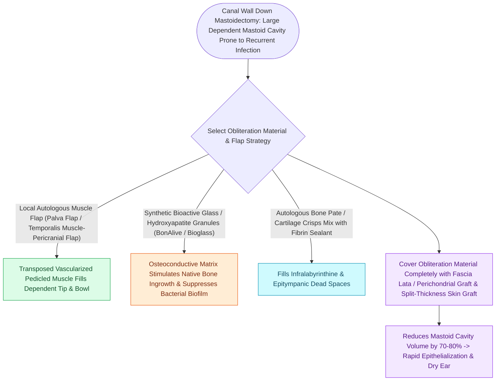

# Mastoid obliteration with local muscle flaps or bioactive glass reduces cavity volume and discharge

## Active Recall

> [!question]- What are the clinical advantages of obliterating a large canal wall down mastoid cavity?
> *Answer / Clinical Rationale*: It creates a **smaller, dry, self-cleaning cavity**, eliminates chronic discharge, and prevents **caloric vertigo from water/cold air exposure**.

> [!question]- What pedicled flap based on the postauricular periosteum is commonly used for mastoid obliteration?
> *Answer / Clinical Rationale*: The **Palva flap** (posterosuperiorly based musculoperiosteal flap).

## Core Clinical & Mechanistic Principles
**Mastoid cavity obliteration** reduces the volume of large mastoid bowls following canal wall down (CWD) or [[Canal wall up mastoidectomy preserves the posterior bony external auditory canal wall|canal wall up mastoidectomy]], preventing chronic otorrhea and cavity problems:
- **The Problem of the Large CWD Cavity**:
  - Poor aeration, accumulation of desquamated keratin, water intolerance, recurrent fungal/bacterial infections, and caloric-induced vertigo with cold wind/water.
- **Obliteration Materials & Flaps**:
  1. **Autologous Local Flaps**:
     - **Palva Flap**: Postero-superiorly based periosteal-fascial flap transposed into the cavity.
     - **Temporalis Muscle / Fascia Flap**: Inferiorly or anteriorly pedicled muscle transposed into the mastoid bowl.
  2. **Autologous Non-Vascularized Materials**:
     - **Bone Pâté**: Bone dust harvested with a collection trap during cortical drilling; mixed with antibiotic solution.
     - **Cartilage chips**: Tragal or conchal cartilage.
  3. **Biomaterials & Alloplasts**:
     - **Bioactive Glass (S53P4)**: Osteoconductive and naturally bactericidal; bonds to bone without shrinking.
     - **Hydroxyapatite granules / Bone cement**.

### Surgical Technique & Critical Safety Checks
- **Rule of Cholesteatoma Clearance**: Never obliterate a cavity over residual cholesteatoma; complete microscopic or endoscopic eradication is mandatory prior to obliteration.

## Connected Concepts & Graph Traversal
- **Canal Wall Down Mastoidectomy**: [[Canal wall down mastoidectomy lowers the facial ridge and exteriorizes the mastoid into the ear canal|CWD Mastoidectomy]]
- **Facial Ridge Lowering**: [[Lowering the facial ridge flush with the facial nerve is essential to prevent dependent cavity pooling|Facial Ridge Lowering]]
- **Meatoplasty Aeration**: [[Wide meatoplasty provides adequate aeration and easy cleaning of a canal wall down mastoid cavity|Wide Meatoplasty]]
- **Cartilage Island Stiffening**: [[Cartilage island tympanoplasty resists negative middle ear pressure and recurrent retraction|Cartilage Island Tympanoplasty]]
- **Recurrent Cholesteatoma Surveillance**: [[Second-look surgery or non-EPI DWI MRI is indicated twelve to eighteen months after canal wall up mastoidectomy|Non-EPI DWI MRI]]
