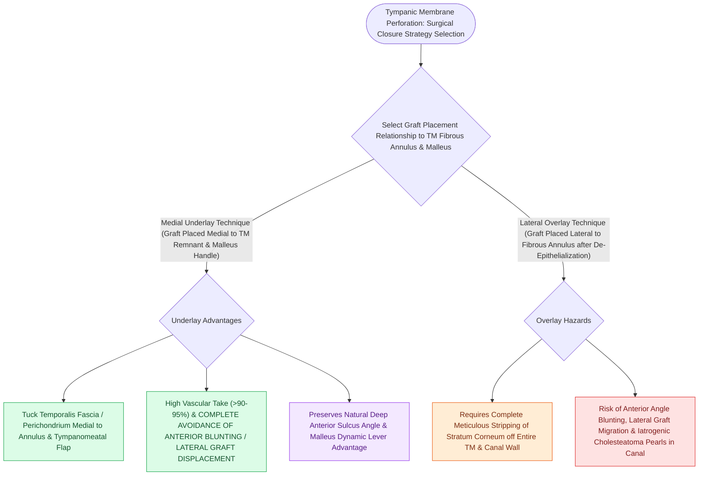

# Medial underlay fascia grafting avoids anterior blunting and lateral graft displacement

## Active Recall

> [!question]- Why must the margin of a tympanic membrane perforation be freshened prior to graft placement?
> *Answer / Clinical Rationale*: To remove the squamous-mucosal epithelial junction and expose **vascularized fibrous tissue**, stimulating angiogenesis and epithelial migration across the graft.

> [!question]- How is the graft supported in the middle ear space during underlay tympanoplasty?
> *Answer / Clinical Rationale*: By packing the middle ear space beneath the graft with **absorbable gelatin sponge (Gelfoam)** or hyaluronic acid.

## Core Clinical & Mechanistic Principles
**Medial [[Underlay and overlay tympanoplasty techniques have distinct advantages and complication profiles|underlay tympanoplasty]]** using deep temporalis fascia is the international workhorse technique for repairing posterior, inferior, and subtotal tympanic membrane perforations:
- **Surgical Step-by-Step Execution**:
  1. **Freshening the Perforation Margin**: De-epithelialize the mucosal-squamous junction around the perforation rim using a straight or angled pick to induce bleeding and stimulate vascular ingrowth.
  2. **Tympanomeatal Flap Elevation**: Incise canal skin $5\text{–}7\text{ mm}$ lateral to the annulus from 12 o'clock to 6 o'clock; elevate flap subperiosteally to the annulus.
  3. **Annulus Elevation & Middle Ear Inspection**: Elevate the fibrous annulus out of the tympanic sulcus; enter middle ear mucosa; palpate malleus, incus, and stapes for ossicular chain mobility.
  4. **Middle Ear Packing**: Pack middle ear space with absorbable gelatin sponges (Gelfoam) soaked in saline, ciprofloxacin, or hyaluronic acid to support the graft.
  5. **Graft Placement**: Slide dehydrated temporalis fascia medial to the tympanic membrane remnant and medial to the manubrium of the malleus.
  6. **Flap Repositioning**: Unroll the tympanomeatal flap over the graft and secure with lateral Gelfoam packing.

### Surgical Technique & Critical Safety Checks
- **Technical Hazards**: Inadvertent displacement of the graft into the middle ear (avoided by adequate anterior middle ear Gelfoam packing) or failure to de-epithelialize the rim (causes persistent perforation).

## Connected Concepts & Graph Traversal
- **Underlay vs Overlay Dynamics**: [[Underlay and overlay tympanoplasty techniques have distinct advantages and complication profiles|Underlay vs Overlay Tympanoplasty]]
- **Cartilage Island Alternative**: [[Cartilage island tympanoplasty resists negative middle ear pressure and recurrent retraction|Cartilage Island Tympanoplasty]]
- **Middle Ear Transformer Gain**: [[The tympanic membrane areal ratio of seventeen to one provides the primary impedance gain|Tympanic Membrane Areal Ratio]]
- **Surgical Approach Selection**: [[Endaural and postauricular surgical approaches provide tailored exposure for middle ear pathology|Endaural vs Postauricular Approaches]]
- **Ossicular Chain Reconstruction**: [[Partial ossicular replacement prosthesis PORP requires an intact and mobile stapes superstructure|PORP Reconstruction]]
