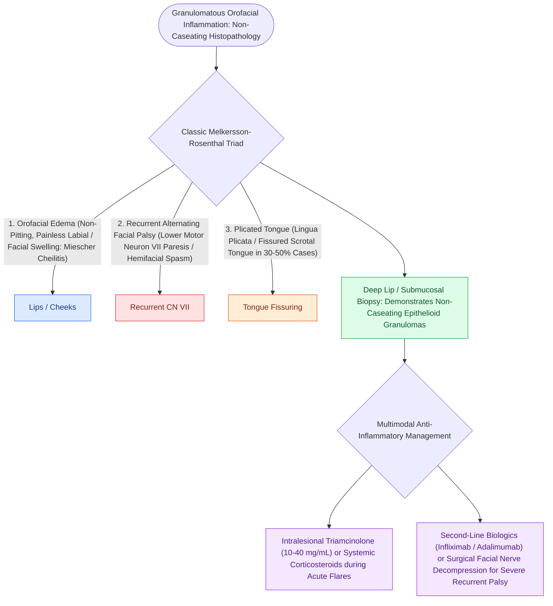

# Melkersson-Rosenthal syndrome is characterized by the classic triad of recurrent facial palsy, plicated tongue, and orofacial edema

## Active Recall

> [!question]- What three clinical features comprise the classic triad of Melkersson-Rosenthal syndrome?
> *Answer / Clinical Rationale*: **Recurrent orofacial edema (cheilitis granulomatosa)**, **recurrent facial nerve palsy**, and a **fissured/plicated tongue (*lingua plicata*)**.

> [!question]- What histopathological finding characterizes tissue biopsies in Melkersson-Rosenthal syndrome?
> *Answer / Clinical Rationale*: **Non-caseating epithelioid granulomas** with Langhans giant cells and perivascular lymphocytic infiltration.

> [!question]- What is the tiered medical and surgical management strategy for acute facial palsy vs persistent cosmetic disfigurement in MRS?
> *Answer / Clinical Rationale*: - *Acute exacerbations / Facial Palsy*: High-dose systemic **corticosteroids (prednisone 1 mg/kg/day tapered over 2–3 weeks)** $\pm$ intralesional triamcinolone acetonide (10–40 mg) injections into the lips. - *Refractory / Granulomatous maintenance*: Immunomodulators (dapsone, minocycline, methotrexate, or anti-TNF agents like infliximab). - *Surgical decompression*: **Total facial nerve decompression (transmastoid and middle cranial fossa approaches)** is indicated for patients with frequent recurrent episodes of complete paralysis to prevent cumulative permanent axonal loss. Lip reduction cheiloplasty is performed for chronic fibrotic macrocheilia.

## Core Clinical & Mechanistic Principles
**Melkersson-Rosenthal Syndrome (MRS)** is a rare, non-caseating granulomatous neuromucocutaneous disorder presenting with episodic, recurrent neurofacial symptoms:
- **The Pathognomonic Clinical Triad**:
  1. **Recurrent Orofacial Edema ($>80\text{–}100\%$)**: Non-pitting, painless, persistent swelling primarily affecting the upper and lower lips (**Cheilitis Granulomatosa of Miescher**), cheeks, and periorbital tissues.
  2. **Recurrent Lower Motor Neuron Facial Palsy ($30\text{–}50\%$)**: Indistinguishable from Bell palsy in its initial presentation, but characteristically **recurrent and alternating bilaterally**, progressing over time to incomplete recovery and synkinesis.
  3. **Plicated (Fissured) Tongue (*Lingua Plicata* / Scrotal Tongue) ($20\text{–}40\%$)**: Deep dorsal grooves and furrows present in the tongue dorsum (often inherited as an autosomal dominant trait).
- **The Complete Triad Frequency**: The full classic triad is present in only **$10\text{–}25\%$ of patients**; oligosymptomatic or monosymptomatic forms (isolated cheilitis granulomatosa) are far more common.
- **Histopathology**: Non-caseating epithelioid cell granulomas with Langhans giant cells and perivascular lymphocytic cuffing (must be differentiated from sarcoidosis and Crohn disease).

### Surgical Technique & Critical Safety Checks
- **Therapeutic Strategy**: Intralesional triamcinolone injections for lip swelling; high-dose systemic corticosteroids for acute facial paralysis; steroid-sparing immunosuppressants (methotrexate, clofazimine) or anti-TNF biologics (infliximab); subtotal [[Transmastoid and middle cranial fossa facial nerve decompression relieves canalicular compression|facial nerve decompression]] for frequent debilitating recurrences.

## Connected Concepts & Graph Traversal
- **Idiopathic Facial Palsy**: [[Acute Bell's palsy presents with unilateral lower motor neuron facial paralysis treated with early oral steroids|Bell's Palsy Differential]]
- **House-Brackmann Staging**: [[House-Brackmann grading system stratifies facial nerve function from Grade I normal to Grade VI total paralysis|House-Brackmann Scale]]
- **Facial Fallopian Decompression**: [[Transmastoid and middle cranial fossa facial nerve decompression relieves canalicular compression|Facial Nerve Decompression]]
- **🔗 Corneal Protection (FPRS)**: [[Upper eyelid platinum weights and lateral tarsal strips protect the cornea in flaccid facial paralysis|Upper Eyelid Weight Implantation]]
- **Herpes Zoster Oticus**: [[Ramsay Hunt syndrome herpes zoster oticus presents with severe facial paralysis, otalgia, and auricular vesicles|Ramsay Hunt Syndrome]]
