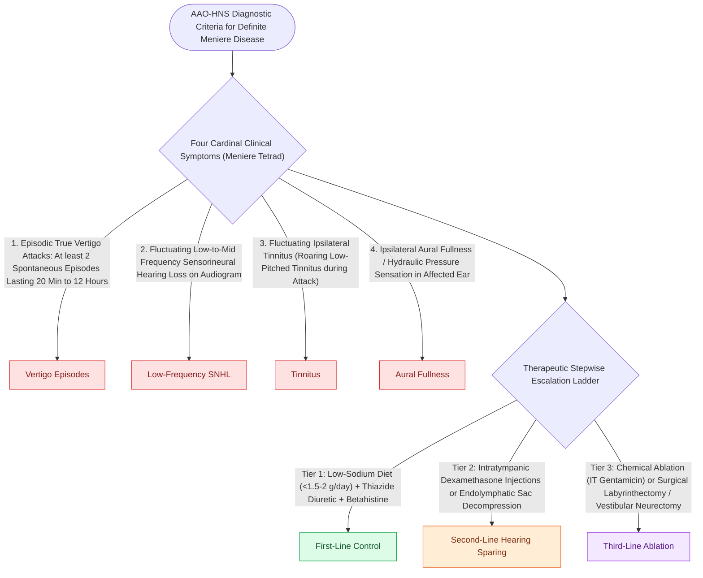

# Meniere disease is characterized by episodic vertigo, fluctuating low-frequency SNHL, tinnitus, and aural fullness

## Active Recall

> [!question]- What are the four components of the classic Meniere's disease symptom tetrad?
> *Answer / Clinical Rationale*: **Episodic rotational vertigo (20 min–12 hr)**, **fluctuating low-frequency SNHL**, **tinnitus**, and **aural fullness**.

> [!question]- What is a Tumarkin crisis (drop attack) in Meniere's disease?
> *Answer / Clinical Rationale*: A sudden, unprovoked **drop to the ground without loss of consciousness**, caused by acute mechanical deformation of the otolith organs.

## Core Clinical & Mechanistic Principles
**Meniere's Disease (Idiopathic [[Endolymphatic hydrops results from impaired resorption of endolymph within the endolymphatic sac|Endolymphatic Hydrops]])** is a chronic inner ear disorder defined by the Barany Society diagnostic criteria:
- **The Classic Clinical Tetrad**:
  1. **Episodic True Vertigo**: At least two spontaneous episodes of rotational vertigo lasting **$20\text{ minutes to }12\text{ hours}$**.
  2. **Fluctuating Low-Frequency Sensorineural Hearing Loss (SNHL)**: Audiometrically documented low-to-mid frequency SNHL in the affected ear on at least one occasion before, during, or after an episode.
  3. **Fluctuating Tinnitus** (roaring / ocean-wave tinnitus).
  4. **Aural Fullness / Pressure** in the affected ear.
- **Natural History & Bilaterality**:
  - Early stage: Low-frequency "up-sloping" SNHL that fluctuates and recovers between attacks.
  - Late stage (Burn-out phase): Hearing loss becomes flat, severe ($50\text{–}70\text{ dB}$), and permanent; vertigo spells subside, replaced by chronic unsteadiness.
  - **Bilateral involvement occurs in $20\text{–}40\%$ of patients** over 10–20 years of follow-up.

### Surgical Technique & Critical Safety Checks
- **Tumarkin Otolithic Crisis (Drop Attacks)**: Sudden, catastrophic drop to the floor without loss of consciousness, caused by acute otolithic mechanical deformation.

## Connected Concepts & Graph Traversal
- **Underlying Pathophysiology**: [[Endolymphatic hydrops results from impaired resorption of endolymph within the endolymphatic sac|Endolymphatic Hydrops]]
- **Electrodiagnostic Biomarker**: [[Electrocochleography SP to AP ratio exceeding zero point four indicates endolymphatic hydrops|ECoG SP/AP Ratio]]
- **First-Line Medical Therapy**: [[Low-sodium diet, hydrochlorothiazide, and betahistine form the first-line medical therapy for Meniere disease|Medical Osmotic Therapy]]
- **Intratympanic Perfusion**: [[Intratympanic dexamethasone and gentamicin provide non-ablative and chemical ablative control of Meniere vertigo|Intratympanic Perfusion]]
- **Endolymphatic Sac Shunting**: [[Endolymphatic sac decompression and shunt surgery alleviate hydrops while preserving auditory function|Endolymphatic Sac Shunting]]
