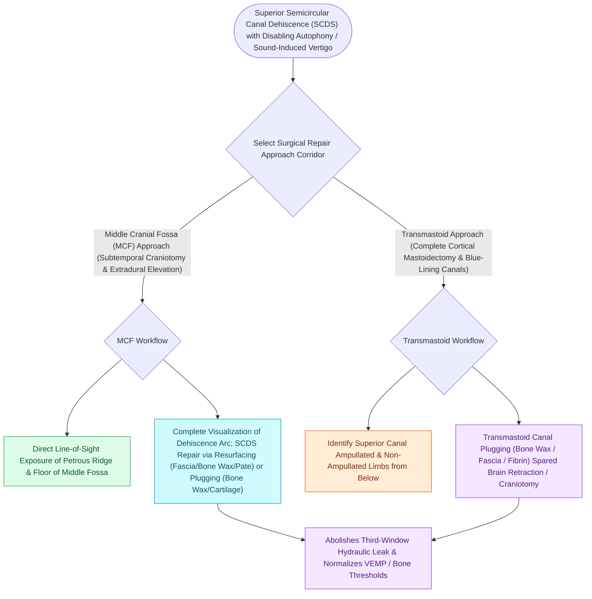

# Middle cranial fossa and transmastoid canal plugging or resurfacing repair superior canal dehiscence

## Active Recall

> [!question]- What is the most effective surgical technique for curing SCDS symptoms during an MCF approach?
> *Answer / Clinical Rationale*: **Canal plugging** (obliterating the canal lumen with bone wax, fascia, and bone pâté), combined with resurfacing.

> [!question]- What is the primary advantage of a transmastoid approach for SCDS repair over an MCF approach?
> *Answer / Clinical Rationale*: It **avoids craniotomy and temporal lobe retraction**, reducing intracranial morbidity in elderly or high-risk patients.

## Core Clinical & Mechanistic Principles
Surgical repair of [[Superior semicircular canal dehiscence SCDS presents with Tullio phenomenon and sound-induced vertigo|Superior Semicircular Canal Dehiscence]] is indicated for patients with disabling autophony, chronic disequilibrium, or intractable sound-induced vertigo:
- **Two Primary Surgical Approaches**:
  1. **Middle Cranial Fossa (MCF) Approach (Gold Standard)**:
     - *Execution*: $4\times 4\text{-cm}$ subtemporal craniotomy centered over the zygomatic root; extradural elevation of the temporal lobe to expose the arcuate eminence on the petrous ridge.
     - *Direct Visualization*: Exposes the dehiscence directly.
     - *Repair*: **Plugging** (pack canal lumen with bone wax, fascia, and bone pâté) and **Resurfacing** (cover with split calvarial bone graft or cartilage, sealed with fascia and fibrin glue).
  2. **Transmastoid Approach**:
     - *Execution*: [[Complete cortical mastoidectomy unroofs the mastoid antrum and establishes dependent middle ear drainage|Complete mastoidectomy]]; skeletonize the superior and posterior canals; create fenestrations in the ampullary and non-ampullary limbs of the SSCC away from the defect and pack with bone wax/pâté.
     - *Advantages*: Avoids craniotomy and temporal lobe retraction; preferred in elderly patients or low-lying tegmen.

### Surgical Technique & Critical Safety Checks
- **Plugging vs. Resurfacing**: Canal **plugging** provides superior long-term cure rates and lower recurrence compared to simple resurfacing alone, with a $<2\text{–}3\%$ risk of sensorineural hearing loss.

## Connected Concepts & Graph Traversal
- **Diagnostic Tullio Syndrome**: [[Superior semicircular canal dehiscence SCDS presents with Tullio phenomenon and sound-induced vertigo|SSCD Tullio Phenomenon]]
- **High-Resolution CT Poschl Views**: [[High-resolution temporal bone CT with Poschl and Stenvers reformatting confirms superior canal dehiscence|Poschl & Stenvers CT Views]]
- **cVEMP Hypersensitivity**: [[cVEMP evaluates the saccule and inferior vestibular nerve via uncrossed sternocleidomastoid inhibition|cVEMP Thresholds]]
- **Otic Capsule Anatomy**: [[The otic capsule is an immutable endochondral bone that provides fixed surgical reference landmarks|Otic Capsule Constants]]
- **Third-Window Pulsatile Tinnitus**: [[Pulsatile tinnitus is differentiated into arterial and venous etiologies by auscultation, jugular compression, and targeted vascular imaging|Pulsatile Tinnitus Workup]]
