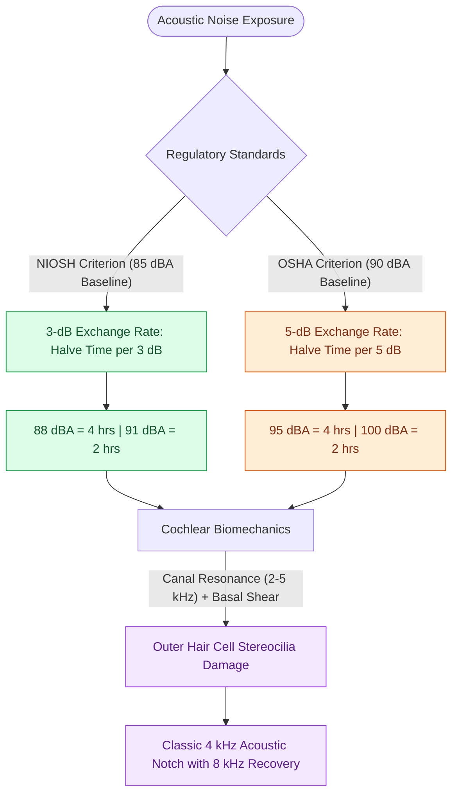

# Noise-induced hearing loss produces a four-kilohertz notch and is governed by damage-risk exchange rates

## Active Recall

> [!question]- State the NIOSH and OSHA limits and their exchange rates.
> *Answer / Clinical Rationale*: NIOSH: 85 dBA TWA, 3-dB exchange. OSHA: 90 dBA TWA, 5-dB exchange.

> [!question]- Why does the notch sit near 4 kHz?
> *Answer / Clinical Rationale*: Basal-turn susceptibility combined with external canal resonance concentrating energy in the 2-5 kHz band.

## Core Clinical & Mechanistic Principles
Noise-induced hearing loss (NIHL) is an insidious sensorineural injury targeting the [[Outer hair cell electromotility driven by prestin amplifies cochlear micromechanics|outer hair cells (OHCs)]] of the organ of Corti in the basal turn of the cochlea:

- **The 4-kHz Acoustic Notch**:
  - The characteristic audiometric **notch at 3–6 kHz (classically maximal at 4 kHz)** with partial or complete recovery at 8 kHz is driven by the acoustic resonance of the external auditory canal (which amplifies sound pressure by $15\text{–}20\text{ dB}$ between 2 and 5 kHz) combined with vulnerable vascular supply in the 4-kHz basal region.
  - Early subclinical injury produces loss of high-frequency [[Otoacoustic emissions evaluate outer hair cell integrity and differentiate cochlear from auditory neuropathy spectrum disorder|distortion product otoacoustic emissions (DPOAEs)]] before conventional pure-tone thresholds drop.
- **Acoustic Decibel Physics & Exchange Rates**:
  - *Sound Intensity Doubling*: Because the decibel scale is logarithmic ( = 10 \log_{10}(I/I_0)$), an increase of **	ext{ dB}$ represents an exact doubling of acoustic sound power/intensity** (whereas a 	ext{ dB}$ increase doubles sound pressure, and a 	ext{ dB}$ increase represents a perceived doubling of subjective loudness).
- **Damage-Risk Regulatory Criteria**:
  - **NIOSH Standard**: 85 dBA 8-hour time-weighted average (TWA) with a **3-dB exchange rate** (exposure time must be halved for every 3-dB increase in sound level: 88 dBA = 4h, 91 dBA = 2h).
  - **OSHA Standard**: 90 dBA 8-hour TWA with a **5-dB exchange rate** (permissible time halves per 5-dB increase: 95 dBA = 4h, 100 dBA = 2h).
- **Acoustic Trauma vs Synaptopathy**:
  - High-peak impulse blasts ($>140\text{ dB}$, e.g. gunfire) cause immediate mechanical disruption of stereocilia tip-links, basilar membrane tear, or ossicular dislocation.
  - Cochlear synaptopathy ("hidden hearing loss") destroys unmyelinated synaptic ribbons between inner hair cells and spiral ganglion neurons, causing impaired speech discrimination in noisy backgrounds despite normal pure-tone thresholds.

### Management & Critical Safety Checks
- **Hearing Conservation**: Primary prevention with engineered noise attenuation followed by personal protective equipment (earplugs/earmuffs).
- **Progression Counseling**: Established NIHL does not progress once industrial/environmental noise exposure terminates; ongoing deterioration mandates evaluation for retrocochlear or systemic otologic disease.

## Connected Concepts & Graph Traversal
- **Hair Cell Micromechanics**: [[Outer hair cell electromotility driven by prestin amplifies cochlear micromechanics|Prestin Motor Proteins & OHC Mechanics]]
- **Electrophysiological Screening**: [[Otoacoustic emissions evaluate outer hair cell integrity and differentiate cochlear from auditory neuropathy spectrum disorder|OAE Distortion Products in Early Injury]]
- **Ototoxicity Surveillance**: [[Platinum and aminoglycoside ototoxicity mandates baseline and serial high-frequency audiometric monitoring|Ototoxic vs Noise-Induced SNHL]]
- **Differential Conductive Notch**: [[Carhart notch presents as an artificial bone-conduction dip at two thousand Hertz in stapes fixation|Carhart Notch vs Acoustic Notch]]
- **Sensorineural Rehabilitation**: [[Cochlear implant candidacy criteria include severe to profound bilateral sensorineural hearing loss|Auditory Rehabilitation Criteria]]
