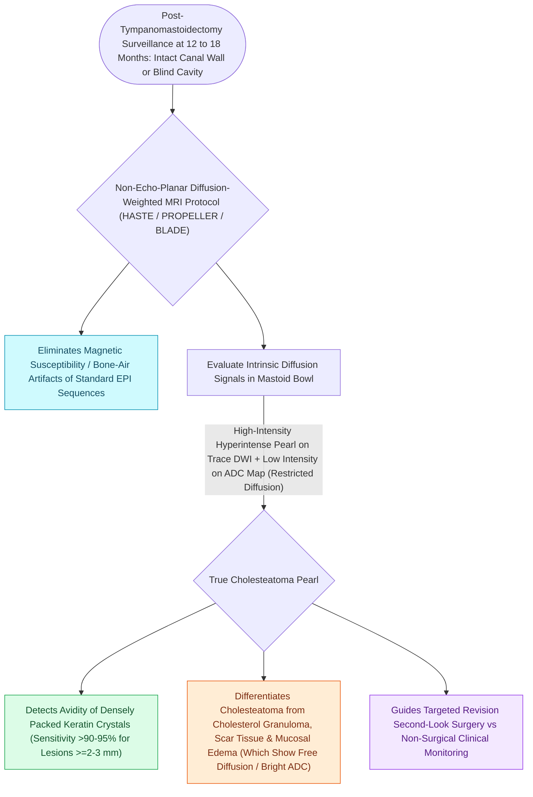

# Non-echo-planar diffusion-weighted MRI detects recurrent and residual cholesteatoma as small as two millimeters

## Active Recall

> [!question]- What is the imaging appearance of a residual cholesteatoma on non-EPI DWI MRI?
> *Answer / Clinical Rationale*: **Intense bright hyperintensity** on DWI (restricted diffusion) with **no internal contrast enhancement** on T1 post-gadolinium.

> [!question]- What is the spatial resolution limit of non-EPI DWI MRI for detecting cholesteatoma pearls?
> *Answer / Clinical Rationale*: Down to **$2.0\text{ to }3.0\text{ mm}$** in diameter.

## Core Clinical & Mechanistic Principles
**Non-Echo-Planar Diffusion-Weighted MRI (non-EPI DWI)** (e.g., HASTE or PROPELLER DWI) has replaced traditional CT and routine exploratory surgery for postoperative [[Second-look surgery or non-EPI DWI MRI is indicated twelve to eighteen months after canal wall up mastoidectomy|cholesteatoma surveillance]]:
- **Biophysical Mechanism**:
  - Cholesteatomas are packed with dense, desquamated keratin flakes and cholesterol crystals.
  - This highly organized, proteinaceous matrix causes **severe restriction of Brownian water molecule motion (restricted diffusion)**.
  - On non-EPI DWI, cholesteatoma appears as an **intense, bright hyperintense signal** with corresponding low signal on ADC maps.
- **Superiority over Standard EPI-DWI**:
  - Conventional EPI-DWI suffers from severe magnetic susceptibility artifacts at the air-bone interfaces of the temporal bone, causing false positives and distortion.
  - **Non-EPI DWI eliminates susceptibility artifacts**, achieving a **sensitivity of $>90\text{–}95\%$ and specificity of $>95\%$** for lesions down to **$\mathbf{2.0\text{–}3.0\text{ mm}}$**.

### Surgical Technique & Critical Safety Checks
- **Distinction from Granulation Tissue & Scar**: Granulation tissue enhances solidly with gadolinium and does NOT restrict on DWI; cholesteatoma shows zero internal enhancement and bright DWI restriction.

## Connected Concepts & Graph Traversal
- **Second-Look Surveillance Protocol**: [[Second-look surgery or non-EPI DWI MRI is indicated twelve to eighteen months after canal wall up mastoidectomy|Second-Look CWU Protocol]]
- **CWU Canal Preservation**: [[Canal wall up mastoidectomy preserves the posterior bony external auditory canal wall|Canal Wall Up Mastoidectomy]]
- **Primary Cholesteatoma Origin**: [[Primary acquired cholesteatoma arises from retraction pocket invagination of the pars flaccida into Prussak space|Prussak Space Invagination]]
- **Petrous Apex Recurrence**: [[Petrous apex cholesteatoma requires infracochlear, translabyrinthine, or middle cranial fossa exteriorization|Petrous Apex Cholesteatoma]]
- **Endoscopic Revision Surgery**: [[Transcanal endoscopic ear surgery TEES provides line-of-sight visualization into the sinus tympani and epitympanum|TEES Revision Surgery]]
