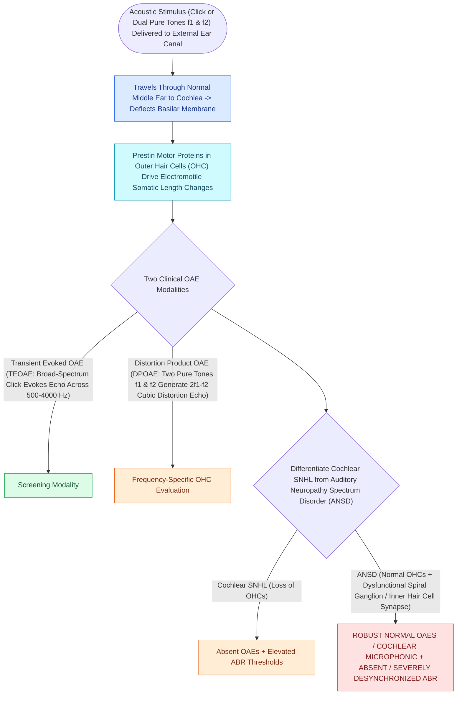

# Otoacoustic emissions evaluate outer hair cell integrity and differentiate cochlear from auditory neuropathy spectrum disorder

## Active Recall

> [!question]- What classic audiologic profile defines Auditory Neuropathy Spectrum Disorder (ANSD)?
> *Answer / Clinical Rationale*: **Present/normal OAEs and cochlear microphonics** combined with **absent or severely degraded ABR waveforms**.

> [!question]- What mathematical formula generates the primary distortion product measured in DPOAE testing?
> *Answer / Clinical Rationale*: **$2f_1 - f_2$** (with a frequency ratio $f_2/f_1 \approx 1.22$).

## Core Clinical & Mechanistic Principles
**Otoacoustic Emissions (OAEs)** are low-level acoustic signals generated by the outer hair cells (OHCs) and recorded in the external [[Auditory brainstem response waves I through V identify retrocochlear and brainstem pathology|auditory]] canal:
- **Types of OAEs**:
  1. **Transient-Evoked OAEs (TEOAEs)**: Elicited by brief broadband clicks ($0.5\text{–}4.0\text{ kHz}$); absent if hearing loss exceeds $30\text{–}35\text{ dB HL}$.
  2. **Distortion Product OAEs (DPOAEs)**: Elicited by two simultaneous pure tones ($f_1, f_2$; ratio $f_2/f_1 \approx 1.22$); records cubic distortion product at **$2f_1 - f_2$**; frequency-specific up to $8\text{ kHz}$; absent if loss $>45\text{–}50\text{ dB HL}$.
- **Auditory Neuropathy Spectrum Disorder (ANSD)**:
  - Characterized by **NORMAL OAEs / Cochlear Microphonics** (intact OHC function) with **ABSENT or severely abnormal ABR waveforms** and poor word recognition out of proportion to pure-tone thresholds.
  - Caused by mutations in otoferlin (*OTOF*), synaptic dysfunction at the inner hair cell ribbon synapse, or auditory nerve dyssynchrony.

### Surgical Technique & Critical Safety Checks
- **Middle Ear Rule**: Conductive middle ear effusion attenuates both the incoming stimulus and outgoing emission, abolishing OAEs even if OHCs are completely healthy.

## Connected Concepts & Graph Traversal
- **Prestin Motor Amplifier**: [[Outer hair cell electromotility driven by prestin amplifies cochlear micromechanics|Prestin Outer Hair Cell Motors]]
- **ABR Electrodiagnostic Disconnect**: [[Auditory brainstem response waves I through V identify retrocochlear and brainstem pathology|ABR Waveform Evaluation]]
- **🔗 Pediatric SNHL Screening (Pediatrics)**: [[Congenital cytomegalovirus infection is the most common non-genetic cause of pediatric sensorineural hearing loss|Congenital CMV Screening]]
- **Cochlear Implant Candidacy**: [[Cochlear implant candidacy criteria include severe to profound bilateral sensorineural hearing loss|Cochlear Implantation in ANSD]]
- **Ototoxic Hair Cell Damage**: [[Platinum and aminoglycoside ototoxicity mandates baseline and serial high-frequency audiometric monitoring|Ototoxicity OAE Monitoring]]
