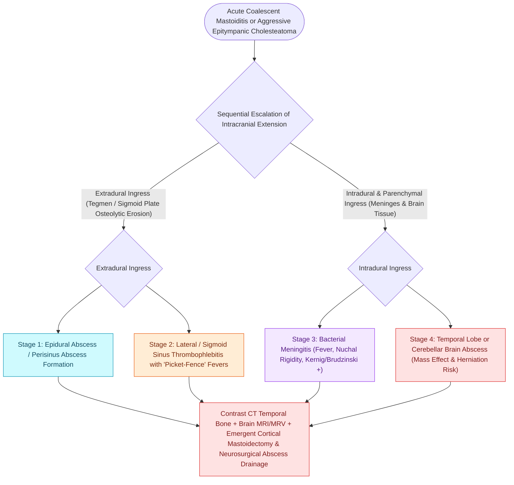

# Otogenic intracranial complications escalate from meningitis to sigmoid sinus thrombosis and brain abscess

## Active Recall

> [!question]- Which two intracranial abscess locations correspond to spread through the tegmen versus Trautmann triangle?
> *Answer / Clinical Rationale*: Tegmen erosion seeds the **temporal lobe**; Trautmann (presigmoid dural) spread seeds the **cerebellum**.

> [!question]- A draining chronic ear abruptly stops draining and headache begins. Why is this ominous?
> *Answer / Clinical Rationale*: Obstructed egress means pus is dissecting a new path — presume intratemporal-to-intracranial extension and image with contrast MRI.

## Core Clinical & Mechanistic Principles
- **Intratemporal ladder**: coalescent mastoiditis, subperiosteal abscess, facial paralysis, [[Labyrinthitis presents with acute prolonged vertigo combined with sudden sensorineural hearing loss|suppurative labyrinthitis]], and [[Gradenigo triad of otorrhea, retroorbital pain, and abducens nerve palsy indicates suppurative petrous apicitis|petrous apicitis]] precede intracranial spread; routes are direct bone erosion, thrombophlebitic (emissary veins), and preformed pathways (oval/round windows, fracture lines, Hyrtl fissure).
- **Meningitis** is the most common intracranial complication overall; **temporal lobe and cerebellar abscess** follow tegmen and Trautmann routes respectively — the abscess location names the wall that failed.
- **Epidural and subdural abscess** may be silent except for headache out of proportion; **otitic hydrocephalus** is raised ICP with normal ventricles after sigmoid thrombosis.
- Classic exam vignette: chronic ear draining for years that suddenly stops draining, then headache/fever — the cholesteatoma found a new direction.

### Management & Critical Safety Checks
- Contrast MRI with DWI is the study; abscess restricts diffusion. Neurosurgical drainage precedes or accompanies otologic source control.
- Source control is a [[Complete cortical mastoidectomy unroofs the mastoid antrum and establishes dependent middle ear drainage|cortical mastoidectomy]] at minimum; the diseased ear is operated during the same admission once the patient is stabilized.

## Connected Concepts & Graph Traversal
- **Coalescent Mastoiditis**: [[Acute coalescent mastoiditis causes trabecular osteoclasis and subperiosteal abscess formation|Coalescent Mastoiditis & Cortical Mastoidectomy]]
- **Sigmoid Sinus Thrombosis**: [[Lateral sinus thrombophlebitis presents with picket fence fevers and Griesinger sign requiring intravenous antibiotics and mastoidectomy|Otogenic Sigmoid Sinus Thrombosis]]
- **Petrous Apicitis**: [[Gradenigo triad of otorrhea, retroorbital pain, and abducens nerve palsy indicates suppurative petrous apicitis|Gradenigo Syndrome]]
- **Cholesteatoma Origin**: [[Primary acquired cholesteatoma arises from retraction pocket invagination of the pars flaccida into Prussak space|Primary Acquired Cholesteatoma]]
- **Anatomical Foundation**: [[Complete cortical mastoidectomy unroofs the mastoid antrum and establishes dependent middle ear drainage|Cortical Mastoidectomy]]
