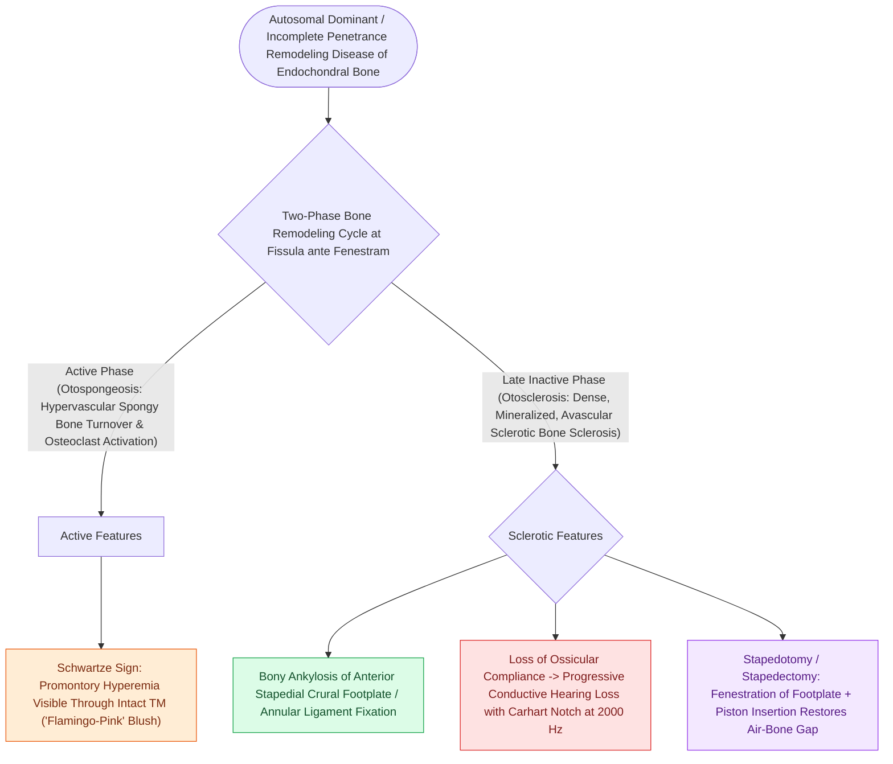

# Otosclerosis is characterized by abnormal bone remodeling of the otic capsule causing stapes fixation

## Active Recall

> [!question]- What is the most common anatomical site of origin for otosclerotic bone lesions?
> *Answer / Clinical Rationale*: The **fissula ante fenestram** (located immediately anterior to the oval window).

> [!question]- What are the two histological phases of otosclerosis?
> *Answer / Clinical Rationale*: The **active vascular (otospongiotic) phase** and the **inactive sclerotic (mineralized) phase**.

## Core Clinical & Mechanistic Principles
**Otosclerosis (Otospongiosis)** is a primary metabolic bone disease of the genetically susceptible human otic capsule (autosomal dominant with incomplete penetrance; linked to *OTSC* loci and measles virus interaction):
- **Biphasic Pathophysiological Stages**:
  1. **Active (Otospongiotic / Vascular) Phase**: Osteoclastic bone resorption replaces dense endochondral bone with [[Schwartze sign indicates active hypervascular otospongeosis over the promontory|hypervascular]], immature sponge-like woven bone.
  2. **Sclerotic (Inactive) Phase**: Osteoblastic remineralization deposits dense, disorganized, sclerotic mineralized bone, causing ankylosis and fixation of the stapes footplate.
- **Predilection Site (Fissula ante Fenestram)**:
  - $>85\text{–}90\%$ of otosclerotic foci originate in the **fissula ante fenestram** (a small embryological vestigial fibrocartilaginous cleft located immediately anterior to the oval window niche).
  - Progressive expansion anteriorly fixes the **anterior crus and anterior footplate** of the stapes, producing a conductive hearing loss.

### Surgical Technique & Critical Safety Checks
- **Cochlear (Retrofenestral) Otosclerosis**: Otosclerotic foci encircle the cochlea, releasing proteolytic enzymes into the scala media that cause sensorineural hearing loss.

## Connected Concepts & Graph Traversal
- **Artificial Audiometric Notch**: [[Carhart notch presents as an artificial bone-conduction dip at two thousand Hertz in stapes fixation|Carhart Notch (2,000 Hz Dip)]]
- **Laser Fenestration Technique**: [[Laser stapedotomy reduces mechanical trauma and footplate mobilization compared to manual perforators|Laser Stapedotomy Safety]]
- **Active Hypervascular Sign**: [[Schwartze sign indicates active hypervascular otospongeosis over the promontory|Schwartze Sign]]
- **Floating Footplate Complication**: [[Floating footplate complication during stapedectomy is managed with small inferior fenestration or vein graft|Floating Footplate Complication]]
- **Middle Ear Transformer Physics**: [[The middle ear transformer ratio provides twenty-seven decibels of acoustic impedance matching|Middle Ear Impedance Matching]]
