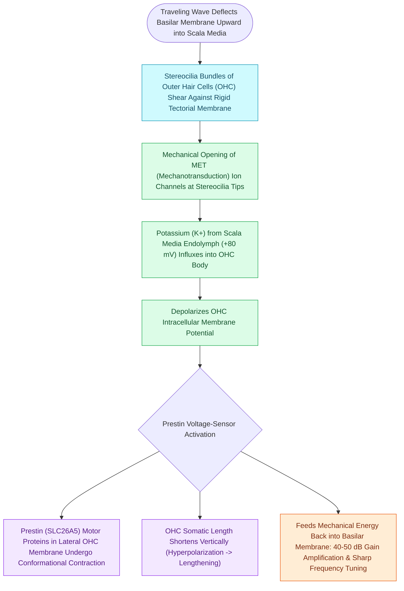

# Outer hair cell electromotility driven by prestin amplifies cochlear micromechanics

## Active Recall

> [!question]- What motor protein in the outer hair cell lateral membrane drives electromotility?
> *Answer / Clinical Rationale*: **Prestin (SLC26A5)**.

> [!question]- How much hearing sensitivity gain (in decibels) is provided by the active cochlear amplifier?
> *Answer / Clinical Rationale*: Approximately **$40\text{ to }50\text{ dB}$** of gain and sharp frequency tuning.

## Core Clinical & Mechanistic Principles
The mammalian cochlea possesses an active biological amplifier that sharpens [[The traveling wave along the basilar membrane establishes tonotopic frequency organization|frequency]] selectivity and increases hearing sensitivity by **$40\text{–}50\text{ dB}$**:
- **The Cellular Motor**: **Outer Hair Cells (OHCs)** (organized in 3 rows; $\approx 12,000$ cells).
- **The Molecular Motor Protein**: **Prestin (SLC26A5)**:
  - Densely packed in the lateral plasma membrane of OHCs.
  - Functions as a voltage-sensitive motor that undergoes rapid conformational changes in response to transmembrane potential fluctuations without requiring ATP hydrolysis.
- **Electromotility Mechanics**:
  - Depolarization (influx of $\text{K}^+$ via stereocilia tip links) causes OHCs to **contract / shorten**.
  - Hyperpolarization causes OHCs to **elongate**.
  - This cycle injects mechanical energy back into the basilar membrane at acoustic frequencies (up to $>20\text{ kHz}$), amplifying the vibration peak for inner hair cell stimulation.

### Surgical Technique & Critical Safety Checks
- **Otoacoustic Emissions (OAEs)**: By-product of OHC electromotility; retrograde acoustic energy travels back through the ossicles and vibrates the tympanic membrane.

## Connected Concepts & Graph Traversal
- **OAE Functional Readout**: [[Otoacoustic emissions evaluate outer hair cell integrity and differentiate cochlear from auditory neuropathy spectrum disorder|Otoacoustic Emissions]]
- **Endocochlear Driving Battery**: [[The stria vascularis generates the endocochlear potential of positive eighty millivolts|Stria Vascularis +80 mV Potential]]
- **Basilar Membrane Tonotopy**: [[The traveling wave along the basilar membrane establishes tonotopic frequency organization|Traveling Wave Tonotopy]]
- **Ototoxic Hair Cell Damage**: [[Platinum and aminoglycoside ototoxicity mandates baseline and serial high-frequency audiometric monitoring|Aminoglycoside Outer Hair Cell Loss]]
- **Sensorineural Presbycusis**: [[Presbycusis produces symmetric high-frequency sensorineural loss with disproportionate speech-in-noise decline|Sensory Presbycusis]]
