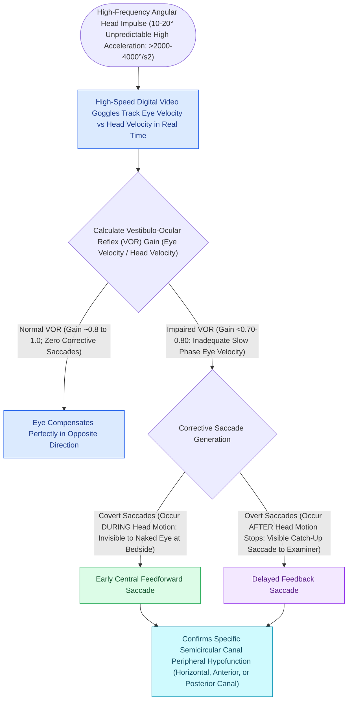

# Overt and covert saccades on vHIT indicate peripheral vestibular hypofunction

## Active Recall

> [!question]- What is the difference between a covert saccade and an overt saccade on vHIT?
> *Answer / Clinical Rationale*: **Covert saccades occur during head rotation** (invisible to naked eye), whereas **overt saccades occur after head rotation stops** (visible at bedside).

> [!question]- Why can a patient with severe vestibular hypofunction have a normal bedside head thrust test?
> *Answer / Clinical Rationale*: Because the patient has learned to generate **covert saccades during the thrust**, masking the eye lag from direct visual observation.

## Core Clinical & Mechanistic Principles
When the angular VOR fails, the eyes move with the head off the visual target, triggering compensatory **catch-up saccades** to re-acquire foveal fixation:
- **Covert Saccades (Invisible to Naked Eye)**:
  - Occur **DURING the head movement** (before head rotation stops).
  - Generated via feed-forward central motor commands or rapid somatosensory/proprioceptive loops.
  - **Cannot be seen on bedside clinical head impulse test (Halmagyi-Curthoys test)**; only detected by high-speed [[The video head impulse test vHIT identifies high-frequency angular vestibulo-ocular reflex deficits|vHIT]] video analysis.
- **Overt Saccades (Visible at Bedside)**:
  - Occur **AFTER the head movement has completely finished**.
  - Generated via visual feedback once the brain perceives retinal slip.
  - Readily visible to the clinician's naked eye during bedside examination.

### Surgical Technique & Critical Safety Checks
- **Clinical Significance**: Patients with chronic or well-compensated vestibular loss convert overt saccades into covert saccades, masking their deficit on bedside exam; vHIT accurately captures covert saccades and documents true residual hypofunction.

## Connected Concepts & Graph Traversal
- **vHIT High-Frequency Testing**: [[The video head impulse test vHIT identifies high-frequency angular vestibulo-ocular reflex deficits|vHIT Angular Testing]]
- **Caloric Low-Frequency Testing**: [[Bithermal caloric testing calculates Jongkees formula to quantify unilateral vestibular paresis|Bithermal Caloric Testing]]
- **Rotary Chair Low-Frequency Testing**: [[Rotary chair testing assesses low-frequency bilateral vestibular hypofunction and central compensation|Rotary Chair Diagnostics]]
- **Acute Neuritis Diagnosis**: [[Vestibular neuritis causes acute spontaneous prolonged vertigo without auditory symptoms|Vestibular Neuritis]]
- **HINTS Bedside Protocol**: [[The HINTS examination separates vestibular neuritis from posterior circulation stroke in acute vestibular syndrome|HINTS Stroke Protocol]]
