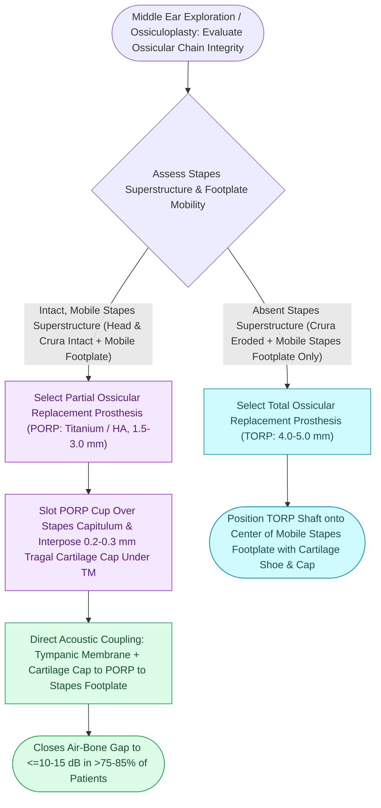

# Partial ossicular replacement prosthesis PORP requires an intact and mobile stapes superstructure

## Active Recall

> [!question]- What anatomical condition must be met to use a Partial Ossicular Replacement Prosthesis (PORP)?
> *Answer / Clinical Rationale*: The **stapes superstructure (head and crura) must be intact and mobile**.

> [!question]- Why must a cartilage shield be placed over the head plate of a PORP?
> *Answer / Clinical Rationale*: To **prevent extrusion of the prosthesis** through the tympanic membrane over time.

## Core Clinical & Mechanistic Principles
A **Partial Ossicular Replacement Prosthesis (PORP)** is used to reconstruct the ossicular chain when the incus long process is eroded (the most common ossicular defect) but the **stapes superstructure (arch) remains intact and mobile**:
- **Prosthesis Architecture & Materials**:
  - Composed of titanium or dense hydroxylapatite (HA).
  - Features a head plate (interfaces with malleus or TM) and a hollow shaft/cup that slots securely over the stapes capitulum (head).
- **Surgical Step-by-Step Inset Protocol**:
  1. **Assess Stapes Mobility & Footplate**: Gently palpate the stapes capitulum with a right-angle pick to confirm round window reflex and absence of stapes fixation (rule out [[Otosclerosis is characterized by abnormal bone remodeling of the otic capsule causing stapes fixation|otosclerosis]] or tympanosclerosis).
  2. **Measure Height**: Measure distance from stapes capitulum to undersurface of malleus handle or TM using an ossicular measuring gauge (typically **$1.5\text{–}3.0\text{ mm}$**).
  3. **Trim Prosthesis**: Adjust shaft length to ensure stable contact without excessive tension (which causes sensorineural hearing loss or prosthesis extrusion).
  4. **Slot Over Capitulum**: Place cup over stapes head; position head plate under the malleus handle.
  5. **Cartilage Interposition**: Always place a thinned piece of **tragal cartilage ($0.2\text{–}0.3\text{ mm}$)** between the prosthesis head and the TM to prevent extrusion.

### Surgical Technique & Critical Safety Checks
- **Hearing Outcomes**: Closes the air-bone gap to $\le 10\text{–}20\text{ dB}$ in $>75\text{–}85\%$ of cases.

## Connected Concepts & Graph Traversal
- **Total Prosthesis Alternative**: [[Total ossicular replacement prosthesis TORP bridges the malleus or tympanic membrane to the stapes footplate|TORP Reconstruction]]
- **Cartilage Interposition Cap**: [[Cartilage interposition over ossicular prostheses prevents extrusion through the tympanic membrane|Cartilage Interposition Cap]]
- **Austin-Kartush Classification**: [[The Austin-Kartush classification categorizes ossicular chain defects based on the presence of the malleus handle and stapes arch|Austin-Kartush Classification]]
- **Impedance Transformer Ratio**: [[The middle ear transformer ratio provides twenty-seven decibels of acoustic impedance matching|Middle Ear Transformer Gain]]
- **Tympanoplasty Grafting**: [[Underlay and overlay tympanoplasty techniques have distinct advantages and complication profiles|Underlay vs Overlay Tympanoplasty]]
