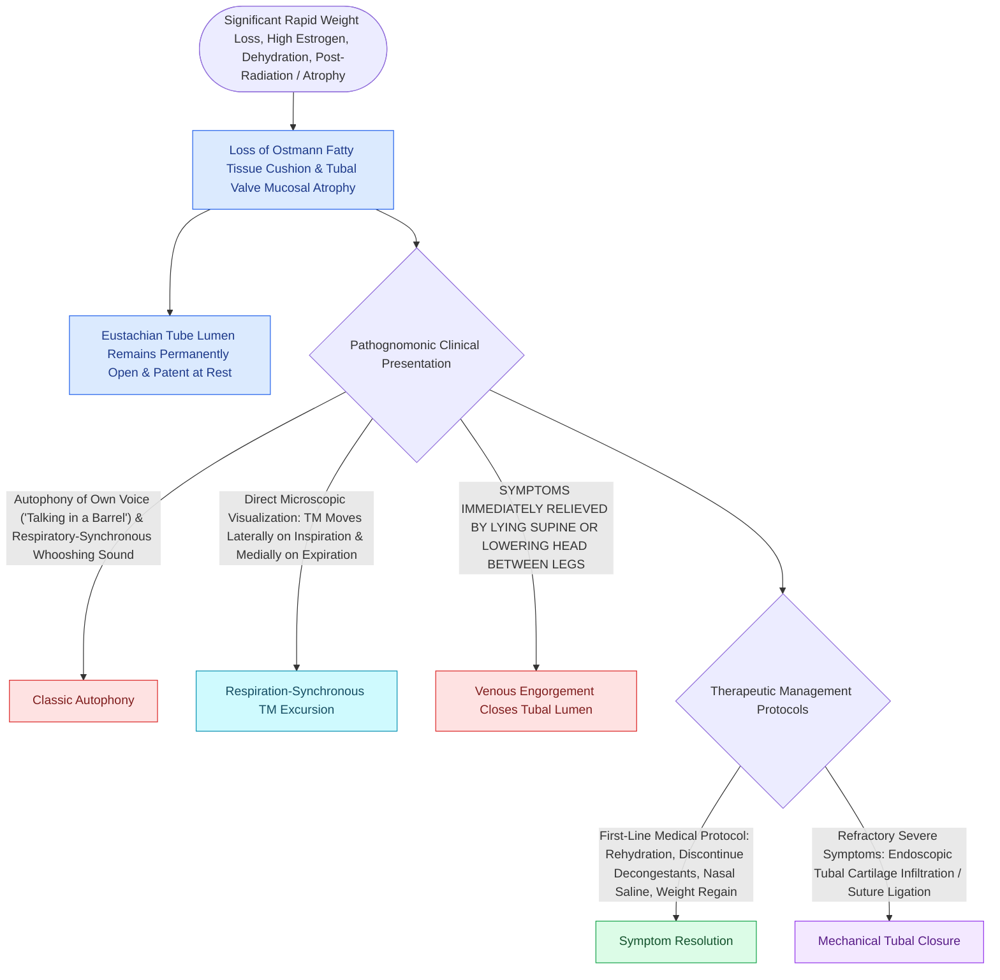

# Patulous Eustachian tube manifests with autophony, respiratory-synchronous tinnitus, and tympanic membrane excursions on nasal breathing

## Active Recall

> [!question]- What is the hallmark physiological defect and clinical presentation of a patulous Eustachian tube?
> *Answer / Clinical Rationale*: A **patulous Eustachian tube** results from an **abnormally patent, permanently or intermittently open cartilaginous Eustachian tube valve at rest** (loss of the anterolateral mucosal seal and Ostmann fatty pad). Patients present with debilitating **autophony (hearing their own voice, breath sounds, and heartbeat loudly echoing in the ear)**, **respiratory-synchronous whooshing tinnitus**, and aural fullness.

> [!question]- What simple physical positional maneuver relieves symptoms, and what diagnostic finding is visualized on microscopic otoscopy?
> *Answer / Clinical Rationale*: Symptoms are **immediately relieved or dramatically improved when the patient lies flat (supine position) or places their head between their knees (dependent head tilt)**, because increased jugular and pterygoid venous engorgement passively swells the tubal mucosa and Ostmann fat pad, temporarily re-establishing closure. On microscopic otoscopy during **forced ipsilateral nasal respiration (with opposite nostril occluded)**, the examiner visualizes **synchronous medial-to-lateral excursions / fluttering of the posterior-superior tympanic membrane**.

> [!question]- What are the primary predisposing systemic triggers for patulous Eustachian tube development?
> *Answer / Clinical Rationale*: (1) **Rapid significant weight loss** (bariatric surgery, eating disorders, cancer cachexia) causing atrophy of the **Ostmann fatty pad**; (2) **High-estrogen states** (pregnancy, high-dose oral contraceptives) altering mucosal surface tension; (3) **High-dose systemic diuretics / dehydration**; (4) **Temporomandibular joint (TMJ) dysfunction** and tensor veli palatini hyperactivity; (5) **Head and neck radiation therapy** causing mucosal scarring and fat necrosis.

## Core Clinical & Mechanistic Principles

The **cartilaginous Eustachian tube** (medial two-thirds) is normally closed at rest by the passive elastic recoil of tubal cartilage, [[Pulsatile tinnitus is differentiated into arterial and venous etiologies by auscultation, jugular compression, and targeted vascular imaging|venous]] plexus turgor, and the **Ostmann fatty pad** situated anterolaterally:

### Stepwise Therapeutic Ladder
1. **Conservative / Medical Management**:
   - Reassurance, patient education, weight regain counseling.
   - Discontinuation of nasal decongestants and systemic diuretics.
   - Saturated solution of **potassium iodide (SSKI)** or nasal instillation of normal saline / hydrochloric acid drops to induce mucosal edema.
   - **Topical conjugated estrogens (Premarin nasal drops)** applied into the nasopharyngeal orifice.
2. **Procedural & Surgical Management**:
   - **Tympanostomy Tube Placement with Mass Loading**: Placing a ventilation tube with a Blu-Tack or silicone dot mass on the TM dampens acoustic coupling, relieving autophony symptoms in $50-60\%$ of patients.
   - **Transnasal Endoscopic Augmentation**: Injection of autologous fat, calcium hydroxyapatite (Radiesse), or hyaluronic acid into the anterolateral wall of the tubal orifice.
   - **Cartilage Shim / Intraluminal Tubal Plugs**: Insertion of an autologous tragal/conchal cartilage catheter or proprietary silicone plug (Kobayashi plug) into the tubal lumen to partially obstruct the persistent patency.

## Connected Concepts & Graph Traversal
- **Eustachian Tube Classification**: [[Eustachian tube dysfunction divides into dilatory and patulous forms with opposite treatment goals|Dilatory vs Patulous ETD]]
- **Tympanometric Features**: [[Tympanometry classifies middle ear compliance and pressure into Jerger Types A, As, Ad, B, and C|Jerger Tympanogram Types]]
- **Third Mobile Window Autophony**: [[Third mobile window pathophysiology causes hyperacusis to bone-conducted sounds and acoustic energy dissipation|SSCD vs Patulous Autophony]]
- **Tensor Veli Palatini Innervation**: [[The twelve cranial nerves are evaluated by functional components, skull base exits, and clinical reflexes|Trigeminal V3 Tubal Innervation]]
- **Tympanostomy Tubes**: [[Tympanostomy tube placement follows guideline criteria for chronic effusion and recurrent acute otitis media|Ventilation Tube Placement]]
- **Pulsatile Tinnitus Workup**: [[Pulsatile tinnitus is differentiated into arterial and venous etiologies by auscultation, jugular compression, and targeted vascular imaging|Pulsatile Tinnitus Differential]]
