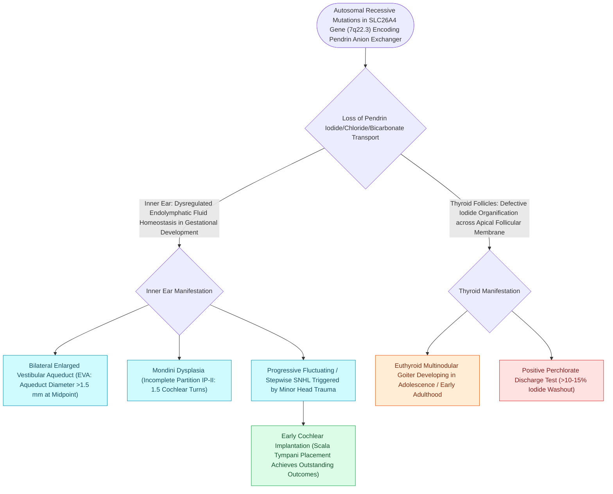

# Pendred syndrome causes sensorineural hearing loss and euthyroid goiter due to SLC26A4 mutations with enlarged vestibular aqueducts

## Active Recall

> [!question]- What is the genetic mutation and biochemical function of the defective protein in Pendred syndrome?
> *Answer / Clinical Rationale*: Pendred syndrome is an autosomal recessive disorder caused by biallelic mutations in **SLC26A4** (chromosome 7q22.3), which encodes **pendrin**, an apical sodium-independent **chloride-iodide and chloride-bicarbonate ($Cl^-/HCO_3^-$) transmembrane exchanger** expressed in the inner ear (stria vascularis and endolymphatic sac) and thyroid follicular cells.

> [!question]- What is the diagnostic hallmark in the thyroid, and what classic diagnostic test confirms impaired organification?
> *Answer / Clinical Rationale*: Development of a **multinodular euthyroid or hypothyroid goiter** in late childhood/puberty due to defective iodide organification. The historical diagnostic gold standard is the **perchlorate discharge test**, where administration of potassium perchlorate causes $>10\text{–}15\%$ washout of unbound radioactive iodine ($^{131}\text{I}$) from the thyroid gland.

> [!question]- What temporal bone imaging findings define Pendred syndrome, and what specific clinical counseling is essential regarding head trauma?
> *Answer / Clinical Rationale*: High-resolution temporal bone CT demonstrates **bilateral Enlarged Vestibular Aqueduct (EVA $>1.5\text{ mm}$ at midpoint or $>2.0\text{ mm}$ at operculum)** and **Mondini cochlear dysplasia** (incomplete partition Type II with $1.5$ cochlear turns and a confluent cystic apex). Patients and families must be counseled on **strict avoidance of contact sports and head trauma**, as minor barotrauma or blows to the head can trigger catastrophic, irreversible stepwise drops in hearing.

## Core Clinical & Mechanistic Principles
[[Syndromic pediatric sensorineural hearing loss encompasses Pendred, Usher, Waardenburg, and Jervell and Lange-Nielsen syndromes|Pendred syndrome]] is the most common syndromic form of hereditary sensorineural hearing loss, accounting for approximately $5\text{–}10\%$ of all prelingual deafness:

### Auditory Management & Surgical Considerations
1. **Audiological Monitoring**:
   - Progressive, severe-to-profound asymmetric or symmetric SNHL.
   - Early hearing aid [[Hearing aid selection is driven by audiometric configuration and verified with real-ear measurement|amplification]] with aggressive audiometric tracking.
2. **Cochlear Implantation**:
   - Outstanding outcomes with cochlear implantation; high-resolution CT/MRI is essential preoperatively to anticipate **intraoperative CSF "gusher"** through the cochleostomy due to dysplastic communication between the subarachnoid space and vestibule/modiolus.
   - Requires perioperative lumbar drainage preparedness and tight soft tissue packing around the electrode entry site.
3. **Head Trauma Safeguards**:
   - Absolute contraindication to contact sports (football, boxing, rugby) and pressure activities (scuba diving).

## Connected Concepts & Graph Traversal
- **Perilymph Fistula & Inner Ear Anomalies**: [[Gushing footplate indicates a congenital perilymph fistula from an abnormally patent cochlear aqueduct|Cochlear Dysplasia & Perilymph Fistula]]
- **🔗 Syndromic SNHL Overview (Pediatrics)**: [[Syndromic pediatric sensorineural hearing loss encompasses Pendred, Usher, Waardenburg, and Jervell and Lange-Nielsen syndromes|Syndromic SNHL Overview]]
- **Cochlear Implantation Craft**: [[Cochlear implant candidacy criteria include severe to profound bilateral sensorineural hearing loss|Cochlear Implantation in EVA & Inner Ear Dysplasia]]
- **🔗 Thyroid Nodular Workup (Head and Neck)**: [[Bethesda cytology and molecular testing stratify thyroid nodule malignancy risk before surgery|Thyroid Nodule Evaluation in Goiter]]
- **🔗 Non-Syndromic SNHL (Pediatrics)**: [[Connexin 26 mutations in GJB2 and congenital CMV infection are leading causes of non-syndromic pediatric sensorineural hearing loss|Connexin 26 Comparison]]
