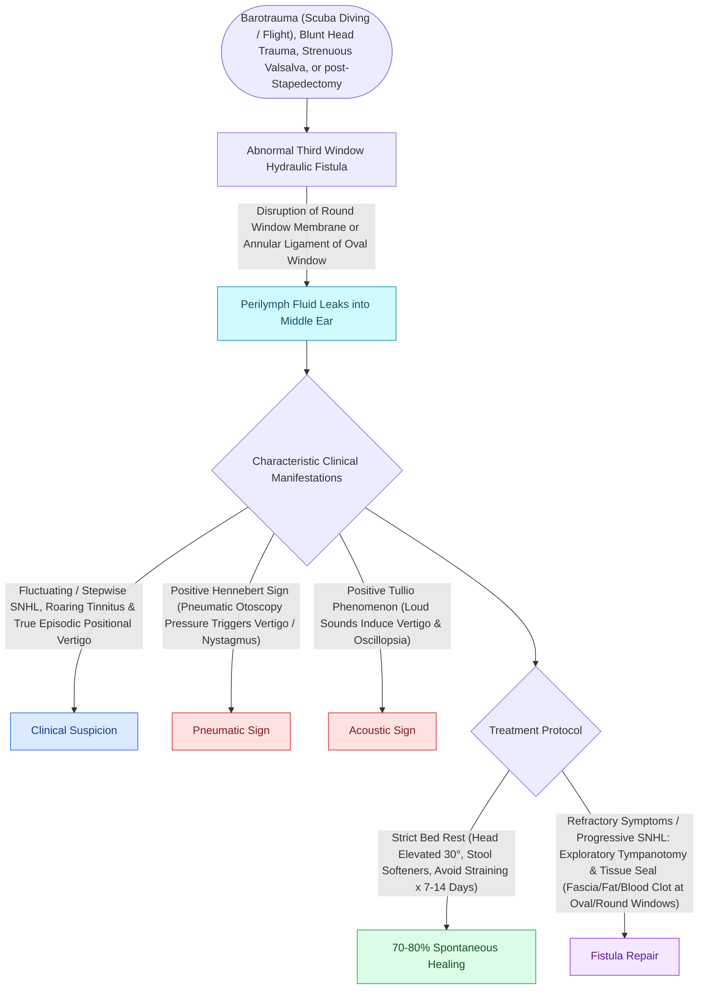

# Perilymphatic fistula causes fluctuating hearing loss and pressure-induced vertigo after barotrauma or stapes surgery

## Active Recall

> [!question]- Which bedside maneuver supports the diagnosis and what is it called?
> *Answer / Clinical Rationale*: Pneumatic pressure on the tragus/canal provoking nystagmus or vertigo — the **Hennebert sign** (fistula test).

> [!question]- First-line management after presumed barotraumatic PLF with stable hearing?
> *Answer / Clinical Rationale*: Conservative: bed rest, head-up positioning, straining precautions; exploration with window grafting is reserved for progression.

## Core Clinical & Mechanistic Principles
- Abnormal communication between perilymph and middle ear at the **oval or round window**, classically after barotrauma, heavy straining, temporal bone fracture, or stapes surgery; a genuinely spontaneous PLF is a contested diagnosis.
- Presentation: fluctuating SNHL, disequilibrium, and **pressure- or sound-provoked vertigo** — a positive [[Labyrinthine fistula from cholesteatoma erosions most frequently involves the lateral semicircular canal|fistula test]] (**Hennebert sign**: nystagmus with tragal pressure/pneumatic otoscopy) supports it.
- The **cochlear aqueduct** connection to CSF explains why straining and pressure transients transmit to the labyrinth.
- Pediatric caveat: recurrent meningitis with SNHL suggests a congenital inner ear malformation with fistula (incomplete partition family) rather than acquired PLF.

### Management & Critical Safety Checks
- Initial management is conservative: bed rest, head elevation, stool softeners, avoidance of straining for days to weeks.
- Persistent or progressive cases undergo middle ear exploration with soft tissue grafting of both windows; intraoperative pooling is sought but absence does not exclude the diagnosis.

## Connected Concepts & Graph Traversal
- **Congenital Stapes Gush**: [[Gushing footplate indicates a congenital perilymph fistula from an abnormally patent cochlear aqueduct|Gushing Footplate Complication]]
- **Stapedotomy Laser Craft**: [[Laser stapedotomy reduces mechanical trauma and footplate mobilization compared to manual perforators|Laser Stapedotomy Safety]]
- **Third-Window SCDS Overlap**: [[Superior semicircular canal dehiscence SCDS presents with Tullio phenomenon and sound-induced vertigo|SCDS Third-Window Vertigo]]
- **Meniere Fluctuating Mimic**: [[Meniere disease is characterized by episodic vertigo, fluctuating low-frequency SNHL, tinnitus, and aural fullness|Meniere Disease Differential]]
- **Post-Op CSF Fistula**: [[Cerebrospinal fluid CSF leak and pseudomeningocele require lumbar drainage, fat obliteration, and re-exploration|CSF Leak Management]]
- **Barotraumatic Etiology Overlap**: [[Inner ear barotrauma and decompression sickness produce acute cochleovestibular dysfunction through pressure-induced membrane rupture or inert gas bubble embolization requiring hyperbaric therapy|Inner Ear Barotrauma & Decompression Sickness]]
