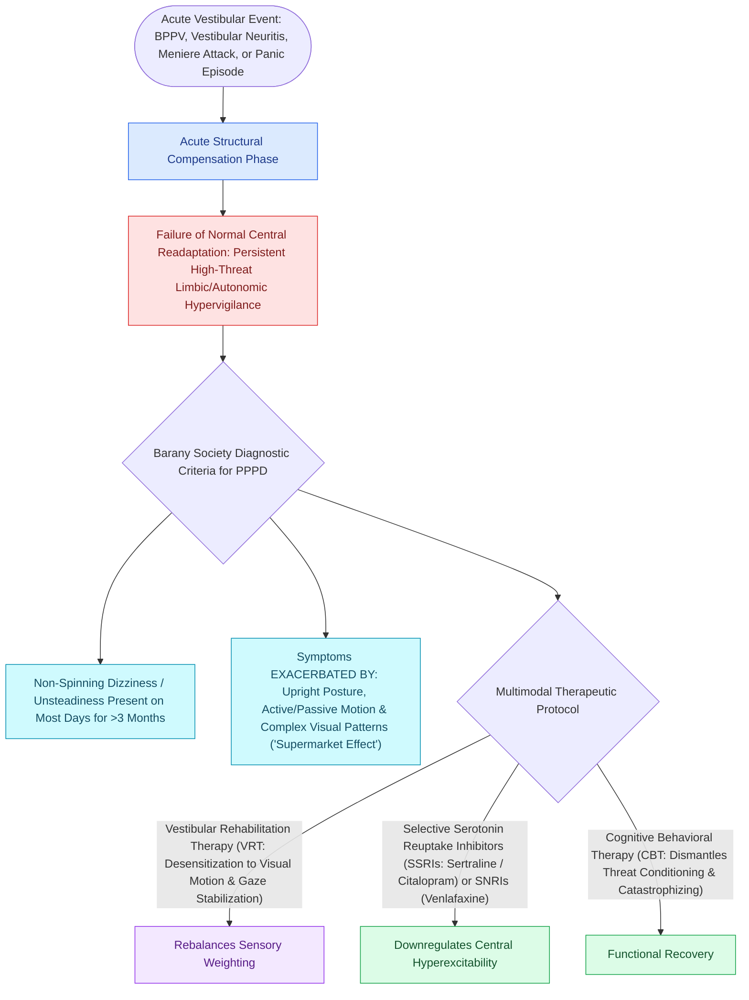

# Persistent postural-perceptual dizziness is a chronic functional vestibular disorder treated with rehabilitation and SSRIs

## Active Recall

> [!question]- Name the three canonical exacerbating conditions in the diagnostic criteria.
> *Answer / Clinical Rationale*: Upright posture, motion (own or environmental), and complex/moving visual stimulation.

> [!question]- Why are meclizine-class suppressants contraindicated as maintenance in PPPD?
> *Answer / Clinical Rationale*: The disorder is maladaptive central processing; suppression blocks the re-adaptation that rehabilitation is trying to drive.

## Core Clinical & Mechanistic Principles
- Definition: non-vertiginous dizziness, unsteadiness, or swaying present **most days for three months or more**, exacerbated by **upright posture, active or passive motion, and complex visual environments** (supermarkets, scrolling screens).
- Pathogenesis: a precipitating event (neuritis, BPPV, migraine, panic) triggers stiffened postural control and visual dependence that persist after the trigger resolves — maladaptive adaptation, not malingering and not ongoing labyrinthine disease.
- Exam and vestibular testing are normal or show only the healed precipitant; the diagnosis is positive-criteria, not exclusionary hand-waving.
- Predecessor labels it unified: phobic postural vertigo, chronic subjective dizziness, visual vertigo.

### Management & Critical Safety Checks
- Treatment triad: explanation the patient believes (mechanism named plainly), **[[Vestibular rehabilitation exploits adaptation habituation and substitution to recalibrate gaze and posture|vestibular rehabilitation]]** with graded visual-motion exposure, and **SSRI/SNRI** at low dose independent of mood; CBT augments.
- Avoid chronic vestibular suppressants — they entrench the disorder.

## Connected Concepts & Graph Traversal
- **Precipitating Neuritis Insult**: [[Vestibular neuritis causes acute spontaneous prolonged vertigo without auditory symptoms|Vestibular Neuritis]]
- **Vestibular Rehabilitation Engine**: [[Vestibular rehabilitation exploits adaptation habituation and substitution to recalibrate gaze and posture|Vestibular Rehabilitation Therapy]]
- **BPPV Precipitating Trigger**: [[The Dix-Hallpike maneuver produces torsional upbeating nystagmus in posterior canal BPPV|BPPV Trigger]]
- **Vestibular Migraine Differential**: [[Vestibular migraine is the most common cause of episodic spontaneous vertigo|Vestibular Migraine Differential]]
- **vHIT Normal Gain Confirmation**: [[The video head impulse test vHIT identifies high-frequency angular vestibulo-ocular reflex deficits|vHIT Normal Gains in PPPD]]
