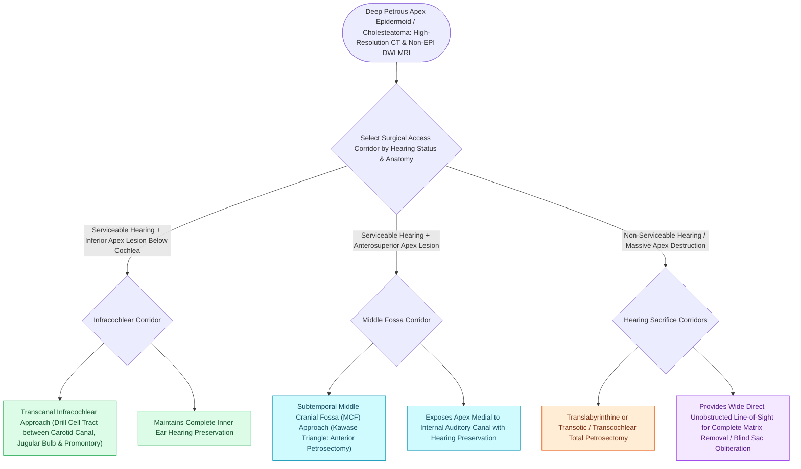

# Petrous apex cholesteatoma requires infracochlear, translabyrinthine, or middle cranial fossa exteriorization

## Active Recall

> [!question]- What three anatomical structures define the boundaries of the infracochlear surgical corridor to the petrous apex?
> *Answer / Clinical Rationale*: The **internal carotid artery anteriorly**, the **jugular bulb inferiorly**, and the **basal turn of the cochlea superiorly**.

> [!question]- When is a translabyrinthine/transcochlear approach indicated for petrous apex cholesteatoma?
> *Answer / Clinical Rationale*: When the patient has a **preoperative dead ear** or when the tumor has already **destroyed the labyrinth and cochlea**.

## Core Clinical & Mechanistic Principles
**Petrous apex cholesteatomas** are complex, deep-seated lesions of the temporal bone that can be congenital or [[Primary acquired cholesteatoma arises from retraction pocket invagination of the pars flaccida into Prussak space|acquired]]:
- **Sassi Classification of Petrous Bone Cholesteatomas**:
  1. **Supralabyrinthine**: Involves epitympanum and petrous apex above the labyrinth/IAC.
  2. **Infralabyrinthine**: Involves hypotympanum and space beneath labyrinth/cochlea.
  3. **Infralabyrinthine-Apical**: Extends into the petrous apex anterior to the IAC.
  4. **Massive**: Destroys labyrinth, cochlea, IAC, and invades clivus.
- **Surgical Corridors Based on Hearing Status & Anatomy**:
  - **Hearing Preservation Approaches (Intact Cochlea)**:
    1. **Infracochlear Approach**: Through the hypotympanum between the carotid artery anteriorly, jugular bulb inferiorly, and basal turn of the cochlea superiorly.
    2. **Middle Cranial Fossa (MCF) / Subtemporal Approach**: Extradural exposure along the petrous ridge; drills anterior to the IAC (Kawase triangle) into the petrous apex.
    3. **Infralabyrinthine Approach**: Below the posterior semicircular canal.
  - **Hearing Sacrifice Approaches (Dead Ear or Massive Destruction)**:
    - **Translabyrinthine / Transcochlear Approach**: Drills through semicircular canals and cochlea, providing direct, wide exteriorization and obliteration with abdominal fat.

### Surgical Technique & Critical Safety Checks
- **Reconstruction**: If complete matrix removal is impossible along carotid/dura, cavity is permanently exteriorized into the canal or obliterated with abdominal fat following blind-sac closure.

## Connected Concepts & Graph Traversal
- **Non-EPI DWI Surveillance**: [[Non-echo-planar diffusion-weighted MRI detects recurrent and residual cholesteatoma as small as two millimeters|Non-EPI DWI MRI]]
- **Translabyrinthine Approach**: [[The translabyrinthine approach provides direct exposure of the internal auditory canal with complete hearing sacrifice|Translabyrinthine Approach]]
- **Gradenigo Syndrome Triad**: [[Gradenigo triad of otorrhea, retroorbital pain, and abducens nerve palsy indicates suppurative petrous apicitis|Gradenigo Syndrome]]
- **Facial Fallopian Decompression**: [[Transmastoid and middle cranial fossa facial nerve decompression relieves canalicular compression|Facial Nerve Decompression]]
- **Primary Acquired Origin**: [[Primary acquired cholesteatoma arises from retraction pocket invagination of the pars flaccida into Prussak space|Primary Acquired Cholesteatoma]]
- **Cholesterol Granuloma Alternative Pathology**: [[Infracochlear and infralabyrinthine approaches establish hearing-preserving drainage pathways for petrous apex cholesterol granulomas inferior to the otic capsule|Infracochlear & Infralabyrinthine Drainage]]
