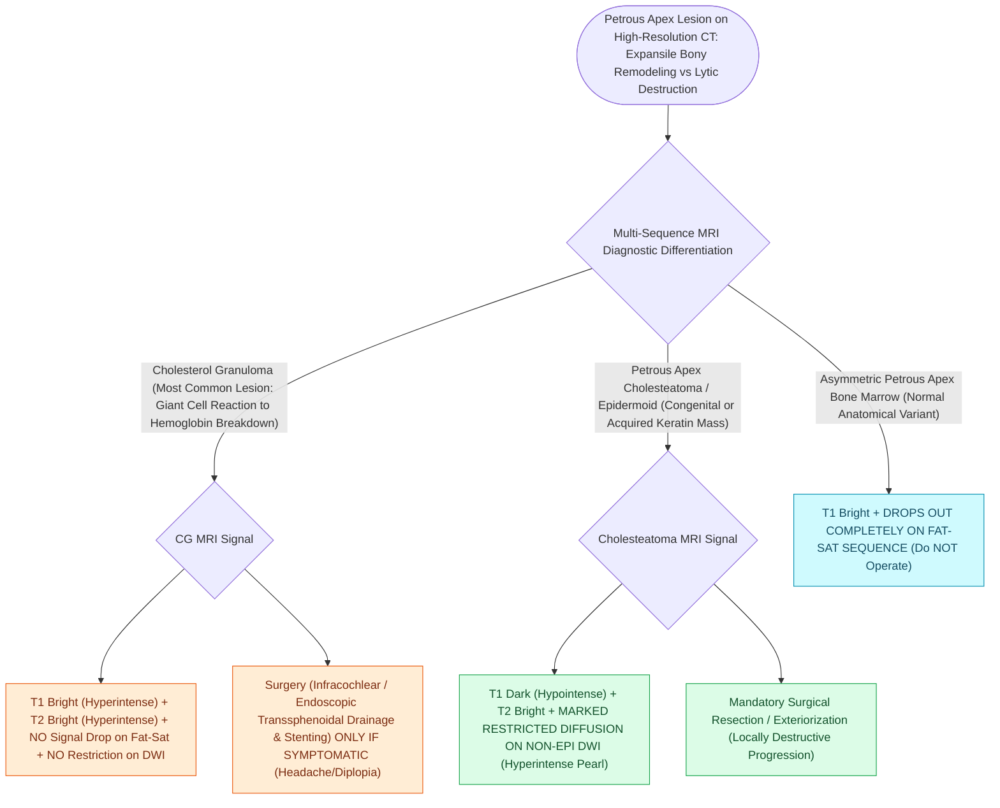

# Petrous apex lesions are differentiated into cholesterol granuloma, cholesteatoma, and mucocele by T1, T2, and non-EPI diffusion-weighted MRI

## Active Recall

> [!question]- What are the characteristic MRI signal intensities (T1-weighted, T2-weighted, Contrast, and Non-EPI DWI) that definitively differentiate a petrous apex Cholesterol Granuloma from a Petrous Apex Cholesteatoma (Epidermoid)?
> *Answer / Clinical Rationale*: - **Cholesterol Granuloma** (most common petrous apex lesion): **T1 hyperintense (bright)** (due to methemoglobin and extracellular lipid breakdown products), **T2 hyperintense (bright)** with a characteristic peripheral hypointense rim of hemosiderin, **does NOT restrict diffusion on DWI**, and exhibits **no internal contrast enhancement** (may have thin peripheral mucosal rim). - **Cholesteatoma / Epidermoid**: **T1 hypointense (dark) to isointense**, **T2 hyperintense (bright)**, **STRIKINGLY RESTRICTS DIFFUSION (bright / hyperintense on Non-EPI DWI)**, and exhibits **no contrast enhancement**.

> [!question]- How does normal asymmetric petrous apex bone marrow mimic pathology on MRI, and how is it definitively recognized?
> *Answer / Clinical Rationale*: Asymmetric fatty marrow presents as high T1 signal in one petrous apex and pneumatization in the other. It is definitively confirmed by: (1) **Fat-suppression sequences (Fat-Sat T1)**, which cause **complete loss of signal (drops dark)** in marrow fat, whereas cholesterol granulomas *remain persistently bright* on fat-saturated T1; and (2) **High-resolution temporal bone CT**, which demonstrates **intact, non-expanded bony trabeculae and preserved cortical borders** in asymmetric marrow, compared to smooth expansive cortical bone erosion in true lesions.

> [!question]- What is the primary surgical strategy for a symptomatic petrous apex cholesterol granuloma versus a petrous apex cholesteatoma?
> *Answer / Clinical Rationale*: - **Cholesterol Granuloma**: A reactive inflammatory cyst treated with **surgical drainage, wide marsupialization, and permanent silastic/T-tube stenting** into an aerated middle ear, sphenoid sinus, or mastoid cavity (complete cyst wall excision is unnecessary and hazardous). - **Cholesteatoma**: An expansive epithelial neoplasm treated with **complete surgical resection and total matrix exenteration or wide permanent exteriorization** (via infracochlear, translabyrinthine, or middle cranial fossa / Kawase approaches) to prevent bone destruction and intracranial complications.

## Core Clinical & Mechanistic Principles

The **petrous apex** is a truncated pyramidal bone forming the anteromedial portion of the temporal bone, pneumatized in approximately $30\%$ of the population:

### Surgical Approach Selection Criteria
- **Hearing-Preserving Approaches**:
  - **Infracochlear / Hypotympanic Approach**: Passes inferior to the cochlea and internal carotid artery and anterior to the jugular bulb into the inferior petrous apex.
  - **Infralabyrinthine Approach**: Passes inferior to the posterior semicircular canal.
  - **Middle Cranial Fossa / Extended Subtemporal (Kawase Triangle)**: Extradural exposure drilling between the [[The first genu marks the location of the geniculate ganglion and origin of the greater superficial petrosal nerve|GSPN]], IAC, and carotid artery.
  - **Transsphenoidal Endoscopic Skull Base Approach**: Transclival / medial petrous apex entry via the posterior sphenoid sinus wall.
- **Hearing-Sacrificing Approach**:
  - **Translabyrinthine / Transcochlear Approach**: For patients with non-serviceable hearing or massive destructive lesions involving the otic capsule.

## Connected Concepts & Graph Traversal
- **Petrous Apex Approaches**: [[Petrous apex cholesteatoma requires infracochlear, translabyrinthine, or middle cranial fossa exteriorization|Petrous Apex Surgical Corridors]]
- **Non-EPI DWI Surveillance**: [[Second-look surgery or non-EPI DWI MRI is indicated twelve to eighteen months after canal wall up mastoidectomy|Non-EPI DWI Imaging Physics]]
- **Gradenigo Syndrome**: [[Gradenigo triad of otorrhea, retroorbital pain, and abducens nerve palsy indicates suppurative petrous apicitis|Gradenigo Syndrome & Dorello Canal]]
- **Translabyrinthine Surgery**: [[The translabyrinthine approach provides direct exposure of the internal auditory canal with complete hearing sacrifice|Translabyrinthine Technique]]
- **Middle Cranial Fossa Approach**: [[The middle cranial fossa approach provides hearing preservation for intracanalicular schwannomas with lateral fundus extension|MCF & Kawase Triangle]]
- **Endolymphatic Sac Tumors**: [[Endolymphatic sac tumors present as destructive lesions of the posterior petrous ridge associated with VHL|ELST & Posterior Ridge Lysis]]
- **Hearing-Preserving Drainage Corridor**: [[Infracochlear and infralabyrinthine approaches establish hearing-preserving drainage pathways for petrous apex cholesterol granulomas inferior to the otic capsule|Infracochlear & Infralabyrinthine Drainage]]
- **Extended Petroclival Exposure**: [[Fisch infratemporal fossa approach Type B and Type C expose the petrous apex, clivus, and infratemporal fossa by mobilizing the zygomatic arch and temporalis muscle|Fisch ITF Type B & C]]
